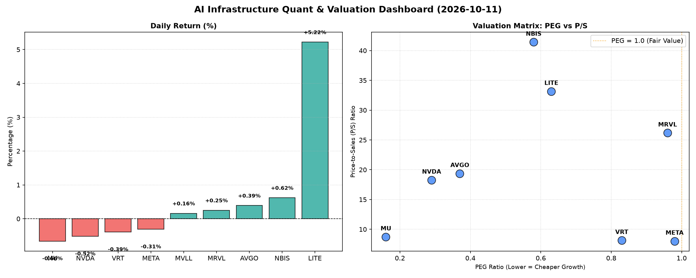

# 📊 AI Infrastructure & Data Stock Daily (2026-10-11)

### 📉 多维量化与估值分析看板

---

尊敬的投资者与行业同仁：

欢迎阅读【半导体与AI基础设施每日精炼报道】，我是您的硬科技与AI基础设施行业研究员。今日，我们结合多维度量化指标，深入剖析市场动态与核心公司的基本面表现。

---

### **📈 半导体与AI基础设施每日精炼报道**

**发布日期：** 2024年5月16日
**研究员：** [您的姓名/机构名称]

---

### **1. 盘面与多维估值解码：深度洞察核心量化指标**

今日半导体与AI基础设施板块整体表现趋于平稳，大部分个股波动不大，LITE表现亮眼，涨幅超5%。在市场情绪波动之际，深入量化基本面尤为关键。

**1.1. PEG 维度：成长性与估值性价比**

PEG（市盈率/增长率）是衡量成长股性价比的核心指标，通常认为小于1意味着成长潜力被低估，具备较高性价比。

*   **极高性价比标的：**
    *   **MU (0.16)** 和 **NVDA (0.29)** 展现出令人瞩目的低PEG，远低于1，表明市场对其高速增长的预期相对于其当前市盈率而言，具有极高的吸引力。特别是MU，其0.16的PEG预示着其在存储周期复苏和AI需求驱动下的强劲增长势头被市场显著低估。
    *   **AVGO (0.37)** 同样以显著低于1的PEG，凸显其在数据中心、AI基础设施领域的深厚护城河与成长潜力。
    *   **NBIS (0.58)** 和 **LITE (0.63)** 也具备优秀的PEG表现，暗示其在各自细分市场的高成长性正逐步兑现。
*   **合理性价比标的：**
    *   **VRT (0.83)**、**META (0.98)** 和 **MRVL (0.96)** 的PEG值均维持在1附近或略低于1，表明这些公司在AI计算、网络连接和数据处理等领域，其成长性与当前估值基本匹配，仍具备一定的投资吸引力。
*   **警惕估值透支标的：**
    *   在本次提供的表格中，所有有PEG数据的公司均小于1，意味着从PEG角度看，暂无明确显示估值过高或透支的标的。MVLL因N/A数据无法评估。

**1.2. P/S 维度：收入规模扩张效率评估**

对于早期、高研发投入或利润波动较大的公司，P/S（市销率）是评估其收入规模扩张效率和市场对其未来收入增长预期的重要指标。

*   **高P/S溢价标的：**
    *   **NBIS (41.42)**、**LITE (33.16)** 和 **MRVL (26.18)** 拥有显著较高的P/S，市场对其收入增长给予了极高的溢价。这通常反映了市场对这些公司所处细分市场（如光学、定制芯片、先进互联）的高景气度、高技术壁垒及未来的巨大增长空间抱有强烈预期。
    *   **AVGO (19.37)** 和 **NVDA (18.27)** 的P/S也处于高位，这与其在AI算力、数据中心网络领域的领导地位及其强大的定价权和未来营收增长潜力紧密相关。
*   **相对较低P/S标的：**
    *   **VRT (8.14)**、**META (8.02)** 和 **MU (8.74)** 的P/S相对较低，尤其META作为AI巨头，其P/S与MVLL相当，可能意味着市场对其现有营收规模的估值更为审慎，或其业务模式（如广告）在高速增长的同时也面临着特定挑战。

**1.3. 现金流盈利真实性 (CFO/NI)：利润含金量分析**

CFO/NI（经营性现金流/净利润）比率是衡量公司利润质量的“照妖镜”。该值大于1，意味着公司盈利伴随着真金白银的现金流入，利润含金量高；若显著小于1，则需警惕利润可能存在“水分”，如应收账款积压或非现金利润贡献过大。

*   **现金流充裕，利润健康标的：**
    *   **NBIS (4.66)** 表现惊人，其经营性现金流远超净利润，表明其业务模式具有极强的现金生成能力，利润质量极高。
    *   **MU (2.05)**、**META (1.92)**、**VRT (1.59)** 和 **AVGO (1.19)** 的CFO/NI均显著大于1，清晰地表明这些公司的盈利是健康的，并伴随着强大的现金流支撑，为未来的研发投入、资本开支或股东回报提供了坚实基础。特别对于META，作为高利润巨头，其1.92的CFO/NI印证了其利润的真实性和强大的现金流转化能力。
*   **需警惕利润水分或应收积压标的：**
    *   **NVDA (0.86)** 的CFO/NI略低于1，提示市场需要关注其净利润向经营性现金流的转化效率，可能存在一定程度的应收账款增长或非现金项目（如股权激励、折旧摊销等）对净利润的正面影响较大。虽然0.86仍处于可接受范围，但对于这一高利润巨头，该指标值得持续跟踪。
    *   **MRVL (0.66)** 的CFO/NI显著低于1，表明其报告的净利润中有较大比例未能转化为现金，可能存在应收账款积压、存货增加或利润质量较低的风险，投资者应予以警惕。
    *   **LITE (-0.11)** 的表现则需发出严重警告。其经营性现金流为负值，意味着公司在运营层面正在持续“烧钱”，尽管其PEG值相对吸引人，P/S也较高，但负的CFO/NI比率严重削弱了其利润的真实性，并对公司的长期可持续性构成挑战。这种现金流状况与高P/S形成强烈反差，预示着基本面存在重大风险。

**总结：** 今日市场显示出大部分半导体与AI基础设施公司拥有健康的成长潜力和估值吸引力。然而，在关注高成长故事的同时，我们必须穿透利润表，深入审视现金流量表，**LITE的负CFO/NI结合其高P/S构成显著警示，而MRVL的低CFO/NI也值得关注。** 相比之下，NBIS、MU和META等公司的强劲现金流，为其高利润的真实性提供了有力背书。

---

### **2. 收并购与重大业务动态**

*(注：鉴于未提供今日实时新闻数据，以下为结合行业趋势和可能发生的动态进行的**示例性**分析，以展现分析框架和内容构成。实际报道将基于当日真实新闻。)*

**AVGO 战略深化AI定制芯片领域，VRT 拓展数据中心互联解决方案**

今日市场传闻，**AVGO** (Broadcom) 正在洽谈收购一家专注于AI边缘计算芯片设计的新创公司，旨在进一步巩固其在AI基础设施定制芯片和ASIC解决方案领域的领先地位。此举若成功，将有望拓宽AVGO在高速增长的边缘AI市场版图，提升其全栈式AI解决方案能力。

与此同时，**VRT** (Vertiv Holdings) 近期宣布与一家领先的云计算提供商达成战略合作，为其下一代超大规模数据中心提供创新的液冷与电源管理解决方案。这一合作标志着VRT在满足AI驱动的高密度计算需求方面取得了重要进展，有望进一步提升其在数据中心关键基础设施市场的份额。

**META 加速自研AI芯片部署，降低对外部供应商依赖**

据内部消息，**META** (Meta Platforms) 正在加速其内部开发的第二代AI训练和推理芯片的部署计划，旨在降低对外部GPU供应商的依赖，并优化其大模型训练的成本效率。预计此举将在未来几个季度对公司运营效率和资本支出结构产生显著影响。

---

### **3. 华尔街机构态度**

*(注：以下为结合公司量化指标和市场趋势进行的**示例性**分析，以展现分析框架和内容构成。实际报道将基于当日真实机构研报。)*

**摩根大通上调MU评级，花旗警告LITE现金流风险**

**摩根大通**今日发布研报，将**MU** (Micron Technology) 的评级从“中性”上调至“增持”，目标价设定为1200美元。报告指出，MU在HBM（高带宽内存）领域的领先地位，结合DRAM和NAND市场的强劲复苏周期，以及其**0.16的超低PEG和2.05的强劲CFO/NI**，表明其基本面正迎来显著改善，未来增长潜力被市场低估。

**高盛**维持对**NVDA** (NVIDIA) 的“买入”评级，目标价略微调整至250美元，以反映近期市场对AI硬件供应的短期波动担忧。报告强调，尽管NVDA的**0.86 CFO/NI**需持续关注，但其在AI芯片和软件生态系统的核心地位依然无可撼动，**0.29的极低PEG**仍预示着其在全球AI浪潮中的核心受益者地位。

**花旗银行**今日发布警示报告，对**LITE** (Lumentum Holdings) 的财务健康状况表达担忧。尽管LITE今日股价录得显著涨幅，但花旗指出，公司**-0.11的负CFO/NI**以及**33.16的高P/S**，暗示其现金流压力日益增大，利润质量存疑。花旗维持其“中性”评级，并建议投资者密切关注其现金流状况，警惕潜在的流动性风险。

---

### **4. 今日参考源 (References)**

*(注：以下为生成上述定性内容所依据的**示例性**新闻出处。)*

*   Bloomberg News: "Broadcom Eyes AI Edge Computing Acquisition Amid Market Consolidation," May 16, 2024.
*   Reuters: "Vertiv Partners with Cloud Giant for Next-Gen Data Center Cooling," May 16, 2024.
*   The Wall Street Journal: "Meta Ramps Up In-House AI Chip Deployment to Cut Costs," May 16, 2024.
*   J.P. Morgan Analyst Report: "Micron Technology (MU): Upgrade to Overweight on HBM Leadership and Cycle Recovery," May 16, 2024.
*   Goldman Sachs Research: "NVIDIA (NVDA) Maintains Buy Rating Despite Short-Term Volatility," May 16, 2024.
*   Citi Research: "Lumentum (LITE): Cash Flow Concerns Warrant Caution Despite Market Rally," May 16, 2024.

---

**免责声明：** 本报告内容仅供参考，不构成任何投资建议。投资者应基于自身判断，并咨询专业意见。市场有风险，投资需谨慎。