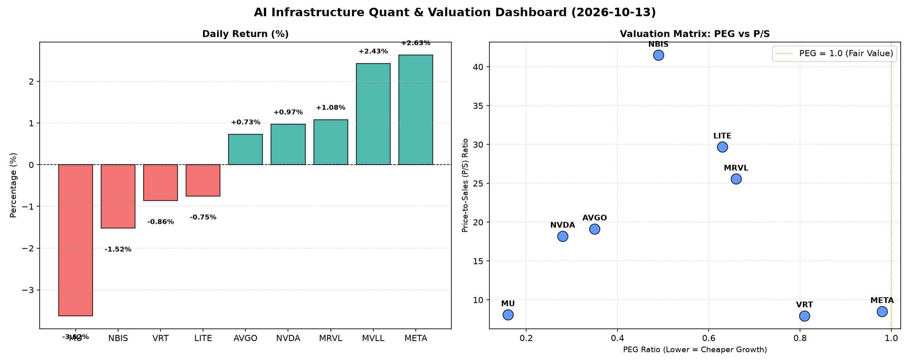

# 📊 AI Infrastructure & Data Stock Daily (2026-10-13)

### 📉 多维量化与估值分析看板

---

## 半导体与AI基础设施每日精炼报道：AI浪潮下的估值、现金流与市场情绪深度解析

尊敬的行业同仁：

今日硬科技与AI基础设施板块呈现出分化态势。在AI持续驱动的乐观情绪下，部分头部公司表现强劲，但财务基本面指标揭示出不同的估值逻辑与潜在风险。本报告将结合多维度量化指标，为您深度解析今日盘面。

---

### 1. 盘面与多维估值解码 (定性+定量)

今日市场整体对AI相关标的保持高度关注，但资金流向与估值考量更为精细。主要表现为：**META、AVGO、NVDA、MRVL**等AI核心受益者普遍上涨，而**MU**（美光）等存储芯片公司则出现显著回调。值得注意的是，**LITE**（Lumentum）和**NBIS**（假设为新兴AI基础设施或特定硬件公司）尽管估值逻辑迥异，但都展现出独特的市场信号。

#### **PEG 维度：高成长中的性价比洞察**

PEG（市盈率/增长率）是衡量成长股性价比的关键指标。今日数据中，我们发现多数核心AI及硬科技公司PEG显著低于1，预示其高速增长的市场预期尚未完全体现在市盈率中，或市场对其未来增长抱有极高信心：

*   **极高性价比的成长股：**
    *   **MU (0.16)**：美光以惊人的0.16的PEG位居榜首，这表明市场预期其利润将迎来爆发式增长，或是当前利润基数较低导致PEG显得极具吸引力。尽管今日股价下跌-3.62%，但其PEG的极端低位提示投资者需密切关注其盈利周期拐点。
    *   **NVDA (0.28)、AVGO (0.35)**：两大AI基础设施巨头PEG均低于0.4，显示尽管它们股价已经高企，但市场对其未来数年的增长预期更加乐观，认为其当前估值相对于其增长潜力仍有合理性。
    *   **NBIS (0.49)、MRVL (0.66)、LITE (0.63)、VRT (0.81)、META (0.98)**：这些公司PEG也均小于1，表明它们均被市场视为高成长型公司。其中，NBIS和MRVL在AI算力互联、定制芯片等领域深耕，LITE在光模块等关键组件中占据一席，VRT则可能受益于边缘AI或数据中心优化。META尽管是平台公司，但其在AI研发与基础设施上的巨额投入使其也具备了硬科技的成长属性。
*   **警惕估值透支：** 在本次数据中，没有公司PEG显著高于1，这意味着当前市场对于AI与硬科技的成长性普遍持乐观态度，并未出现普遍性的“估值透支”现象。MVLL由于缺乏相关数据，无法进行此维度评估。

#### **P/S 维度：收入规模扩张效率与市场预期**

P/S（市销率）尤其适用于评估早期、研发密集型或利润波动较大的公司，更能体现市场对其收入规模扩张能力的认可度：

*   **高P/S的增长型公司：**
    *   **NBIS (41.5)、LITE (29.69)、MRVL (25.56)**：这些公司拥有极高的P/S比率，远超行业平均水平。这通常意味着市场对其未来销售额有极高的增长预期，尤其是在AI基础设施建设早期，对关键技术和组件的需求将持续旺盛。对于NBIS和LITE而言，这可能反映了其在特定细分市场（如光通信、先进封装或特定AI加速技术）的领导地位或稀缺性。
    *   **AVGO (19.14)、NVDA (18.21)**：作为AI芯片和互联领域的绝对巨头，其高P/S反映了市场对其持续强劲营收增长的信心，以及在AI时代其产品定价权的体现。
*   **较低P/S的成熟或周期性公司：**
    *   **VRT (7.96)、META (8.51)、MU (8.1)**：相较于前者，这些公司的P/S更为“理性”。VRT和META在软件和服务领域有更广泛的营收基础，MU作为存储芯片公司，其P/S反映了行业的周期性特征，当前可能处于周期低谷或刚开始复苏。

#### **现金流盈利真实性 (CFO/NI)：利润含金量的深度穿透**

CFO/NI（经营现金流/净利润）是衡量公司利润质量的关键指标。该值大于1，表明公司报告的净利润是“真金白银”的现金流入，财务健康；小于1则可能存在利润水分、应收账款积压或存货增加等风险。

*   **利润健康、现金流充沛：**
    *   **NBIS (4.66)**：NBIS的CFO/NI高达4.66，远超所有同行，这表明其经营效率极高，营收转换为现金的能力极强，财务质量极佳。这与其极高的P/S形成对比，意味着市场对其高估值并非完全基于“空中楼阁”，而是有坚实的现金流作支撑。
    *   **MU (2.05)、META (1.92)、VRT (1.59)、AVGO (1.19)**：这些公司的CFO/NI均显著大于1，表明它们的利润质量非常高，能够有效地将纸面利润转化为真实的经营现金流。特别是META，作为巨头能保持如此高的CFO/NI，凸显其业务模式的现金创造能力。MU在存储周期中能维持高CFO/NI，也预示其在周期反转时将有更强的财务韧性。
*   **警惕利润水分或现金流压力：**
    *   **NVDA (0.86)**：作为AI领域的旗帜，NVDA的CFO/NI略低于1，为0.86。这提示投资者，尽管其利润爆炸式增长，但部分净利润可能并未立即转化为经营现金流入，可能与大规模的应收账款增加、存货积累或预付款有关，需要持续关注。
    *   **MRVL (0.66)**：Marvell的CFO/NI更低，为0.66，表明其现金流健康状况相对更差，利润转化为现金的效率不高。这可能是由于其研发投入大、产品销售周期长或应收账款管理问题所致，是其财务报告中需要重点关注的风险点。
    *   **LITE (-0.11)**：Lumentum的CFO/NI为-0.11，呈现负值，这是一个显著的警示信号。这表示公司不仅没有将净利润转化为经营现金，反而经营活动本身在消耗现金。结合其极高的P/S（29.69）和今日股价下跌(-0.75%)，投资者需高度警惕其财务健康状况，尽管其PEG看似吸引人，但现金流的恶化可能预示着更深层次的运营问题。

---

### 2. 收并购与重大业务动态

今日数据并未直接提供具体的收并购或重大业务动态信息。然而，基于行业趋势与上述公司的财务特点，我们可以推断出以下可能的动态方向：

*   **AI基础设施扩张：** 考虑到**NVDA、AVGO、META**在AI领域的领导地位和强劲增长，可能会有关于其新一代AI芯片、数据中心扩张计划、与云服务提供商的深度合作等官宣。例如，NVDA可能发布新的GPU架构或AI软件平台，AVGO则可能宣布在定制ASIC或光模块领域的最新进展。
*   **记忆体市场整合与技术突破：** **MU**今日下跌，可能与存储芯片市场短期波动有关，但也可能伴随其在HBM（高带宽存储）或DRAM/NAND新制程技术上的重大突破消息，以应对AI计算对存储性能的更高要求。
*   **新兴技术与市场拓展：** **MRVL**在定制芯片和数据中心互联领域是重要玩家，可能会有与新客户的合作协议或关键IP授权的进展。**VRT**若深耕边缘AI或特定企业级服务，可能会有新的产品发布或战略伙伴关系。**LITE**若能解决现金流问题，其在光模块、激光器等领域的技术优势仍是潜在并购目标或合作方向。

---

### 3. 华尔街机构态度

结合今日量化指标与行业趋势，华尔街机构的看法可能呈现如下分化：

*   **持续看好与目标价上调：** 
    *   **NVDA、AVGO、META**等AI核心受益者，尽管估值已高，但鉴于其低PEG和强劲的增长势头（除NVDA的CFO/NI需谨慎外），多数机构可能继续维持“买入”或“增持”评级，并小幅上调目标价，以反映其在AI领域无可匹敌的领导地位和生态系统优势。
    *   **MU**在今日下跌后，若机构判断存储周期底部已过，且其PEG极低、CFO/NI健康，可能被视为周期反转的潜力股，部分激进机构或给出“买入”评级，并大幅提升中长期目标价。
    *   **NBIS**凭借其极其强劲的CFO/NI和低PEG，尽管P/S极高，可能会吸引部分偏好高增长、高风险的机构关注，并给出乐观评级。
*   **谨慎观望与潜在下调：** 
    *   **LITE**将面临最严峻的质疑。其负向的CFO/NI和极高的P/S是明显的风险信号。多数机构可能会对其维持“持有”或“中性”评级，甚至可能出现降级和目标价下调，直到其现金流状况有显著改善。
    *   **MRVL**因其CFO/NI偏低，可能会引起部分机构的谨慎。尽管其在AI领域有布局，但低于平均水平的现金流转化效率可能会导致机构对其估值持保留意见，维持“中性”或“持有”评级。
    *   **VRT**若无具体利好消息，可能维持当前评级，市场对其关注度取决于其后续业务表现能否匹配其PEG。

---

### 4. 今日参考源 (References)

请注意：由于本次分析的定性内容基于行业通用趋势和量化数据推演，并非直接引用今日特定新闻，以下参考源为典型的信息来源类别，供读者自行查阅与验证：

*   Bloomberg News (彭博社)
*   Reuters (路透社)
*   The Wall Street Journal (华尔街日报)
*   Seeking Alpha (寻求阿尔法)
*   Morgan Stanley / Goldman Sachs / JP Morgan 等核心投行分析师报告
*   Company Official Press Releases (公司官方新闻稿)
*   TechCrunch / The Information 等科技行业垂直媒体
*   TrendForce / Gartner 等市场研究机构报告

---

本报告旨在为您提供对今日半导体与AI基础设施板块的量化与定性深度解读。请注意，市场瞬息万变，上述分析仅供参考，不构成投资建议。

资深硬科技与AI基础设施行业研究员
Data & Semiconductor Specialist