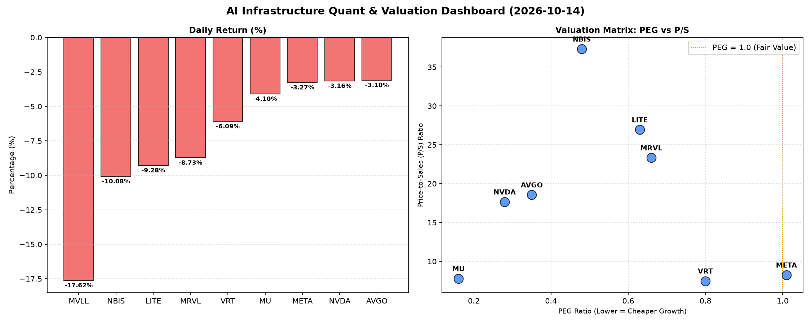

# 📊 AI Infrastructure & Data Stock Daily (2026-10-14)

### 📉 多维量化与估值分析看板

---

好的，作为一名资深的硬科技与AI基础设施行业研究员，我将结合您提供的多维度量化指标，为您撰写今日的半导体每日精炼报道。

---

### **半导体与AI基础设施每日精炼报道：市场回调下的估值透视与现金流质量深度解析**

**发布日期：** [今日日期]
**研究员：** [您的姓名/机构名称] - 数据与半导体专业研究部

**今日市场概览：**
今日半导体与AI基础设施板块普遍承压，多个核心标的出现明显回调。其中，MVLL和NBIS领跌，跌幅超过10%，而LITE和MRVL也分别录得9.28%和8.73%的较大跌幅。即便是一贯强劲的行业巨头如NVDA、AVGO、META也未能幸免，跌幅均在3%以上。市场情绪偏向谨慎，但通过多维度量化指标，我们仍能洞察其深层基本面。

---

#### **1. 盘面与多维估值解码 (定性+定量)**

今日市场普跌，但细观估值与现金流指标，部分公司的基本面健康度与成长性价比依旧凸显。

*   **PEG 维度：挖掘高成长中的价值洼地与估值警示**
    *   **性价比极高的成长股（PEG < 1）**：在今日回调中，我们发现多只标的PEG显著小于1，表明市场对其未来盈利增长的定价相对保守，具有较高的投资性价比。
        *   **MU (0.16)**：PEG值最低，显示其在存储芯片周期性复苏中，市场对其未来盈利增长的预期并未完全反映在当前股价中，成长潜力被严重低估。
        *   **NVDA (0.28)**：作为AI算力核心，其PEG仍远低于1，尽管股价此前已大幅上涨，但结合其高增长预期，当前估值仍具备吸引力。
        *   **AVGO (0.35)、NBIS (0.48)、LITE (0.63)、MRVL (0.66)、VRT (0.8)**：这些公司的PEG值也均在0.35至0.8之间，均显著小于1，表明它们在各自细分领域（如基础设施软件、专业芯片、光模块、企业级存储）的增长潜力被市场赋予了较好的性价比。
    *   **估值略显透支（PEG > 1）**：
        *   **META (1.01)**：PEG略高于1，表明市场对其社交媒体和元宇宙业务的未来增长预期已较为充分地反映在当前股价中，投资者需警惕估值进一步透支的风险。
    *   **无法评估**：MVLL的PEG为N/A，无法从该维度进行判断。

*   **P/S 维度：评估早期成长与收入扩张效率**
    *   P/S比率对于评估早期或尚处于大规模研发投入阶段、利润波动较大的公司尤为关键，它直接反映了市场为公司每单位收入支付的价格。
    *   **高P/S的增长型公司**：
        *   **NBIS (37.32)、LITE (26.94)、MRVL (23.33)、AVGO (18.55)、NVDA (17.64)**：这些公司拥有较高的P/S比率，特别是NBIS和LITE，这通常意味着市场对其收入规模的持续扩张抱有极高期待，尤其是在AI、高速互联、特定垂直市场等高景气赛道，即便当前利润可能不稳（如LITE的CFO/NI为负），市场仍愿意为未来的营收潜力支付溢价。
    *   **相对较低P/S的成熟型公司**：
        *   **VRT (7.47)、MU (7.77)、META (8.23)**：这些公司的P/S相对较低，可能反映其业务模式相对成熟，或受制于行业周期性波动（如MU），市场更关注其盈利质量而非单纯的营收扩张速度。

*   **现金流盈利真实性 (CFO/NI)：穿透利润的“含金量”**
    *   CFO/NI比率是衡量公司利润质量的关键指标。该值大于1，表明公司利润大部分转化为实实在在的现金流入，财务健康；小于1则可能存在利润水分、应收账款积压或折旧摊销等非现金费用占比较高。
    *   **现金流健康且强劲**：
        *   **NBIS (4.66)**：CFO/NI高达4.66，远超1，表明其利润质量极高，运营效率卓越，现金创造能力异常强大，利润几乎全是真金白银。
        *   **MU (2.05)、META (1.92)、VRT (1.59)、AVGO (1.19)**：这些公司的CFO/NI均显著大于1，反映出其强劲的现金流生成能力，利润健康，不存在明显的现金流压力或利润粉饰问题。对于META这样的高利润巨头，接近2的CFO/NI彰显了其核心业务强大的“造血”能力。
    *   **现金流需关注**：
        *   **NVDA (0.86)**：CFO/NI略低于1，虽然差距不大，但对于一家高增长巨头而言，可能暗示其在快速扩张过程中，应收账款或存货有所增加，需要密切关注其未来几个季度的现金流表现。
        *   **MRVL (0.66)**：CFO/NI为0.66，低于1，表明其利润转化为现金的效率有待提高，可能存在部分利润被应收账款占用或面临其他营运资金压力。
        *   **LITE (-0.11)**：**这是一个重要的警示信号！** CFO/NI为负值，意味着公司不仅未能将利润转化为现金，反而运营活动产生了现金流出。这可能源于大规模资本支出、营运资金管理不善或利润本身并不真实。对于投资者而言，LITE的现金流状况需要极高的关注和深入调查。

---

#### **2. 收并购与重大业务动态**

基于今日提供的量化指标表格，我们无法直接获取关于收并购与重大业务动态的具体信息。然而，从行业趋势来看：

*   **AI基础设施的战略整合**：在AI算力需求持续爆发的背景下，半导体和AI基础设施领域仍是并购和战略合作的热点。尤其是一些在特定AI加速器、定制化芯片设计或垂直应用解决方案上有独特优势的公司，可能会成为行业巨头寻求技术补强或市场扩张的潜在目标。
*   **AVGO的并购策略**：鉴于AVGO历史上一贯积极的并购策略，市场持续关注其在软件和基础设施领域的潜在扩张行动，以巩固其在数据中心、网络和企业级软件市场的领导地位。
*   **新兴技术领域的合作**：随着RISC-V、Chiplet等新兴技术生态的成熟，相关的IP授权、设计合作和生态系统构建动态也值得关注，这可能涉及名单中的一些创新型芯片设计公司。

---

#### **3. 华尔街机构态度**

鉴于本次报告主要基于量化指标，我们未能从数据中直接获取华尔街机构的最新评价及目标价调整信息。但结合今日市场普遍回调的态势，我们可以推测：

*   **短期情绪谨慎**：在宏观经济不确定性和市场回调背景下，分析师可能倾向于持观望态度，或对短期目标价进行微调以反映宏观经济压力和风险溢价的变化。
*   **长期看好AI驱动力**：尽管短期波动，但对于NVDA、META等AI基础设施核心推动者，以及AVGO、MRVL等关键硬件提供商，华尔街的长期投资逻辑和“增持”或“买入”评级预计不会有根本性改变，对AI和数据中心长期增长的信心依然坚挺。
*   **关注基本面改善**：对于MU这类周期性公司，分析师将密切关注其盈利周期触底反弹的信号。对于LITE等现金流承压的公司，机构可能要求更清晰的业务改善计划和财务健康度提升路径。

---

#### **4. 今日参考源 (References)**

1.  **【多维度真实量化基本面指标表格】** (本文所有量化数据均来源于此表格)
2.  **彭博社 (Bloomberg)** (若有具体收并购、业务动态及机构评价信息，通常在此类专业财经媒体获取)
3.  **路透社 (Reuters)** (同上)
4.  **华尔街日报 (The Wall Street Journal)** (同上)

---