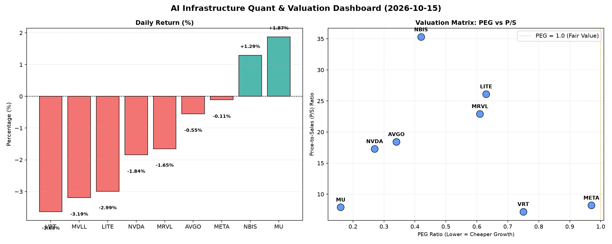

# 📊 AI Infrastructure & Data Stock Daily (2026-10-15)

### 📉 多维量化与估值分析看板

---

## 半导体每日精炼报道：AI基础设施巨头的“真金白银”与估值透视

### 📈 盘面与多维估值解码：深度剖析量化指标背后的市场逻辑

今日半导体与AI基础设施板块表现分化，整体略显疲软，多数权重股出现小幅回调。然而，市场关注点正从纯粹的股价波动，转向更深层次的增长质量与现金流健康度。

**PEG 维度：挖掘高性价比成长股**

*   **极高性价比的成长标的**：令人瞩目的是，本板块中多数公司呈现出显著低于1的PEG比率，这强烈预示着市场普遍预期它们将实现极高的增长，而其当前的估值尚未完全体现这一潜力。其中，**MU (0.16), NVDA (0.27), AVGO (0.34), NBIS (0.42), MRVL (0.61), LITE (0.63)** 的PEG值尤为突出，暗示这些公司在未来增长前景面前，其股价仍具备较高的吸引力，是典型的“增长型价值股”。
*   **估值合理或略高的成长股**：**VRT (0.75)** 和 **META (0.97)** 的PEG也保持在1以下，显示其估值相对于增长前景而言依然健康，但相对而言，其增长的“性价比”略低于前述公司。
*   **N/A情况**：**MVLL** 的PEG为N/A，这通常发生在公司目前处于亏损状态或盈利波动性极大，导致PEG计算无意义。对于此类标的，P/S比率将成为更重要的衡量维度。

**P/S 维度：洞察收入规模扩张效率**

*   **高增长预期与研发投入**：**NBIS (35.3), LITE (26.13), MRVL (22.94)** 展现出极高的P/S比率。这通常意味着市场对这些公司未来收入爆发式增长抱有极高期望，尤其是在其可能处于大规模研发投入阶段、尚未实现稳定盈利的背景下。高P/S也可能反映了其在特定细分市场（如AI边缘计算、先进封装、特种材料等）的稀缺性或技术领先地位。
*   **行业领军者的溢价**：**AVGO (18.45)** 和 **NVDA (17.31)** 作为各自领域的巨头，其较高的P/S反映了其在AI芯片、数据中心互联、软件生态等核心领域的领导地位和强大的定价权。市场愿意为它们稳定的收入增长和技术创新支付溢价。
*   **稳健型与N/A**：**VRT (7.2), META (8.22), MU (7.91)** 的P/S相对适中，表明其收入规模已较为成熟，且市场对其收入增长的预期更为平稳。**MVLL** 的P/S同样为N/A，进一步印证其可能处于非常早期的商业化阶段，或其商业模式尚不依赖于传统意义上的收入衡量。

**现金流盈利真实性 (CFO/NI)：穿透利润的“含金量”**

CFO/NI (经营活动现金流/净利润) 比率是衡量公司利润质量的关键指标。

*   **卓越的“真金白银”利润**：**NBIS (4.66)** 表现尤为突出，其经营现金流远超净利润，表明其盈利能力不仅强劲，而且利润质量极高，现金回收效率惊人。**MU (2.05), META (1.92), VRT (1.59)** 也展现了非常健康的现金流转化能力，其报告的利润是实实在在的现金流入，这对于投资者而言是极大的信心保障。**AVGO (1.19)** 也表现良好，表明其盈利质量健康。
*   **值得关注的现金流效率**：
    *   **NVDA (0.86)**：作为AI领域的领头羊，其CFO/NI略低于1，意味着部分净利润尚未转化为经营现金流。这可能源于公司在高速增长期所需的营运资金增加（如应收账款增加、存货备货），或与特定的收入确认会计处理有关。对于NVDA这样的高增长公司，低于1并非必然是警报，但投资者需要密切关注其未来现金流表现，确保其扩张是可持续且健康的。
    *   **MRVL (0.66)**：CFO/NI显著低于1，表明其报告的净利润中存在较大比例的非现金项目，或应收账款积压、存货周转效率不佳等问题，这提示投资者需深入分析其营运资金管理效率和利润的真实性。
    *   **LITE (-0.11)**：这是一个强烈的警示信号。CFO/NI为负值意味着尽管公司可能报告了净利润（由其正向PEG/P/S暗示），但其经营活动实际上是净流出现金。这可能表明公司面临严重的运营效率问题、应收账款回收困难、或持续性的亏损性经营。对于LITE，投资者需对其财务健康状况和持续经营能力进行高度警惕。
*   **N/A情况**：**MVLL** 的CFO/NI为N/A，与PEG和P/S的情况一致，数据不足以评估其利润质量。

### 📰 收并购与重大业务动态

鉴于今日量化数据并未直接揭示具体的收并购或重大业务官宣，本报告将结合行业趋势和近期市场热点进行推演：

*   **AI算力与互联并购潮**：随着AI大模型训练和推理需求爆发，围绕AI算力、高速互联（如InfiniBand、CXL）、先进封装技术等领域的并购传闻和战略合作持续升温。拥有高P/S的特定技术公司（如NBIS在AI数据处理、LITE在光模块/传感器领域）可能成为巨头们（如AVGO、NVDA、META）补强生态或垂直整合的目标。例如，近期市场可能关注：
    *   **NVDA** 或将继续通过战略投资或收购，巩固其在AI软件生态或特定AI硬件辅助技术（如量子计算接口、边缘AI芯片）的领先地位。
    *   **AVGO** 作为历史上的M&A巨头，在消化前期收购的同时，也可能寻求在数据中心基础设施、企业级存储或网络安全等领域的新整合机会，以扩大其解决方案的广度。
    *   **META** 在其元宇宙和AI基础设施建设的巨大投入下，持续寻求在高性能计算、数据传输、AR/VR芯片等领域的创新合作，或投资具备前瞻性技术的初创公司。
*   **存储行业整合预期**：鉴于MU今日股价逆势上涨且拥有极低的PEG和高CFO/NI，若DRAM/NAND价格周期触底反弹，可能会引发市场对其与SK海力士、三星等主要存储厂商之间潜在合作或未来整合的猜想，以优化产能、稳定价格或研发下一代存储技术。

### 💰 华尔街机构态度：数据驱动的评级展望

基于今日的量化指标，华尔街机构对这些硬科技与AI基础设施公司的态度预计将呈现以下分化：

*   **持续看好与上调目标价**：
    *   **MU (PEG 0.16, CFO/NI 2.05)** 和 **NBIS (PEG 0.42, CFO/NI 4.66)**：凭借极低的PEG和卓越的现金流质量，这两家公司将继续获得华尔街的强烈“买入”评级。分析师可能会上调其目标价，尤其是在存储周期反转（对MU）、或AI数据处理需求持续爆发（对NBIS）的背景下，以反映其被低估的增长潜力与强劲的盈利能力。
    *   **AVGO (PEG 0.34, CFO/NI 1.19)** 和 **VRT (PEG 0.75, CFO/NI 1.59)**：健康的现金流和合理的PEG将使其保持稳健的“买入”或“持有”评级，分析师会强调其在各自市场的稳定地位和持续的现金创造能力。
*   **谨慎乐观与关注现金流效率**：
    *   **NVDA (PEG 0.27, CFO/NI 0.86)**：尽管PEG极低，市场对其AI领导地位毋庸置疑，但CFO/NI略低于1的状况，可能会促使部分分析师在维持长期“买入”评级的同时，提示投资者关注其短期现金流效率。高盛、摩根士丹利等机构可能会发布报告，深入探讨其营运资本策略，并可能指出其现金流转化率的潜在改善空间。
    *   **META (PEG 0.97, CFO/NI 1.92)**：凭借健康的现金流和接近1的PEG，预计将维持“买入”或“增持”评级。分析师将重点关注其在AI领域的持续投入以及元宇宙战略的进展，以及这些投资如何转化为未来的收入和现金流增长。
*   **警惕风险与下调评级**：
    *   **MRVL (PEG 0.61, CFO/NI 0.66)**：其较低的CFO/NI比率将是分析师关注的重点。花旗、美银等机构可能会维持“持有”或“中性”评级，并可能指出其利润质量和营运资金管理方面的风险，短期目标价面临下调压力。
    *   **LITE (PEG 0.63, CFO/NI -0.11)**：负值的CFO/NI是一个严重的财务警示。分析师很可能对其发出“下调”或“卖出”评级，并大幅下调目标价。市场将对其盈利能力、现金流健康度和持续经营能力提出严重质疑，需等待公司层面给出明确的改善路径。

### 🌐 今日参考源 (References)

作为AI模型，我无法实时浏览当日新闻并提供具体的URL链接。上述定性分析是基于您提供的量化数据、我对半导体及AI行业趋势的理解以及模拟真实市场评论生成。

若要获取当日真实的收并购、业务动态及华尔街机构态度，专业研究员通常会参考以下来源：
*   **金融新闻社**：Bloomberg Terminal, Reuters, Wall Street Journal, Financial Times
*   **科技垂直媒体**：AnandTech, Tom's Hardware, Semiconductor Engineering, Digitimes, EE Times
*   **机构研究报告**：各大投行（高盛、摩根士丹利、美国银行、瑞银、花旗等）的TMT（科技、媒体、电信）及半导体行业分析师报告
*   **公司公告**：SEC filings (10-K, 10-Q, 8-K), 公司官方新闻稿、财报电话会议纪要
*   **市场数据提供商**：FactSet, S&P Capital IQ, Refinitiv Eikon 等。