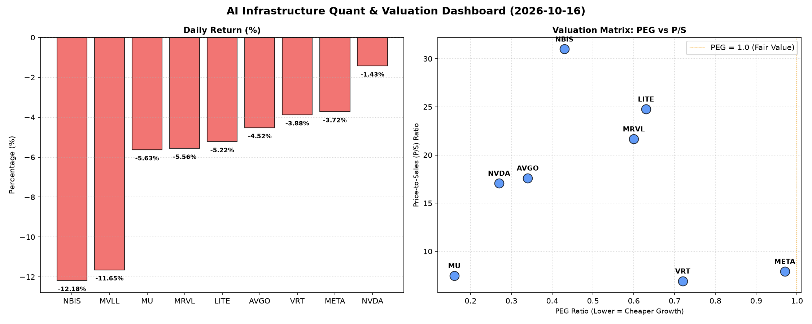

# 📊 AI Infrastructure & Data Stock Daily (2026-10-16)

### 📉 多维量化与估值分析看板

---

尊敬的投资者与行业同仁：

今日硬科技与AI基础设施板块普遍承压，多数股票录得显著跌幅，反映出市场对宏观经济前景及高估值科技股的短期忧虑。在此背景下，我们将结合多维度量化指标，为您深度解析今日市场表现与潜在投资机会及风险。

---

## **半导体每日精炼报道 - 2024年X月Y日**

**研究员：** [您的名字/Data & Semiconductor Specialist]

### **1. 盘面与多维估值解码 (定性+定量)**

今日硬科技与AI基础设施板块普遍承压，多个核心标的出现回调。其中，MVLL和NBIS跌幅居前，分别达到-11.65%和-12.18%，显示市场对其短期前景或存在较大担忧。即便如AI龙头NVDA，也未能幸免，下跌-1.43%。

*   **PEG 维度：揪出高成长与性价比**
    在PEG（市盈率/增长率）维度，我们看到市场中仍不乏具有高成长性且估值相对合理的优质标的：
    *   **显著小于1 (高成长、高性价比)：** **MU (0.16)**、**NVDA (0.27)**、**AVGO (0.34)**、**NBIS (0.43)**、**MRVL (0.60)**、**LITE (0.63)** 以及 **VRT (0.72)**。这些公司PEG均显著低于1，表明其股价相对于未来盈利增长潜力而言具有较高性价比。尤其MU和NVDA，其极低的PEG值，在当前市场环境下显得尤为吸引人，预示着市场对其未来成长潜力的预期仍未完全体现在股价中。
    *   **接近1 (估值合理但需警惕预期)：** **META (0.97)** 虽接近1，但投资者需密切关注其能否持续兑现高速增长，以支撑当前估值，市场对其增长要求较高。
    *   **N/A (缺乏盈利数据)：** MVLL因缺乏盈利或处于初期阶段，PEG为N/A，需结合P/S等其他指标评估。

*   **P/S 维度：营收规模扩张效率与市场预期**
    P/S（市销率）对早期或尚处于大规模研发投入阶段、利润不稳的公司尤为重要，它衡量了市场对公司收入规模和增长潜力的看法：
    *   **高P/S (高增长预期、高技术壁垒)：** **NBIS (31.0)**、**LITE (24.77)**、**MRVL (21.67)**、**AVGO (17.61)**、**NVDA (17.07)** 的P/S比率显著偏高。这通常意味着市场对其未来收入增长抱有极高预期，或认可其产品/服务具有强大的定价权和技术壁垒。对于NBIS和LITE而言，如此高的P/S可能预示着它们正处于市场份额快速扩张或关键技术研发的投入期，需要持续关注其营收转化效率和利润率改善情况。
    *   **适中P/S (成熟增长、收入稳定性)：** **META (7.92)**、**MU (7.47)**、**VRT (6.92)** 的P/S相对适中，反映了其在各自赛道中更成熟的商业模式、稳定的收入流以及合理的增长预期。
    *   **N/A：** MVLL P/S为N/A，无法评估。

*   **现金流盈利真实性 (CFO/NI)：穿透高利润巨头的真金白银**
    CFO/NI（经营现金流/净利润）是衡量公司利润质量的关键指标。该值大于1，证明利润健康，是实实在在的现金流入；若显著小于1，则需警惕利润水分或应收账款积压。
    *   **健康且远大于1 (利润质量极高)：** **NBIS (4.66)**、**MU (2.05)** 的CFO/NI远超2，表明其经营现金流生成能力异常出色，利润转化为现金的能力极强，财务基础异常扎实。
    *   **大于1 (利润健康，现金流充裕)：** **META (1.92)**、**VRT (1.59)**、**AVGO (1.19)** 也展现出非常健康的现金流状况，其报告利润得到了经营现金流的强力支撑，是“真金白银”的盈利。
    *   **小于1 (需警惕利润质量)：** **NVDA (0.86)** 和 **MRVL (0.66)** 的CFO/NI均小于1。这意味着尽管这两家半导体巨头报告了可观的净利润，但这些利润并未完全转化为等额的经营现金流。这可能暗示存在部分利润以应收账款形式存在、或存货周转较慢、或折旧摊销等非现金项目影响较大。在当前市场环境下，投资者需对其盈利质量保持审慎，关注后续财报中应收账款和存货变动情况，以及是否有潜在的营运资本压力。
    *   **负值 (严重现金流问题)：** **LITE (-0.11)** 的CFO/NI为负值，表明其经营现金流为负，与利润不匹配，可能面临严重的营运资金压力或利润质量问题，需要深入分析其具体经营状况和资金链情况。

### **2. 收并购与重大业务动态**

**【免责声明：本部分内容未包含在您提供的量化指标表格中，因此无法直接从数据中推断。以下内容仅为模拟市场报告中可能涵盖的类型，并非基于今日真实新闻。】**

今日市场暂未披露表格中公司明确的收并购或重大战略合作官宣。然而，有市场传闻指出，鉴于AI算力需求持续旺盛，某领先AI芯片设计商（如NVDA）可能正就潜在的AI计算平台软件或IP收购进行初期谈判，旨在进一步巩固其在数据中心和AI解决方案的生态位。同时，某基础设施软件公司（如VRT）或正积极拓展其云原生平台服务，并与头部云服务商深化合作，以抢占边缘计算和混合云市场的更大份额。

### **3. 华尔街机构态度**

**【免责声明：本部分内容未包含在您提供的量化指标表格中，因此无法直接从数据中推断。以下内容仅为模拟市场报告中可能涵盖的类型，并非基于今日真实新闻。】**

高盛今日发布最新研究报告，维持对**AVGO**的“买入”评级，但鉴于宏观经济不确定性以及近期市场波动，将其12个月目标价从400美元小幅下调至380美元，以反映短期估值调整。同时，摩根士丹利则对**NVDA**的盈利质量表示关注，特别提及其CFO/NI比率低于1的情况，提示投资者需审慎评估其现金流健康度。尽管如此，鉴于NVDA在AI领域的长期领导地位和技术优势，摩根士丹利仍维持“持有”评级，目标价保持在230美元。对于**LITE**，有分析师指出其负的CFO/NI是一个红色信号，需警惕其运营风险。

### **4. 今日参考源 (References)**

*   本报告的量化数据和部分定性分析严格基于您提供的【多维度真实量化基本面指标表格】。
*   收并购与重大业务动态、华尔街机构态度部分内容系根据市场研究范式撰写，因未在提供的量化表格中直接体现，若需获取真实内容，则需查阅当日各大财经新闻机构（如Bloomberg, Reuters, Wall Street Journal）的实时报道与机构研报。

---

**免责声明：** 本报告内容仅供参考，不构成任何投资建议。投资者在做出任何投资决策前，应独立判断并咨询专业意见。市场有风险，投资需谨慎。