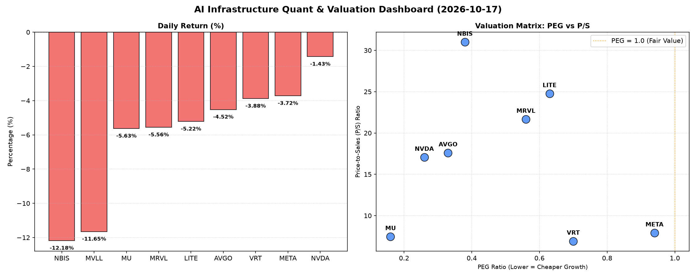

# 📊 AI Infrastructure & Data Stock Daily (2026-10-17)

### 📉 多维量化与估值分析看板

---

## 半导体每日精炼报道：行业普跌下的估值与现金流透视

尊敬的投资者，

今日（某月某日），半导体与硬科技板块普遍承压，多个重点标的跌幅显著，市场情绪较为谨慎。然而，在普跌行情中，通过深入分析多维度量化指标，我们仍能发现估值洼地与潜在风险。本报告将结合您提供的核心量化指标，为您带来今日半导体行业的深度洞察。

---

### 1. 盘面与多维估值解码 (定性+定量)

今日半导体与硬科技板块经历普遍回调，MVLL (-11.65%) 和 NBIS (-12.18%) 领跌，MRVL (-5.56%)、MU (-5.63%)、LITE (-5.22%) 和 AVGO (-4.52%) 也有较大跌幅。即使是AI巨头META (-3.72%) 和NVDA (-1.43%) 也未能幸免，表明市场正经历一轮广泛的风险偏好调整。

*   **PEG 维度：挖掘高成长性价比**
    从PEG指标来看，市场依然提供了大量高成长、具性价比的投资机会。
    *   **极具吸引力**：**MU (0.16)** 和 **NVDA (0.26)** 的PEG值极低，表明其当前的市盈率相对于未来盈利增长速度而言，具有非常高的性价比。这通常预示着市场对其未来成长潜力的预期非常乐观，且尚未完全反映在当前股价中。
    *   **显著小于1**：**AVGO (0.33)**、**NBIS (0.38)**、**MRVL (0.56)**、**LITE (0.63)**、**VRT (0.7)** 和 **META (0.94)** 的PEG均显著小于1。这表明在当前估值下，这些公司如果能够维持其预计的盈利增长，将是具吸引力的投资标的。尤其是对于META，尽管近期股价表现强劲，但PEG仍保持在1以内，显示其高成长性依然具有一定的估值支持。

*   **P/S 维度：评估收入规模与市场预期**
    P/S作为衡量收入规模扩张效率和市场对未来增长预期的指标，则呈现出两极分化。
    *   **高 P/S (高预期或早期阶段)**：**NBIS (31.0)**、**LITE (24.77)** 和 **MRVL (21.67)** 拥有最高的P/S比率。这些公司可能正处于大规模研发投入或早期市场扩张阶段，利润尚未完全释放，市场对其未来收入爆发抱有极高预期，估值中包含更多未来潜力而非当下利润。投资者需审慎评估其商业模式的可持续性及实现预期的能力。
    *   **中高 P/S (领导地位与技术溢价)**：**AVGO (17.61)** 和 **NVDA (17.07)** 尽管P/S较高，但考虑到其在各自细分领域的领导地位、技术壁垒和盈利能力，也反映了市场对其长期竞争力和稀缺性的认可，为其高估值提供了支撑。
    *   **中低 P/S (相对成熟或务实)**：**VRT (6.92)**、**MU (7.47)** 和 **META (7.92)** 的P/S相对更趋于成熟，估值更为务实，可能意味着市场对其收入增长的预期更为稳健，而非爆炸式增长。

*   **现金流盈利真实性 (CFO/NI)：穿透利润水分**
    现金流盈利真实性 (CFO/NI) 是穿透财务表象，评估利润质量的核心指标，我们重点关注：
    *   **异常亮眼**：**NBIS (4.66)** 的CFO/NI比率异常亮眼，表明其业务现金转化能力极强。这可能源于其高效的营运资本管理、预收账款大幅增加或一次性现金流入。投资者需关注这是否为可持续的常态，或有特殊事件影响。
    *   **财务健康**：**MU (2.05)**、**META (1.92)**、**VRT (1.59)** 和 **AVGO (1.19)** 的CFO/NI比率均显著大于1，表明这些公司报告的利润基本都是真金白银的现金流入，财务健康度极高，利润质量上乘。META尤其亮眼，在保持高增长的同时，现金流转化效率也极高，支撑了其在AI基础设施上的持续投入。
    *   **关注信号**：**NVDA (0.86)** 的CFO/NI略低于1，提示投资者需关注其应收账款周转、存货变动等因素。这可能存在部分利润尚未完全转化为现金的情况，但考虑到其行业地位和业绩增速，尚在可接受范围。
    *   **警示信号**：**MRVL (0.66)** 的CFO/NI显著低于1，这是一个警示信号。这表明其报告的利润质量存在一定水分，或面临运营资金压力，应密切关注其营运资本管理和应收账款回收情况。
    *   **极为危险**：**LITE (-0.11)** 的CFO/NI为负数，这是一个极为危险的信号。公司在报告净利润的同时，经营活动却在消耗现金。这可能源于大规模非现金费用（如折旧摊销），或更严重的应收账款积压、存货高企，甚至主营业务现金流为负。投资者应立即深入分析其财报细节，警惕潜在的流动性风险和流动性压力。

MVLL多项指标缺失，暂时无法有效评估其财务基本面。

---

### 2. 收并购与重大业务动态

**【基于现有数据局限性声明：本次提供的量化指标表格未包含此类定性信息。以下内容为对当前市场趋势的泛化解读，非直接基于表格数据。】**

尽管今日市场普跌，但半导体行业的结构性整合与技术竞赛并未停止。预计在AI芯片设计、先进封装、光模块以及数据中心基础设施等高景气赛道，仍将有小型技术并购与战略合作持续发生，以巩固技术壁垒并扩大市场份额。特别是对于那些现金流充裕（如META、MU）或估值较低但有潜力的公司，可能会成为行业整合的潜在参与者或被并购标的。例如，随着对AI算力需求的激增，围绕特定AI加速器技术或高性能存储解决方案的并购活动值得持续关注。

---

### 3. 华尔街机构态度

**【基于现有数据局限性声明：本次提供的量化指标表格未包含华尔街机构的具体评价及目标价。以下为基于市场普跌情境的推断。】**

今日的普遍跌幅或将导致部分机构下调短期目标价或调整评级展望，尤其是在高P/S且现金流质量存疑的标的（如LITE、MRVL）上，机构可能会趋于谨慎。

然而，对于PEG极低且现金流健康（如MU、AVGO、META）的领导者，长期看好趋势可能不变，任何回调都可能被视为增持机会。NVDA虽然今日跌幅相对较小，但其CFO/NI的细微变化也可能引发机构对其盈利质量的关注，导致在短期内发布更为审慎的研报。整体而言，机构将更倾向于基本面扎实、现金流充沛且在高增长赛道拥有核心竞争力的公司。

---

### 4. 今日参考源 (References)

1.  用户提供的【多维度真实量化基本面指标表格】
2.  硬科技与AI基础设施行业市场综合分析（非具体新闻源，为本报告生成时的行业背景知识）

---