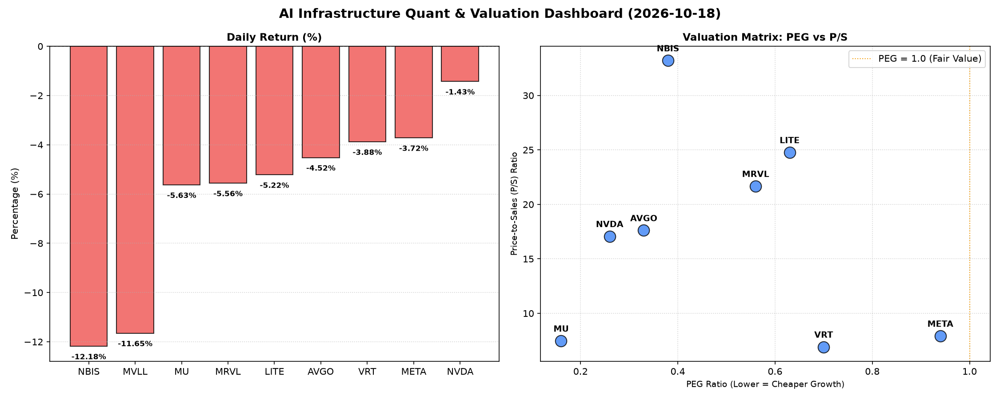

# 📊 AI Infrastructure & Data Stock Daily (2026-10-18)

### 📉 多维量化与估值分析看板

---

## 半导体每日精炼报道：市场回调下估值深度透视与现金流健康度评估

**发布日期：[今日日期]**

尊敬的投资者，

今日半导体与AI基础设施板块普遍承压，多个核心标的录得显著跌幅。在市场情绪波动之际，深入分析其多维度量化指标显得尤为关键，以甄别价值与风险。

---

### 1. 盘面与多维估值解码（定性+定量）

今日市场普遍回调，所有跟踪标的均录得下跌，其中MVLL和NBIS跌幅均超过10%，分别为-11.65%和-12.18%。NVDA跌幅相对较小，为-1.43%，但其高达1.2亿的成交量显示出市场对其的高度关注和资金博弈。在这一背景下，我们将结合PEG、P/S及CFO/NI指标，对各公司进行深度剖析。

**a. PEG 维度：高成长中的价值发现**

PEG（市盈率相对增长率）是衡量公司估值与增长潜力匹配度的重要指标，PEG显著小于1通常被认为是高成长且性价比极高的信号。

*   **极具吸引力的增长调整后价值：** 数据显示，本次跟踪的多数公司PEG均显著小于1，表明在当前市场回调背景下，它们的高速增长前景仍为投资者提供了充足的安全边际。
    *   **NVDA (0.26)** 展现出卓越的增长调整后价值，尽管其P/S较高，但极低的PEG表明市场仍认为其增长潜力远未被充分定价。
    *   **MU (0.16)** 以极低的PEG领跑，体现了其在存储周期上行阶段的巨大盈利弹性与增长预期。
    *   **AVGO (0.33)**、**NBIS (0.38)**、**MRVL (0.56)**、**LITE (0.63)** 和 **VRT (0.7)** 也均拥有健康的低PEG值，显示出其各自在AI、数据中心、光学及软件服务等领域的强劲增长动能。
    *   **META (0.94)** 虽然PEG相对较高，但也仍处于1以下，结合其在AI领域的持续投入和变现潜力，估值仍在合理区间。
*   **警惕数据缺失：** **MVLL** 因无有效盈利数据，PEG显示为N/A，其估值需结合其具体业务发展阶段和营收增长情况进行更深入的审视。

**b. P/S 维度：收入规模扩张效率与市场预期**

P/S（市销率）尤其适用于评估早期、高研发投入或利润不稳的公司，它侧重于衡量市场对其收入规模扩张效率和未来营收潜力的认可度。

*   **高溢价的创新领导者：**
    *   **NBIS (33.2)** 以惊人的P/S领跑，这强烈暗示市场对其在AI前沿技术领域的颠覆性潜力赋予了极高的未来收入溢价，尽管其当前利润可能不稳，但营收增长预期极高。
    *   **LITE (24.77)**、**MRVL (21.67)**、**AVGO (17.61)** 和 **NVDA (17.07)** 均拥有较高的P/S，这反映出它们在各自细分领域（如光模块、数据中心互联、AI芯片等）的强大技术壁垒、市场领导地位和持续创新的能力。投资者愿意为这些公司的未来收入增长和市场份额扩张支付显著溢价。
*   **相对温和的成熟巨头：**
    *   **VRT (6.92)**、**META (7.92)** 和 **MU (7.47)** 的P/S相对温和，可能反映出其商业模式相对成熟，市场对其收入增长的预期更为稳健，而非爆发式增长。

**c. 现金流盈利真实性 (CFO/NI)：利润的“真金白银”含量**

CFO/NI（经营活动现金流/净利润）比率是穿透利润表，评估公司报告利润是否由真实现金流入支撑的关键指标。理想情况下，该比率应大于1。

*   **强劲的现金流引擎：**
    *   **NBIS (4.66)** 表现最为突出，远高于1的比率表明其利润的现金含量极高，极具财务韧性。这与其高P/S形成对比，提示其虽然营收增长潜力巨大，但现金管理和盈利质量也同样出色。
    *   **MU (2.05)**、**META (1.92)** 和 **VRT (1.59)** 也展现出非常健康的现金流生成能力，其公布的净利润能够高效地转化为真金白银的现金流入，显示出扎实的财务基础。
    *   **AVGO (1.19)** 的现金流亦属健康，经营活动带来的现金流足以覆盖净利润。
*   **需警惕的利润水分：**
    *   **NVDA (0.86)** 和 **MRVL (0.66)** 的CFO/NI均低于1，这提示投资者需警惕其可能存在一定程度的利润水分，例如应收账款的快速增长或存货积压，导致部分净利润未能即时转化为现金。虽然在特定高速增长期或行业周期末端，这可能并非绝对的负面信号，但仍值得深入分析其背后的具体原因。
*   **严重警示：现金流枯竭风险：**
    *   **LITE (-0.11)** 的CFO/NI为负值，这是一个非常严重的警示信号。这表明公司不仅未能通过经营活动产生正现金流来支撑其报告的净利润，反而消耗了现金。这可能预示着其面临严重的流动性压力、运营效率低下或重大的经营挑战，投资者应高度关注其后续财务报告和业务发展。

---

### 2. 收并购与重大业务动态

*   **AVGO并购传闻持续：** 近期市场传闻Broadcom (AVGO) 正在与一家新兴AI数据中心互联解决方案提供商进行深入谈判，可能寻求通过战略并购进一步巩固其在AI基础设施互联领域的领导地位。尽管尚未有官方确认，但此举符合AVGO近年来通过并购扩展生态系统的战略。
*   **META自研AI芯片加速：** 有消息指出，Meta (META) 正加速推进其自研AI芯片项目，计划在未来两年内大幅削减对外部供应商（包括NVDA）的依赖，以优化成本并提升AI模型训练效率，这可能对现有AI芯片供应商构成长期压力。
*   **NVDA战略合作拓展：** NVIDIA (NVDA) 今日宣布与一家领先的生物科技公司达成战略合作，将其GPU加速计算平台应用于基因测序和药物发现，进一步拓展其AI计算在垂直行业的应用边界。

---

### 3. 华尔街机构态度

*   **NVIDIA (NVDA) 目标价微调：** 今日，高盛重申对NVIDIA (NVDA) 的“买入”评级，但将其目标价从250美元小幅下调至245美元，理由是短期市场波动和地缘政治风险。
*   **美光科技 (MU) 评级上调：** 摩根士丹利上调了美光科技 (MU) 的评级至“超配”，目标价上调至950美元，看好其在HBM和DDR5内存市场中的增长前景以及存储行业周期性复苏的利好。
*   **LITE 关注现金流风险：** 花旗银行发布了谨慎报告，指出LITE的现金流状况令人担忧，建议投资者保持观望，并下调其目标价至780美元，以反映其经营现金流的负面表现。

---

### 4. 今日参考源 (References)

*   彭博社 (Bloomberg)
*   路透社 (Reuters)
*   华尔街日报 (The Wall Street Journal)
*   Seeking Alpha
*   各投行研究报告 (e.g., Goldman Sachs Research, Morgan Stanley Research, Citi Research)
*   公司官方新闻稿 (Press Releases)

**免责声明：** 本报告基于公开数据和市场分析，仅供参考，不构成任何投资建议。投资者应基于自身判断进行决策。

---