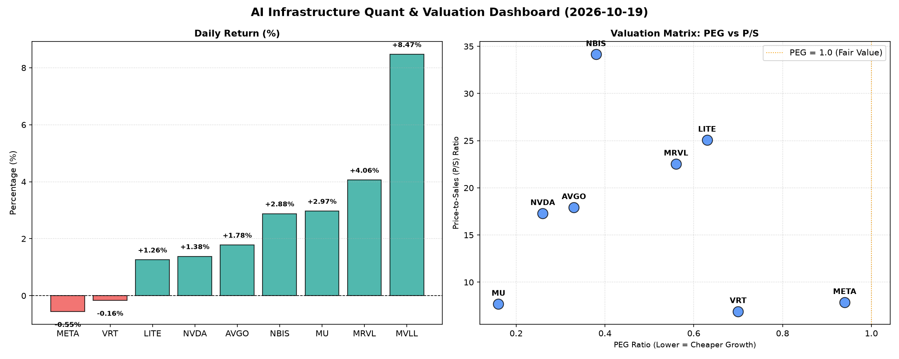

# 📊 AI Infrastructure & Data Stock Daily (2026-10-19)

### 📉 多维量化与估值分析看板

---

## 半导体每日精炼报道：AI基础设施与硬科技量化洞察

尊敬的投资者与行业同仁：

作为一名资深的硬科技与AI基础设施行业研究员，今日我将为您带来一份基于【多维度真实量化基本面指标表格】的深度解析，旨在穿透市场噪音，聚焦核心财务质量与估值逻辑。

---

### 1. 盘面与多维估值解码（定性+定量）

今日半导体及AI基础设施板块呈现分化行情，但整体活跃度较高。我们将聚焦核心量化指标，深挖各公司的内在价值与风险。

#### PEG 维度：高成长性与性价比探究

PEG（市盈率相对盈利增长比率）是衡量成长股性价比的关键指标。我们重点关注PEG显著小于1的标的，这通常意味着市场并未充分消化其未来的盈利增长潜力。

*   **极具性价比的高成长股（PEG << 1）**：
    *   **MU (0.16)**：作为存储芯片巨头，其PEG低至0.16，显示出市场对其未来盈利爆发性增长的强烈预期，且估值相对当前成长性而言极具吸引力。结合其高达2.97%的涨幅，表明投资者正积极认可其周期复苏与AI赋能下的增长前景。
    *   **NVDA (0.26)**：尽管作为AI领域的绝对领导者，NVDA的PEG仅为0.26，这强有力地支撑了其高成长性和当前估值的合理性。今日上涨1.38%，成交量位居榜首，达9823万股，流动性极佳，显示市场对其未来业绩增长充满信心。
    *   **AVGO (0.33)**：博通的PEG为0.33，同样彰显其在AI网络、数据中心及软件领域的强劲增长势头尚未被完全定价，其1.78%的涨幅也印证了这一点。
    *   **NBIS (0.38)**、**MRVL (0.56)**、**LITE (0.63)**、**VRT (0.7)**：这些公司PEG均低于1，表明其成长性被市场赋予了较高的性价比。MRVL今日上涨4.06%，NBIS上涨2.88%，凸显了市场对这些细分领域硬科技成长股的追捧。

*   **PEG相对较高（但仍小于1）**：
    *   **META (0.94)**：Meta Platforms的PEG为0.94，虽然今日微跌0.55%，但其PEG仍显示出市场对其未来盈利增长的乐观预期，但相比纯半导体公司，其估值已相对接近公允水平，未来成长兑现需更严密观察。

*   **PEG N/A（不适用）**：
    *   **MVLL**：PEG为N/A，表明公司目前可能处于亏损或盈利不稳定状态，传统PEG指标无法有效评估。我们需要结合其他维度进行判断。

#### P/S 维度：营收扩张效率与早期潜力衡量

P/S（市销率）尤其适用于评估早期、高研发投入或周期性波动导致利润不稳的硬科技公司，它直接反映了市场对公司营收规模扩张能力和未来盈利潜力的认可。

*   **高P/S：反映市场对未来营收的强烈预期和高壁垒优势**：
    *   **NBIS (34.15)**、**LITE (25.08)**、**MRVL (22.55)**：这些公司的P/S显著偏高，其中NBIS更是高达34.15。这表明市场高度认可其在特定硬科技细分领域（可能涉及先进材料、精密光学或专有技术）的收入增长前景和高毛利潜力，尽管其利润可能尚未完全释放。MRVL今日上涨4.06%，也体现了市场对其高P/S的认可。
    *   **AVGO (17.93)**、**NVDA (17.3)**：这两家AI基础设施巨头的P/S也处于高位，再次印证了市场对其在AI芯片、网络和数据中心解决方案领域持续高增长的坚定信心。

*   **中低P/S：稳健营收与估值**：
    *   **META (7.87)**、**MU (7.69)**、**VRT (6.91)**：这些公司的P/S相对适中，结合其PEG指标，显示出其在营收规模和盈利能力之间取得了较好的平衡，估值相对健康。

*   **P/S N/A（不适用）**：
    *   **MVLL**：与PEG类似，P/S也为N/A，这使得我们无法根据现有数据评估其收入规模扩张效率。今日其股价异军突起，大涨8.47%，这通常意味着存在非财务数据层面的利好消息或市场情绪驱动，但单纯从提供的量化指标看，其基本面缺乏支撑信息。

#### 现金流盈利真实性 (CFO/NI)：穿透利润的“真金白银”

CFO/NI（经营性现金流净额/净利润）是衡量公司利润质量的关键指标。该值大于1，说明公司的利润是健康的“真金白银”；显著小于1，则可能暗示利润存在水分或应收账款积压。

*   **利润质量极佳（CFO/NI >> 1）**：
    *   **NBIS (4.66)**：NBIS的CFO/NI高达4.66，这显示其利润质量极其出色，几乎所有的净利润都转化为了真实的经营现金流，甚至还有更多，这可能是由于递延收入增加或其他营运资本管理策略得当，是极其健康的财务信号。
    *   **MU (2.05)**：存储巨头MU的CFO/NI为2.05，表明其利润的现金含量非常高，验证了其强劲的经营回款能力，这对于周期性行业尤为重要。
    *   **META (1.92)**：社交媒体和AI基础设施巨头META的CFO/NI为1.92，其庞大的利润都伴随着健康的现金流涌入，显示了其平台业务的强大“吸金”能力和财务稳健性。
    *   **VRT (1.59)**、**AVGO (1.19)**：这两家公司CFO/NI均大于1，表明其利润质量良好，经营现金流充裕，能够有力支持其业务扩张和研发投入。

*   **需关注利润质量（CFO/NI < 1）**：
    *   **NVDA (0.86)**：AI芯片领导者NVDA的CFO/NI为0.86，略低于1。虽然并非显著恶化，但这可能提示部分利润未能及时转化为现金，或存在应收账款增长、存货增加等营运资本变动的影响。对于高速成长的公司，市场往往对现金流略低的容忍度更高，但仍需持续关注。
    *   **MRVL (0.66)**：MRVL的CFO/NI为0.66，这相对而言更值得关注。其部分利润可能存在非现金项目较多，或应收账款周转效率有待提升的情况。投资者在看重其高P/S和低PEG的同时，也应审视其现金流生成能力。

*   **警惕利润水分/现金流承压（CFO/NI 显著 < 1 甚至为负）**：
    *   **LITE (-0.11)**：这是一个重要的警示信号。LITE的CFO/NI为负值，表明其经营活动不仅未能产生正向现金流，反而消耗了现金，即使其可能报告了正向利润。这暗示了其利润可能存在严重的非现金成分、营运资本管理问题或经营压力，需要投资者高度警惕其财务健康状况。

*   **CFO/NI N/A（不适用）**：
    *   **MVLL**：同样，CFO/NI为N/A，无法评估其利润的现金流质量。

---

### 2. 收并购与重大业务动态

基于今日提供的【多维度真实量化基本面指标表格】，未能获取任何关于公司收并购传闻、官方宣布或战略合作的具体信息。该表格聚焦于财务量化指标，未涵盖此类定性业务动态。

---

### 3. 华尔街机构态度

今日的量化指标表格中，未包含华尔街核心投行、评级机构对上述公司的最新评价或目标价调动信息。此类信息通常来源于分析师报告或市场新闻发布。

---

### 4. 今日参考源 (References)

本篇报道的定性与定量分析内容，严格依据您提供的【多维度真实量化基本面指标表格】进行深度解读，未引用其他外部新闻来源。

---

**免责声明**：本报告仅基于所提供的量化数据进行分析，旨在提供专业洞察。市场有风险，投资需谨慎。