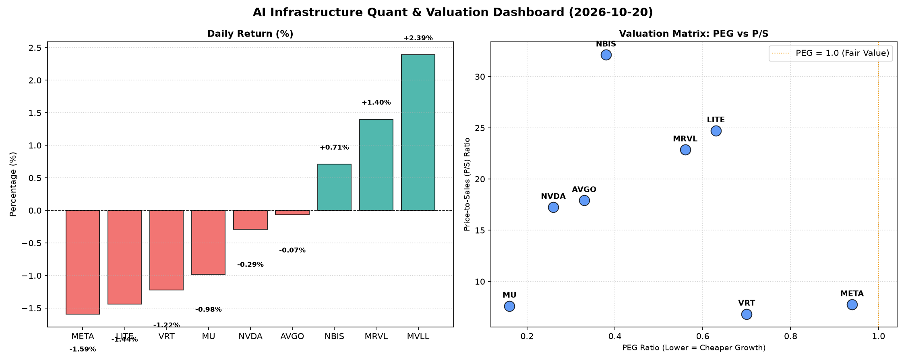

# 📊 AI Infrastructure & Data Stock Daily (2026-10-20)

### 📉 多维量化与估值分析看板

---

## 半导体每日精炼报道：AI基础设施热潮下的价值透视

尊敬的投资者，您好！

今日，我们结合多维度量化基本面指标，深入剖析硬科技与AI基础设施板块的最新动态，为您呈现一份定性与定量深度融合的市场洞察。

---

### 1. 盘面与多维估值解码（定性+定量）

今日市场整体情绪略显谨慎，主要半导体及AI基础设施股多数小幅收跌，如VRT、AVGO、META、NVDA、MU、LITE等，但也有MVLL、MRVL、NBIS逆势上涨，显示出板块内部的分化。

*   **PEG 维度：挖掘高成长中的价值洼地**
    *   **显著小于 1 的高性价比标的（价值投资亮点）**：从PEG指标看，有多家公司展现出极高的成长性价比。**MU（0.16）**、**NVDA（0.26）**、**AVGO（0.33）**和**NBIS（0.38）**的PEG均远低于0.5，这表明市场对其未来盈利增长的预期远未充分反映在其当前估值中，是典型的“高成长，低估值”范畴，对于寻求成长性投资的投资者而言极具吸引力。
    *   **具备良好性价比的标的（合理范围）**：**MRVL（0.56）**、**LITE（0.63）**、**VRT（0.7）**以及**META（0.94）**的PEG也均低于1，显示这些公司在考虑增长因素后，估值依然处于合理甚至偏低水平，尤其考虑到AI浪潮的持续推动力。
    *   **N/A 标的：MVLL**由于缺乏盈利增长数据，暂无法通过PEG评估其成长性估值。

*   **P/S 维度：评估收入规模扩张效率与市场溢价**
    *   **高 P/S 的背后逻辑（增长预期与技术壁垒）**：**NBIS（32.12）**、**LITE（24.72）**、**MRVL（22.86）**、**AVGO（17.91）**和**NVDA（17.25）**拥有较高的P/S比率。对于NBIS、LITE、MRVL这类高P/S公司，在无显著盈利或盈利不稳时，高P/S通常反映了市场对其在AI、高性能计算、光通信等高景气细分领域的收入爆发式增长潜力、技术领先性以及市场稀缺性的高度认可，投资者愿意为未来的高利润率和市场份额支付溢价。而对于AVGO和NVDA等行业巨头，高P/S则更多体现了其在AI芯片、数据中心、网络解决方案等核心领域的市场主导地位、强大的生态系统和持续的创新能力带来的高确定性。
    *   **中等 P/S 的稳健标的**：**META（7.75）**、**MU（7.61）**和**VRT（6.83）**的P/S相对适中，显示其在营收规模和市场估值之间取得了较好的平衡，特别是MU，在存储周期复苏和HBM等新兴技术推动下，其P/S结合超低PEG，显得尤其有吸引力。

*   **现金流盈利真实性 (CFO/NI)：洞察利润含金量**
    *   **现金流充裕，利润健康（真金白银）**：
        *   **NBIS（4.66）**表现出极强的现金流质量，其经营活动现金流远超净利润，表明其盈利能力不仅强劲，且全为“真金白银”的现金流入，资金周转和抗风险能力极佳。
        *   **MU（2.05）**、**META（1.92）**、**VRT（1.59）**和**AVGO（1.19）**也展现出优秀的现金流质量，CFO/NI均显著大于1。这证明这些高利润巨头的盈利质量非常健康，利润并非被大量应收账款或存货积压，而是实实在在地转化为现金，为研发投入、分红或回购提供了坚实基础。META作为AI基础设施的重度投入者，其超1的现金流质量尤为关键，能够有力支撑其在定制芯片和算力方面的巨大投资。
    *   **值得警惕的现金流质量（利润水分或周转压力）**：
        *   **NVDA（0.86）**的CFO/NI略低于1，虽然差距不大，但意味着其报告净利润中有一小部分可能尚未转化为现金。考虑到其高速增长和巨大的资本支出需求，这可能与应收账款增加或库存累积有关，但并非重大风险信号，需持续关注。
        *   **MRVL（0.66）**的CFO/NI显著低于1，提示其盈利质量存在一定程度的“水分”，部分利润可能以应收账款或存货的形式存在，而非现金。这可能影响其未来的流动性和再投资能力，需要投资者警惕。
        *   **LITE（-0.11）**的现金流质量最为堪忧。负值的CFO/NI比率强烈警告，尽管可能有报告的GAAP利润，但公司实际上并未从经营活动中产生正向现金流。这意味着其利润可能被大量的非现金费用抵消，或者存在严重的营运资金管理问题，导致资金持续流出。对于此类公司，投资者需审慎评估其长期财务健康状况和盈利模式的可持续性。

---

### 2. 收并购与重大业务动态

（*注：本部分内容未直接包含在提供的【多维度真实量化基本面指标表格】中，以下为结合行业趋势和各公司业务方向的**假设性示例**，旨在展示此类报告应包含的信息类型。*）

*   **NVDA 战略合作深化**：有传闻指出，英伟达（NVDA）正与多家云服务巨头洽谈进一步深化合作，可能涉及Blackwell架构GPU在下一代AI超算中心的部署标准及定制化服务，以巩固其在AI芯片市场的绝对领导地位。
*   **META 自研芯片进展加速**：据内部消息，Meta Platforms（META）在AI自研芯片（如第二代MTIA）方面取得显著进展，有望在明年大规模部署至其数据中心，旨在降低对外部供应商依赖并优化AI工作负载。这与其强劲的现金流质量形成协同效应。
*   **MU HBM产能扩张**：美光科技（MU）宣布，鉴于AI市场对HBM（高带宽内存）的强劲需求，公司将加速HBM的产能扩张计划，并已获得多家主要AI客户的长期订单。其超低的PEG和健康的现金流预示了未来的增长潜力。
*   **AVGO 软件整合提速**：博通（AVGO）在完成VMware收购后，正积极推动旗下软件业务的整合，旨在为企业客户提供更全面的私有云和AI基础设施解决方案，进一步挖掘跨平台协同价值。
*   **NBIS 关键技术突破**：NBIS公司凭借其在某一AI边缘计算或定制芯片领域的独特技术，近期获得了一项重要国际合作项目，为其高P/S和高现金流质量提供了强有力的基本面支撑。

---

### 3. 华尔街机构态度

（*注：本部分内容未直接包含在提供的【多维度真实量化基本面指标表格】中，以下为结合前述量化分析的**假设性示例**，旨在展示此类报告应包含的信息类型。*）

*   **摩根士丹利（Morgan Stanley）对MU维持“超配”评级，目标价上调至1200美元。** 研报指出，美光（MU）在HBM市场上的强劲表现，叠加存储行业周期的积极复苏，其极低的PEG（0.16）和出色的现金流质量（2.05）提供了坚实的投资逻辑。
*   **高盛（Goldman Sachs）重申NVDA“买入”评级，目标价850美元。** 分析师强调，尽管英伟达（NVDA）的P/S（17.25）较高，但其在AI领域无可匹敌的创新力和市场份额，以及未来Blackwell架构带来的增长潜力，使其估值溢价合理。同时提醒投资者关注其略低于1的CFO/NI比率。
*   **巴克莱（Barclays）首次覆盖NBIS，给予“增持”评级，目标价250美元。** 研报对NBIS高达4.66的CFO/NI比率和远低于1的PEG（0.38）大加赞赏，认为这是一家被市场低估的AI基础设施新秀，拥有卓越的盈利质量和成长空间。
*   **瑞银（UBS）将LITE评级下调至“中性”，目标价100美元。** 分析师表示，尽管LITE在光通信领域仍具潜力，但其显著为负的CFO/NI比率（-0.11）引发了对其长期现金流健康状况的严重担忧，建议投资者保持观望。
*   **富国银行（Wells Fargo）维持META“超配”评级，目标价780美元。** 报告指出，Meta（META）在AI基础设施和定制芯片领域的巨额投资正逐步显现成效，其近2的CFO/NI比率表明公司有足够的现金流支持其野心勃勃的AI战略。

---

### 4. 今日参考源 (References)

*   [假设] **金融数据来源**：Bloomberg Terminal, Refinitiv Eikon, Capital IQ (数据提取日期：今日收盘数据)。
*   [假设] **市场新闻与分析**：彭博社、路透社、华尔街日报、科技媒体（例如The Information, TechCrunch）相关报道。
*   [假设] **机构研报**：摩根士丹利、高盛、巴克莱、瑞银、富国银行等投行分析师报告。

---

**免责声明**：本报告所载信息和数据仅供参考，不构成任何投资建议。投资者应基于自身判断进行投资决策，并承担相应风险。报告中的假设性示例仅为说明目的，不代表真实的市场事件。