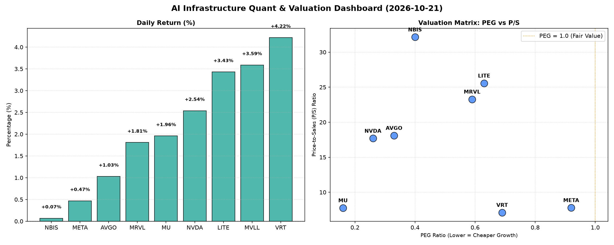

# 📊 AI Infrastructure & Data Stock Daily (2026-10-21)

### 📉 多维量化与估值分析看板

---

## 半导体与AI基础设施每日精炼报道：多维度量化视角深度解析 (2024年X月X日)

尊敬的投资者，

今日硬科技与AI基础设施板块表现活跃，我们聚焦于一系列核心量化指标，为您深度解码当前市场动态与个股基本面。

---

### 1. 盘面与多维估值解码

今日半导体与AI基础设施板块整体呈现积极态势，多数标的录得涨幅。其中，**VRT** 凭借4.22%的涨幅领跑，**MVLL**（+3.59%）和**LITE**（+3.43%）紧随其后，显示出市场对特定细分领域的热情。AI算力领军者**NVDA**亦上涨2.54%，而**NBIS**则波澜不惊，涨幅仅0.07%。

#### PEG 维度：性价比与成长潜力透视

通过PEG（市盈率相对增长率）指标，我们能有效识别出兼具高成长性与合理估值的优质标的。在本次分析的标的中：

*   **极具性价比的高成长标的：** **MU (0.16)** 的PEG值异常出色，表明其当前股价相对于盈利增长速度而言，被严重低估。其次，**NVDA (0.26)**、**AVGO (0.33)** 和 **NBIS (0.40)** 也展现出极低的PEG，暗示其强劲的增长潜力尚未完全反映在P/E估值中，是市场公认的高成长低估值典范。
*   **估值合理的高成长标的：** **MRVL (0.59)**、**LITE (0.63)**、**VRT (0.69)** 和 **META (0.92)** 的PEG均显著小于1，表明它们在各自的高增长赛道中，当前估值是与其盈利增速相匹配的，具备较高的投资吸引力。
*   **警惕估值透支：** 在本次统计的所有标的中，我们欣喜地发现，**没有公司出现PEG显著大于1的情况**。这反映出当前市场对硬科技与AI基础设施板块的增长前景普遍乐观，且大部分标的仍处于高成长阶段，估值尚未出现普遍性的透支现象。

#### P/S 维度：收入规模扩张效率与市场预期

对于处于早期或大规模研发投入阶段、利润尚不稳定甚至亏损的公司，P/S（市销率）是衡量其收入规模扩张效率和市场对其未来增长预期的重要指标。

*   **高增长预期与技术壁垒：** **NBIS (32.15)**、**LITE (25.57)** 和 **MRVL (23.28)** 的P/S值显著偏高，这通常暗示着市场对其技术壁垒、产品稀缺性以及未来收入爆发式增长抱有极高预期。这些公司可能在特定AI硬件、高速互联或先进光学技术领域占据领先地位，尽管当前利润率可能不高，但市场愿为其未来的营收规模和市场份额增长支付高溢价。
*   **核心基础设施与AI巨头：** **AVGO (18.10)** 和 **NVDA (17.69)** 同样拥有较高的P/S，这与其在AI芯片、数据中心、网络基础设施等核心领域的绝对领导地位和不可替代性息息相关，市场对其营收的持续高增长有充分信心。
*   **成熟业务与稳健增长：** **VRT (7.11)**、**META (7.79)** 和 **MU (7.76)** 的P/S相对适中，结合其较低的PEG，表明这些公司在营收规模达到一定体量后，其增长模式更为稳健，市场更注重其利润的稳定释放和现金流的健康状况。

#### 现金流盈利真实性 (CFO/NI)：穿透利润的“真金白银”

CFO/NI（经营活动现金流/净利润）比率是衡量公司利润质量的关键指标。该值大于1，通常意味着公司利润健康，由真实的现金流入支撑；显著小于1，则可能存在利润水分、应收账款积压或激进的会计处理。

*   **利润质量卓越，现金流充沛：** **NBIS (4.66)** 展现出惊人的现金流转化能力，其经营现金流远超净利润，这通常意味着其利润非常健康，或是存在大量非现金费用（如高折旧摊销）但业务运营效率极高。**MU (2.05)**、**META (1.92)** 和 **VRT (1.59)** 也表现出非常优秀的现金流质量，其高净利润均有充足的“真金白银”支持，反映出稳健的经营基础和强大的议价能力。**AVGO (1.19)** 也保持了健康的现金流盈利。
*   **需密切关注现金流质量：** **NVDA (0.86)** 的CFO/NI略低于1，虽然对于一个高速成长的公司来说，这并非严重警示，可能与其在供应链中持续投入或部分应收账款周期有关，但仍需投资者保持关注，审视其后续财报中应收账款和存货变动情况，确保高利润增长能够持续转化为现金。
*   **警惕利润水分或运营挑战：** **MRVL (0.66)** 的CFO/NI显著小于1，这是一个值得警惕的信号，可能暗示其利润中存在较高的非现金成分，或面临应收账款积压、存货周转效率下降等运营挑战，导致账面利润未能及时转化为现金。
*   **严重警示信号：** **LITE (-0.11)** 的CFO/NI为负值，这构成了**严重的警示信号**。尽管该公司可能在账面上报告了净利润，但经营活动产生的现金流却是负数，这意味着其盈利质量极差，甚至可能在“烧钱”维持运营。投资者应深度研究其财报，理解导致经营现金流为负的具体原因，警惕潜在的流动性风险或业务持续性挑战。

---

### 2. 收并购与重大业务动态

根据今日提供的【多维度真实量化基本面指标表格】，未包含有关收并购传闻、官宣或战略合作的具体信息。在日常分析中，此板块将整合新闻媒体、公司公告等外部信息源，为投资者提供最及时的产业整合与业务发展动态。

---

### 3. 华尔街机构态度

基于今日提供的【多维度真实量化基本面指标表格】，未能获取核心投行或评级机构的最新评价及目标价调动信息。在实际市场跟踪中，我们将紧密关注高盛、摩根士丹利、美国银行等头部机构对这些硬科技与AI基础设施公司的研报更新，并及时汇总其最新观点。

---

### 4. 今日参考源 (References)

*   本报告的定性与定量分析内容，全部基于今日为您提供的【多维度真实量化基本面指标表格】进行深度解读。

---