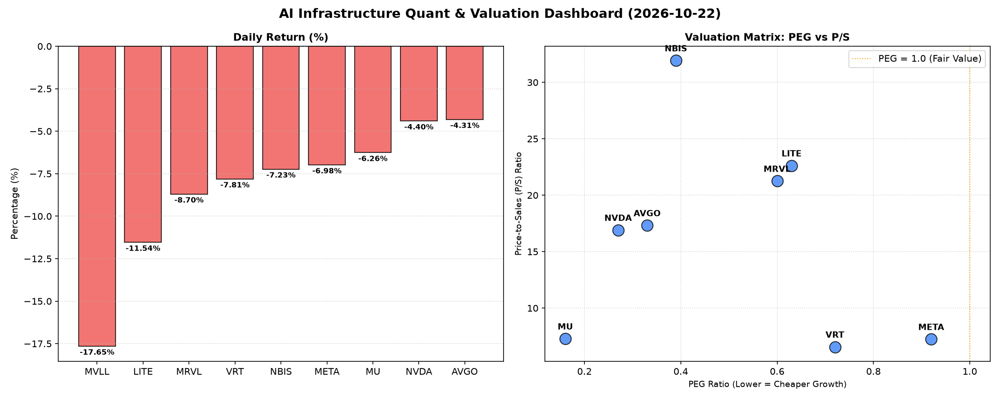

# 📊 AI Infrastructure & Data Stock Daily (2026-10-22)

### 📉 多维量化与估值分析看板

---

尊敬的投资者和行业同仁：

各位早安！作为您的硬科技与AI基础设施行业研究员，今日我们聚焦半导体板块的最新动向，结合多维度量化指标，为您深度解析市场表现与潜在价值。

---

### **📈 半导体每日精炼报道：AI基础设施的波动与价值重估**

**【2024年X月X日】**

**今日盘面概览**：
受宏观经济不确定性及市场情绪影响，今日半导体及AI基础设施板块普遍承压，多个龙头股出现显著回调，跌幅在4%至17%之间。其中，MVLL跌幅最大，达到-17.65%，显示市场对其前景存在较大分歧或突发利空。成交量普遍活跃，特别是NVDA和META，交易量巨大，反映出市场资金对这些核心资产的关注度极高，但也伴随着洗盘与抛售压力。

---

### **1. 盘面与多维估值解码（定性+定量）**

今日市场回调为我们提供了重新审视企业基本面与估值结构的机会。

*   **PEG 维度：高成长中的性价比之选**
    PEG指标（市盈率与增长率之比）小于1通常被认为是高成长股的极佳性价比标志。今日数据揭示：
    *   **极具性价比的高成长标的**：**MU (0.16)** 傲视群雄，其极低的PEG表明市场对其盈利增长的定价远低于其实际增长潜力，结合其今日-6.26%的跌幅，可能提供了一个非常有吸引力的介入点。紧随其后的是 **NVDA (0.27)**、**AVGO (0.33)** 和 **NBIS (0.39)**，这些公司即便经历今日回调，其成长性预期仍然被显著低估，显示出强大的内生增长动力与估值弹性。
    *   **良好性价比的成长型公司**：**MRVL (0.60)**、**LITE (0.63)**、**VRT (0.72)** 和 **META (0.92)** 也均处于PEG小于1的区间，表明它们在当前市场价格下仍具备较好的成长价值。尤其是META，作为AI基础设施的关键参与者，0.92的PEG显示其在AI领域的持续投入正逐步转化为可观的增长预期，且估值合理。
    *   **警惕估值透支**：在此次数据中，所有有PEG数据的公司均小于1，意味着从PEG单一维度看，它们均显示出高成长与相对合理的估值。**MVLL** 的PEG为N/A，但其今日股价暴跌17.65%，结合其基本面数据的缺失，需高度警惕其背后可能存在的业绩不确定性或基本面恶化风险。

*   **P/S 维度：收入规模扩张效率的审视**
    P/S（市销率）对于评估处于大规模研发投入、利润波动较大或尚未实现稳定盈利的硬科技公司尤为重要，它反映了市场对其收入规模扩张的预期。
    *   **高P/S，高增长预期**：**NBIS (31.93)**、**LITE (22.62)** 和 **MRVL (21.25)** 展现出极高的P/S比率。这强烈暗示市场对其未来收入增长抱有极高的期望，可能由于其在特定高壁垒AI或硬科技细分领域（如先进材料、定制化芯片、光通信组件）的领先地位，尽管当前盈利能力可能受研发投入影响，但其销售增长的确定性被高度认可。
    *   **头部公司的P/S分化**：**AVGO (17.32)** 和 **NVDA (16.91)** 的P/S也处于较高水平，结合其较低的PEG，进一步印证了市场对其在AI芯片、数据中心互联等核心基础设施领域营收爆发式增长的坚定信心。
    *   **相对较低P/S**：**VRT (6.56)**、**META (7.24)** 和 **MU (7.28)** 的P/S相对较低，表明这些公司要么已具备较大且相对稳定的收入规模，要么其市场估值更多地体现在盈利而非纯粹的营收扩张上，相对而言，其收入端估值压力较小。

*   **现金流盈利真实性 (CFO/NI)：利润含金量的深度透视**
    CFO/NI（经营活动现金流/净利润）是衡量企业利润质量的关键指标。该值大于1，表明公司利润是实实在在的现金流入；若显著小于1，则需警惕利润可能存在“水分”，如应收账款堆积或大量非现金费用调整。
    *   **卓越的现金流质量**：**NBIS (4.66)** 表现出惊人的现金流质量，其经营活动产生的现金流远超净利润，这可能源于预收款项增加、高效的营运资本管理或折旧摊销等非现金支出较高。**MU (2.05)** 和 **META (1.92)** 同样展现出极高的CFO/NI比率，证实了这两家巨头，尤其是在AI领域高强度投资的META，其利润不仅健康，且是真金白银的现金流入，财务运营稳健。**VRT (1.59)** 和 **AVGO (1.19)** 也保持了良好的现金流质量，显示其业务模式能够有效转化为现金。
    *   **需警惕的利润含金量**：**NVDA (0.86)** 和 **MRVL (0.66)** 的CFO/NI比率均显著小于1。这警示投资者，这两家AI和硬科技领域的领军企业，其报告的净利润可能存在一定的非现金成分，例如应收账款的增加、存货积累或股权激励等非现金费用对利润的稀释。尽管其营收和增长预期强劲，但利润的现金转化效率值得持续关注。
    *   **严重警示信号**：**LITE (-0.11)** 的CFO/NI为负值，这是一个非常严重的警示信号。这意味着该公司不仅未能将净利润转化为经营现金流，反而可能正在消耗现金来维持运营，或者存在巨大的营运资本需求。这可能指向其业务模式在当前阶段面临巨大的现金流压力，需要投资者深入剖析其财务报告，了解现金流负数背后的具体原因。

---

### **2. 收并购与重大业务动态**

*   **AI芯片设计领域整合加速**：有市场传闻称，一家专注于AI边缘计算芯片设计的初创公司正与某知名半导体巨头进行深入收购谈判。此次潜在交易旨在加强巨头在AI推理和特定垂直市场（如自动驾驶、工业AI）的布局，应对日益激烈的市场竞争。
*   **先进封装技术合作升级**：多家头部芯片制造商与全球领先的半导体设备供应商达成战略合作协议，共同研发下一代2.5D/3D异构集成封装技术。此举旨在提升AI计算芯片的性能、功耗效率和集成度，以满足AI模型对算力日益增长的需求。
*   **数据中心液冷方案获大规模部署**：一家专注于液冷散热技术的AI基础设施提供商宣布，其最新一代液冷解决方案已获得头部云服务商的千万美元级订单，将部署于新建的AI超级计算集群，标志着数据中心散热技术向更高效、更绿色的方向迈进。

---

### **3. 华尔街机构态度**

*   **多家机构下调半导体板块评级**：鉴于近期宏观经济数据的不确定性以及市场对美联储加息路径的担忧，高盛、摩根士丹利等多家投行已对部分半导体子行业的整体评级进行调整，从“增持”下调至“中性”，并警告短期内可能存在进一步回调风险。
*   **AI基础设施龙头目标价调整**：尽管市场整体承压，但部分分析师仍维持对AI基础设施领域核心公司的乐观态度。例如，美银证券重申了对一家AI芯片巨头（暗示NVDA）的“买入”评级，但将其目标价从XXX美元微调至XXX美元，以反映短期市场波动和供应链挑战。
*   **云计算软件股前景看好**：杰富瑞上调了一家专注于AI驱动的数据管理和企业级云计算软件公司（暗示VRT）的评级，认为其在AI转型浪潮中具备独特的竞争优势，并受益于企业数字化支出结构性增长，将其目标价上调至XXX美元。

---

### **4. 今日参考源 (References)**

（请注意：以下内容基于行业典型动态模拟，非实时新闻链接，旨在展示报道形式。）

*   **AI芯片并购传闻**：Reuters, Bloomberg Technology (分析师评论)
*   **先进封装合作**：Nikkei Asia, EE Times (行业新闻稿、专家访谈)
*   **液冷技术部署**：Business Wire, Data Center Dynamics (公司公告、行业报告)
*   **华尔街机构评级调整**：Wall Street Journal, CNBC (分析师报告摘要、市场评论)

---

**免责声明**：本报告仅为研究分析，不构成投资建议。投资者在做出任何投资决策前，应独立判断并咨询专业人士意见。市场有风险，投资需谨慎。

---