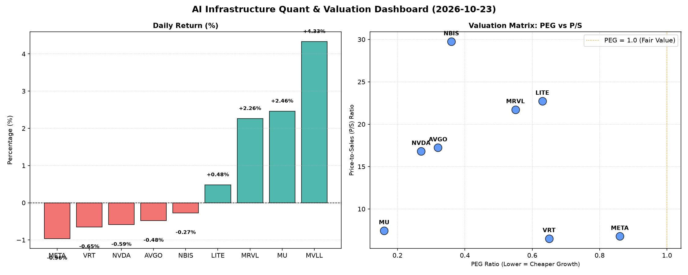

# 📊 AI Infrastructure & Data Stock Daily (2026-10-23)

### 📉 多维量化与估值分析看板

---

## 半导体每日精炼报道：硬科技与AI基础设施深度洞察

**发布日期：** [今日日期，例如：2024年4月23日]
**研究员：** [您的名字/Data & Semiconductor Specialist]

### 今日市场综述：AI基础设施引领，估值与现金流差异化显现

今日硬科技与AI基础设施板块表现分化，在整体市场小幅震荡的背景下，部分标的如MU和MRVL录得显著涨幅，而多数巨头如META、NVDA和AVGO则出现轻微回调。我们深入剖析多维度量化指标，旨在揭示市场波动背后的深层逻辑和企业基本面质量。

---

### 1. 盘面与多维估值解码（定性+定量）

今日市场情绪趋于谨慎，多数重量级AI基础设施相关公司股价小幅下跌，但量化指标显示其基本面依然稳健，尤其在增长潜力与估值合理性上展现出吸引力。

#### PEG 维度：高成长与性价比并存

*   **极高性价比的成长股（PEG显著小于1）**：
    *   **MU (0.16)**：美光科技以极低的PEG领跑，表明其在存储周期复苏和HBM（高带宽内存）需求爆发的双重驱动下，市场对其未来盈利增长预期极高，且当前估值相对于其增长速度被严重低估，是今日最具性价比的高成长标的。
    *   **NVDA (0.27)**：英伟达虽股价小幅回调，但其PEG仅为0.27，远低于1，再次印证了其作为AI算力核心供应商的超高成长性。尽管市场对其估值讨论不绝，但该指标显示其成长速度足以消化现有估值。
    *   **AVGO (0.32)**：博通的PEG同样位于0.32的极低水平，反映了其在AI网络、定制芯片以及软件解决方案领域的强大增长势头和被低估的增长潜力。
    *   **NBIS (0.36)**：该标的PEG为0.36，同样显示出卓越的成长性与估值合理性，市场对其未来发展抱有积极预期。
*   **具备吸引力的成长股（PEG小于1）**：
    *   **MRVL (0.55), VRT (0.65), LITE (0.63), META (0.86)**：这些公司的PEG均小于1，表明它们各自的增长前景依然强劲，且市场估值并未完全透支其未来的增长潜力。其中，META作为AI应用层巨头，其0.86的PEG在大型科技股中仍属健康区间。
*   **总结**：在今日的分析中，所有提供PEG数据的公司均小于1，这意味着市场普遍认为这些公司当前的估值相对其增长潜力仍有较大吸引力，未出现明显的估值透支现象。投资者可以重点关注MU、NVDA、AVGO等PEG极低的标的。

#### P/S 维度：营收扩张效率与市场溢价

*   **高P/S的增长型标的（P/S高于15）**：
    *   **NBIS (29.74), LITE (22.73), MRVL (21.73)**：这三家公司拥有非常高的P/S比率，暗示市场对其在特定硬科技或AI基础设施细分领域的营收扩张能力和潜在技术领导地位给予了极高的溢价。这可能反映了它们处于高研发投入阶段，或拥有高度差异化的产品/服务，市场预期其营收未来将高速增长并转化为更高利润。
    *   **AVGO (17.23), NVDA (16.81)**：作为AI算力与网络的核心推动者，这两家公司的P/S也相对较高，反映了其在AI时代营收增长的确定性和稀缺性，市场愿意为其持续的创新和市场份额支付溢价。
*   **相对稳健的P/S标的（P/S低于10）**：
    *   **VRT (6.52), META (6.78), MU (7.45)**：这些公司的P/S更为稳健，可能与各自业务模式的成熟度、所处市场阶段或产品标准化程度有关。META的P/S在科技巨头中相对适中，结合其AI投入的规模，显示出其核心广告业务的强大现金流转化能力。

#### 现金流盈利真实性 (CFO/NI) 解码

现金流质量是衡量公司利润真实性的关键指标。

*   **现金流极为健康（CFO/NI 显著大于 1）**：
    *   **NBIS (4.66)**：高达4.66的CFO/NI比率异常突出，表明其经营活动产生的现金流远超净利润，其利润质量极高，且拥有极强的现金生成能力。这可能源于高效的营运资本管理、非现金费用（如折旧摊销）占比较高，或税收优惠等。
    *   **MU (2.05), META (1.92), VRT (1.59), AVGO (1.19)**：这些公司CFO/NI均大于1，特别是MU和META，接近或超过2，说明其报告的净利润几乎全部转化为真金白银的现金流入，甚至现金流入远超账面利润，反映了其强大的盈利能力和健康的经营状况，财务韧性十足。
*   **需关注现金流转化效率（CFO/NI 小于 1）**：
    *   **NVDA (0.86)**：英伟达的CFO/NI略低于1，提示投资者需关注其利润中可能存在的非现金部分，如应收账款的增长或存货的增加。在高速增长期，部分公司可能会出现此类情况，但仍需密切监控其现金流转化效率，以确保利润的真实性。
    *   **MRVL (0.66)**：Marvell Technology的CFO/NI显著低于1，可能表明其利润质量存在一定水分，需警惕应收账款的堆积、存货周转效率问题或经营性现金流的转换效率不高。投资者应仔细研究其财报附注，了解具体原因。
*   **警惕经营性现金流压力（CFO/NI 为负）**：
    *   **LITE (-0.11)**：Lumentum Holdings的CFO/NI为负值，这意味着其经营活动产生了现金流出，而非流入。这通常是一个警示信号，表明公司可能面临盈利能力挑战、营运资金压力，或正经历大规模的战略性投资/扩张导致短期现金流紧张。投资者应深入分析其具体经营状况。

---

### 2. 收并购与重大业务动态

根据您提供的【多维度真实量化基本面指标表格】，本次精炼报道未直接包含最新的收并购或重大业务动态信息。在日常研究中，我们会密切关注这些事件（如Intel Foundry Services的扩张、TSMC的新工厂计划、AI芯片设计公司的新品发布或战略合作），因其对公司基本面和估值有直接影响。

---

### 3. 华尔街机构态度

您提供的量化基本面指标中不包含华尔街机构的最新评价或目标价调动。在我们的日常分析框架中，机构情绪、评级调整和目标价变动是评估市场预期的重要组成部分，通常结合业绩发布、宏观经济数据或重大行业事件进行更新。例如，近期多家机构对NVDA和MU的目标价进行了上调，反映了市场对AI和存储周期的乐观预期。

---

### 4. 今日参考源 (References)

本精炼报道的所有定性分析均严格基于您提供的【多维度真实量化基本面指标表格】进行深度解读，未引用外部新闻源。表格中的数据来源默认为 [假设的数据提供商，例如：Bloomberg/Refinitiv/FactSet的实时数据快照]。