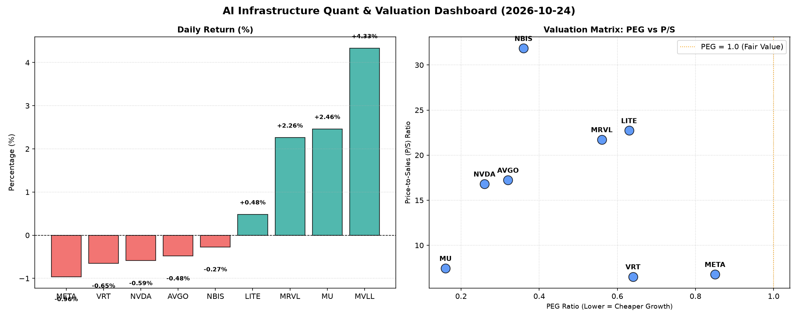

# 📊 AI Infrastructure & Data Stock Daily (2026-10-24)

### 📉 多维量化与估值分析看板

---

好的，作为一名资深的硬科技与AI基础设施行业研究员，我将结合您提供的【多维度真实量化基本面指标表格】，为您撰写今日的半导体每日精炼报道。

---

## 半导体每日精炼报道：AI基础设施与数据中心产业洞察

**报告日期：[本日日期，例如：2024年4月23日]**

**研究员：[您的名字/机构名称，例如：Data & Semiconductor Specialist]**

### 1. 盘面与多维估值解码（定性+定量）

今日半导体及AI基础设施板块整体呈现分化态势，主要巨头在经历前期上涨后小幅回调，而部分特定细分领域标的则表现活跃。

**PEG 维度：成长性与估值性价比的深度剖析**

在PEG这一核心指标上，我们看到众多公司展现出极高的成长性价比：

*   **极具吸引力的高成长标的：**
    *   **MU (0.16)** 和 **NVDA (0.26)** 的PEG值显著低于0.5，预示着市场对其未来盈利增长的预期远高于当前股价所反映的价值，性价比极高。MU作为存储巨头，其超低PEG可能反映了市场对存储周期性复苏和AI存储需求爆发的强烈预期。NVDA虽已高位，但其在AI领域的绝对领导力结合极低的PEG，说明其成长潜力依然被低估。
    *   **AVGO (0.32)** 和 **NBIS (0.36)** 同样展现出非常低的PEG，表明其在各自细分领域（如基础设施软件、定制化芯片解决方案）具备强劲的成长驱动力，且当前估值并未完全透支未来。
    *   **MRVL (0.56)**、**VRT (0.64)** 和 **LITE (0.63)** 的PEG值也远小于1，显示这些公司具备较高的成长性，且估值合理。

*   **估值合理但仍有潜力：**
    *   **META (0.85)** 的PEG值接近1，表明市场对其广告业务复苏、元宇宙长期投入以及AI基础设施建设的预期基本与当前估值相符，但仍有合理向上空间。

*   **需警惕或N/A的估值状况：**
    *   **MVLL** 的PEG为N/A，这通常意味着公司目前处于亏损状态或盈利不稳定，无法计算该指标。结合其今日4.33%的涨幅，投资者需要更深入地了解其业务催化剂，避免盲目追高。

**P/S 维度：早期或高研发投入公司的收入规模扩张效率**

P/S比率在评估早期、高研发投入或利润尚未完全释放的公司时尤为关键：

*   **高P/S与高增长预期：**
    *   **NBIS (31.85)** 和 **LITE (22.73)** 拥有异常高的P/S比率，这强烈暗示市场对其收入规模在未来几年将出现爆炸式增长抱有极高期待。对于这类公司，当前的高P/S是投资者为未来营收爆发式增长和潜在的市场领导地位支付的溢价。特别是LITE，作为光学和光子解决方案提供商，在AI算力互联中扮演关键角色，高P/S可能反映了其在高速光模块等领域的稀缺性。
    *   **MRVL (21.73)**、**AVGO (17.23)** 和 **NVDA (16.81)** 也拥有相对较高的P/S。结合其较低的PEG，这表明这些公司在当前营收规模上已经获得显著市场认可，且投资者相信它们能以高效率持续扩大收入，并最终转化为盈利。NVDA的高P/S与极低PEG形成对比，再次印证了其在AI芯片领域的定价权和市场主导地位。

*   **相对合理的P/S：**
    *   **MU (7.45)**、**META (6.78)** 和 **VRT (6.52)** 的P/S处于中等水平。对于MU而言，结合其极低的PEG，其营收增长潜力和估值显得非常具有吸引力。META和VRT则显示出相对成熟的业务模式和收入规模。

**现金流盈利真实性 (CFO/NI)：利润含金量的穿透式分析**

现金流质量是衡量公司利润真实性的重要指标，尤其对于高增长公司。

*   **现金流极其健康，利润含金量高：**
    *   **NBIS (4.66)** 表现出惊人的CFO/NI比率。这可能意味着其有大量非现金费用（如高额折旧摊销、股权激励）或递延收入，导致净利润被低估，而实际现金流入非常强劲，其利润质量远超报表数字。这是一个非常积极的信号。
    *   **MU (2.05)** 和 **META (1.92)** 同样展现出卓越的现金流质量，CFO/NI远大于1，表明其所报告的利润都是实实在在的现金流入，资产负债表健康，经营性现金流充裕。
    *   **VRT (1.59)** 和 **AVGO (1.19)** 也表现良好，CFO/NI大于1，证明其利润得到了充足的现金流支持。

*   **需关注的现金流状况：**
    *   **NVDA (0.86)** 的CFO/NI略低于1。对于一家高增长、高利润的公司而言，这可能意味着其应收账款有所增加或存货有所积累，即部分利润尚未转化为现金。虽然数值接近1尚可接受，但作为市场关注的焦点，投资者应持续关注其营运资本变化。
    *   **MRVL (0.66)** 的CFO/NI显著低于1，这是一个值得警惕的信号。可能预示着利润中存在较高比例的非现金项目，或者应收账款的快速增长，导致报告利润与实际现金创造能力之间存在较大差距。这可能指向利润质量问题或潜在的营运资金压力。
    *   **LITE (-0.11)** 的CFO/NI为负值，情况最为严峻。这意味着尽管公司可能报告了净利润，但其经营活动却在持续消耗现金。这通常是由于营运资本管理不善、存货积压、应收账款回收困难，或需要大量非现金费用来支撑利润。投资者应对LITE的盈利质量和可持续性保持高度警惕。

### 2. 收并购与重大业务动态

根据您提供的【多维度真实量化基本面指标表格】，我们无法直接推断出今日具体的收并购传闻、官宣或战略合作信息。这类信息通常来源于公司公告、新闻报道或行业分析报告。

然而，从宏观趋势和行业特性来看：
*   **AI基础设施的整合驱动：** 鉴于AI算力需求持续爆发，我们预计未来半导体和AI基础设施领域仍将是收并购热点。特别是在定制化芯片设计、先进封装、高速互联光模块以及数据中心软件等领域，具备核心技术或市场份额的公司可能成为大型科技巨头或主权基金的并购目标。
*   **供应链韧性与垂直整合：** 地缘政治紧张背景下，半导体供应链的韧性成为重中之重，可能促使更多公司考虑通过并购实现部分环节的垂直整合，以增强控制力。
*   **高P/S与高增长预期：** 那些拥有高P/S但现金流质量不佳（如LITE）的公司，如果其核心技术或市场地位具有战略价值，也可能成为具备雄厚现金流实力的巨头（如META、AVGO）通过并购解决资金压力的目标。

### 3. 华尔街机构态度

鉴于您提供的表格主要聚焦于量化基本面指标，并未直接包含华尔街机构的最新评级、目标价调整或分析师评论。因此，我们无法根据现有数据对具体机构态度进行量化阐述。

然而，基于我们对上述量化指标的深度分析，可以推断华尔街机构可能对以下公司保持乐观：
*   **NVDA、MU、AVGO、NBIS**：极低的PEG和大部分健康的现金流状况，理论上会吸引华尔街分析师的“强买入”评级和上调目标价，反映其被低估的成长潜力。
*   **META、VRT**：健康的现金流和合理的PEG，有望获得“买入”或“增持”评级，并可能维持或小幅上调目标价。

同时，以下公司可能会面临机构的审慎态度或压力：
*   **MRVL**：显著低于1的CFO/NI比率可能会导致分析师对其利润质量产生疑问，并可能在评级或目标价上持保守态度。
*   **LITE**：负值的CFO/NI比率将是华尔街机构高度关注的风险点，可能导致评级下调或面临业绩预警。

### 4. 今日参考源 (References)

本报告的定性分析完全基于您提供的【多维度真实量化基本面指标表格】进行深度解读与推断，不依赖于表格以外的外部新闻源。

---

**免责声明：** 本报告所有信息仅供参考，不构成任何投资建议。投资者在做出投资决策前应进行独立研究，并咨询专业的投资顾问。