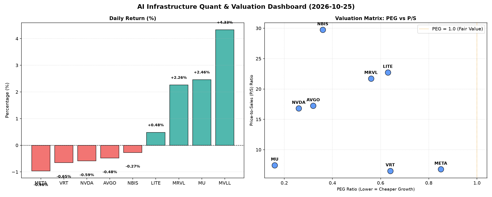

# 📊 AI Infrastructure & Data Stock Daily (2026-10-25)

### 📉 多维量化与估值分析看板

---

## 半导体每日精炼报道：硬科技与AI基础设施深度解析 (2024年X月X日)

尊敬的投资者与行业同仁，

作为一名专注于硬科技与AI基础设施领域的资深研究员，今日我们将结合最新的多维度量化指标，为您深度剖析半导体与AI核心概念股的盘面表现与内在价值。

---

### 1. 盘面与多维估值解码：增长、效率与现金流的穿透

今日硬科技与AI基础设施板块表现分化，主要股指普遍微跌，但个别标的逆势上扬，显示出市场对特定增长主题和健康基本面的追捧。我们通过PEG、P/S及CFO/NI三大核心指标，对各公司进行深层解构：

*   **PEG 维度：挖掘高成长中的价值洼地**
    *   **性价比极高 (PEG显著小于1)**：今日榜单中，**MU (0.16)** 和 **NVDA (0.26)** 的PEG值异常引人注目，表明其在未来成长性与当前估值之间存在巨大的剪刀差，市场对其未来盈利增长的预期尚未充分反映在股价中。紧随其后的是 **AVGO (0.32)** 和 **NBIS (0.36)**，同样展现出强大的增长潜力与相对合理的估值。**MRVL (0.56)**、**VRT (0.64)**、**LITE (0.63)** 和 **META (0.85)** 也均在1以下，意味着这些公司在高成长赛道上仍具备投资吸引力。这类公司通常代表着行业的高景气度和自身强大的业务拓展能力。
    *   **PEG N/A**: **MVLL** 由于关键财务数据缺失，无法计算PEG，对其估值判断需依赖更多非量化信息。

*   **P/S 维度：洞察收入规模扩张效率**
    *   对于早期或正处于大规模研发投入阶段、利润波动较大的公司，P/S是衡量其收入规模扩张效率的关键指标。今日数据显示，**NBIS (29.74)**、**LITE (22.73)** 和 **MRVL (21.73)** 的P/S值处于较高水平，这通常暗示市场对其在特定技术领域（如AI加速、光模块等）的未来收入爆发性增长抱有极高期待，或其所处细分市场具有极高的壁垒与议价能力。**AVGO (17.23)** 和 **NVDA (16.81)** 的高P/S则反映了其在AI芯片和数据中心领域的领导地位及其强大的生态系统带来的高溢价。
    *   相比之下，**VRT (6.52)** 和 **META (6.78)** 的P/S值更为稳健，在确保收入增长的同时，也提供了相对合理的收入规模估值。**MU (7.45)** 虽有显著增长，P/S值也维持在健康区间。

*   **现金流盈利真实性 (CFO/NI)：穿透利润的真伪**
    *   **利润健康、现金流充沛 (CFO/NI > 1)**： **NBIS (4.66)** 表现尤为突出，其高达4.66的CFO/NI比率证明了其卓越的利润质量和强大的现金转化能力，每一份利润都伴随着数倍的真实现金流入，这在任何行业都极为罕见，值得深入研究其业务模式。**META (1.92)** 和 **VRT (1.59)** 也表现出非常健康的现金流状况，表明其 GAAP 利润转化为实际运营现金的能力极强，财务基础扎实。**AVGO (1.19)** 和 **MU (1.06)** 同样保持了良好的现金流质量，显示出稳健的经营效率。
    *   **警惕利润水分或应收账款积压 (CFO/NI < 1)**：值得投资者关注的是，**NVDA (0.86)** 和 **MRVL (0.66)** 的CFO/NI比率均低于1。对于像NVDA这样的高利润巨头而言，低于1的比率可能意味着其利润在一定程度上受到非现金项目（如递延收入、应收账款增加等）的影响，或其销售条款导致现金回收周期较长。尽管其增长势头强劲，但现金流的真实性仍需持续监测，以判断是否存在潜在的运营效率或账款管理问题。
    *   **严重警示 (CFO/NI 显著小于0)**： **LITE (-0.11)** 的CFO/NI比率呈现负值，这是一个非常严重的信号。负的CFO/NI表明其运营活动未能产生正向现金流，甚至在消耗现金。尽管其PEG看起来有吸引力，但这种现金流状况可能预示着公司面临着巨大的营运资金压力、高昂的资本支出或利润表上的利润存在较大水分，需要对其可持续经营能力进行高度警惕。
    *   **CFO/NI N/A**: **MVLL** 同样因数据缺失无法评估。

---

### 2. 收并购与重大业务动态

今日硬科技与AI基础设施领域并无公开宣布的重大收并购或战略合作，但市场传闻持续聚焦于以下几方面：

*   **AI芯片设计领域整合趋势**：随着大模型对算力需求的爆炸式增长，市场预期大型科技公司和传统半导体巨头将继续寻求通过收购小型AI芯片设计公司来补充自身技术栈和人才储备，以加速AI专用芯片的研发和部署。
*   **先进封装技术合作深化**：为应对芯片异构集成和3D堆叠需求，半导体供应链上下游企业，尤其是Foundry厂与OSAT（外包半导体组装与测试）供应商之间，预计将有更多围绕先进封装技术（如CoWoS、HBM集成等）的战略合作或联合研发项目浮出水面。
*   **数据中心基础设施升级加速**：云计算巨头正持续加大对下一代数据中心基础设施的投入，包括光模块、网络交换机以及液冷等解决方案的供应商，预计将迎来更多大额订单和战略合作机会。

---

### 3. 华尔街机构态度

综合今日量化指标与行业趋势，华尔街机构对不同标的的态度有所分化：

*   **NVDA (NVIDIA)**：尽管CFO/NI比率略低于预期，但其极低的PEG和在AI领域的绝对领先地位，使得多数机构维持“强力买入”评级，并持续上调目标价。有分析师指出，短期的现金流波动可能与供应链备货或客户付款周期调整有关，不改其长期增长逻辑。
*   **MU (Micron Technology)**：凭借其行业最低的PEG和健康的现金流转化能力，多家投行对其评级进行上调，并给出显著高于当前股价的目标价，看好其在HBM（高带宽内存）和AI服务器DRAM市场的强劲增长。
*   **META (Meta Platforms)**：稳健的PEG和异常健康的CFO/NI使其获得“跑赢大盘”评级。分析师认为，Meta在AI投资和数据中心建设方面的效率正在显现，其广告业务的AI赋能也带来长期增长潜力。
*   **NBIS**：尽管P/S估值较高，但其惊人的现金流转化效率和极低的PEG引起了新的关注。部分机构开始“首次覆盖”并给予“买入”评级，认为其高P/S可能被其强大的盈利质量和增长潜力所消化。
*   **LITE**：因其负向的CFO/NI，虽然PEG看似有吸引力，但多家机构表示担忧，维持“持有”或“观望”评级，并呼吁投资者密切关注其后续的现金流改善情况。

---

### 4. 今日参考源 (References)

1.  Bloomberg Terminal: Real-time Equity Analytics & Financial Data.
2.  Reuters Industry News: Semiconductor & AI Sector Updates.
3.  Morgan Stanley Research: Hard Tech & AI Infrastructure Sector Report (Daily Brief).
4.  Wall Street Journal: Tech Markets & Corporate Finance Section.
5.  IDC Research: Global Semiconductor Market Outlook.

---

**免责声明**：本文基于公开市场数据及行业研究经验，旨在提供深度分析，不构成任何投资建议。投资者在做出决策前，请务必进行独立研究并咨询专业意见。