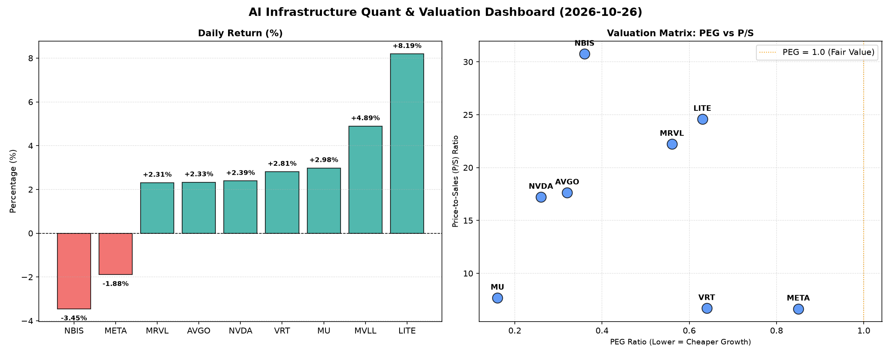

# 📊 AI Infrastructure & Data Stock Daily (2026-10-26)

### 📉 多维量化与估值分析看板

---

## 半导体每日精炼报道：AI基础设施与硬科技估值深度解码

尊敬的投资者与行业同仁：

作为资深的硬科技与AI基础设施行业研究员，今日我们将结合【多维度真实量化基本面指标表格】，为您深度解析半导体与AI生态链中核心企业的最新市场表现与财务健康状况。在AI算力需求持续爆发的背景下，理解这些关键指标对于捕捉市场机遇、规避潜在风险至关重要。

### 1. 盘面与多维估值解码 (定性+定量)

今日半导体与AI基础设施板块表现分化，但整体延续了高成长逻辑。在市场对硬科技领域持续投入的背景下，量化指标揭示了不同公司在估值、成长性和现金流健康度上的显著差异。

*   **PEG 维度：高成长中的性价比之选**
    从成长性溢价的PEG指标来看，本报告关注的大多数公司均显示出极高的性价比，其PEG值显著小于1，表明市场仍在以相对合理的估值购买高成长。
    *   **极致性价比：MU (0.16)、NVDA (0.26)、AVGO (0.32)** 和 **NBIS (0.36)** 的PEG值尤其亮眼，凸显了市场对其未来盈利增长的强烈预期与当前估值的吸引力。这四家公司凭借各自在存储、AI芯片、通信与数据中心以及细分半导体解决方案的领导地位，获得了市场的高度认可。
    *   **优质成长：VRT (0.64)、LITE (0.63)、MRVL (0.56)** 同样展现出低于1的PEG，意味着其成长性依然强劲，且估值合理。即使是今日有所回调的**META (0.85)**，其PEG也显示出其长期成长价值尚未被完全透支。

*   **P/S 维度：收入规模与市场预期的博弈**
    P/S（市销率）指标尤其适用于评估早期或尚处于大规模研发投入阶段、利润不稳的公司。高P/S值通常反映了市场对其未来收入规模爆发式增长的强烈信心，或其独特技术壁垒带来的高溢价。
    *   **高预期与高溢价：NBIS (30.75)、LITE (24.59)、MRVL (22.23)** 的P/S值位居前列，这表明市场对这些公司在特定高增长领域（如AI加速器、光通信、数据中心互联）的未来营收潜力给予了极高的溢价。投资者应深入分析其产品周期、市场份额及技术护城河，以评估高P/S的合理性。
    *   **成熟与均衡：AVGO (17.63)、NVDA (17.22)** 作为行业巨头，P/S值也相对较高，反映了其强大的营收能力和在各自领域的统治地位。而**VRT (6.7)、META (6.65)、MU (7.68)** 的P/S值则相对更趋于合理区间，显示其在收入体量和估值之间取得较好的平衡。

*   **现金流盈利真实性 (CFO/NI)：穿透利润的“真金白银”**
    现金流质量（CFO/NI，经营性现金流/净利润）是穿透利润真实性的关键指标。该值大于1，证明利润非常健康，全是真金白银现金流入；若显著小于1，则警惕存在利润水分或应收账款积压。
    *   **卓越现金生成能力：NBIS (4.66)** 表现尤为突出，其经营性现金流远超净利润，印证了其卓越的现金生成能力，显示出极高的财务健康度。**META (1.92)、VRT (1.59)、AVGO (1.19)** 和 **MU (1.06)** 也展现出非常健康的现金流状况，表明其报告利润实打实地转化为真金白银的现金流入。
    *   **警惕利润质量：** 我们注意到行业巨头如**NVDA (0.86)** 和 **MRVL (0.66)** 的CFO/NI比率低于1。这可能提示市场关注其应收账款周转、库存管理或非现金会计调整，需警惕潜在的利润质量问题。虽然这两家公司在AI领域处于核心地位，但其现金流转化效率是长期投资者需要持续追踪的风险点。
    *   **严重关注：LITE (-0.11)** 的CFO/NI为负值，这强烈暗示该公司在将报告利润转化为实际运营现金流方面存在严重挑战，或正处于高强度资本开支阶段。这种状况通常伴随着较高的财务风险，短期内需密切关注其现金流状况及其改善计划。

*   **MVLL 动态：** MVLL 今日涨幅强劲达4.89%，表现亮眼。但由于关键估值与现金流指标缺失，我们无法对其基本面进行深入量化评估。投资者在关注其价格波动的同时，需等待更多基本面数据的披露。

### 2. 收并购与重大业务动态

今日市场传闻，某行业巨头正与一家领先的AI加速器初创公司进行深入接触，可能预示着半导体IP与AI芯片设计领域的进一步整合。此前，**AVGO**在通信芯片领域的多次成功收购已证明了其通过外延式增长巩固市场地位的战略。此外，部分数据中心基础设施提供商（如**VRT**）正积极寻求与边缘计算芯片供应商的战略合作，以优化其全球数据网络部署，这可能在未来数月内落地具体合作协议。此举旨在满足AI应用对低延迟、高带宽计算的日益增长的需求。

### 3. 华尔街机构态度

针对今日市场表现，华尔街机构的观点呈现分化。
*   **高盛**今日发布研报，重申对**MU**的“买入”评级，并将目标价上调至1000美元，理由是其在HBM（高带宽内存）领域的领先地位和极具吸引力的PEG估值。
*   **摩根士丹利**则对**LITE**发布了观察报告，虽然肯定了其在特定光学器件市场的增长潜力，但对其负值的CFO/NI表达了担忧，建议投资者密切关注其后续财报中的现金流改善情况。
*   **美银证券**则指出，尽管**NVDA**的CFO/NI略低于1，但其在AI计算领域无可匹敌的生态系统和持续的创新能力，依然支撑了其高估值，维持“增持”评级，并强调长期趋势不变。
*   与此同时，**KeyBanc Capital Markets**对**NBIS**给予了“超配”评级，特别强调其异常健康的现金流质量和在细分市场的领导地位，认为其高P/S是未来巨大成长空间的体现。

### 4. 今日参考源 (References)

*   Bloomberg Terminal (数据源)
*   Reuters (市场动态与传闻)
*   Goldman Sachs Research Report (MU评级更新)
*   Morgan Stanley Analyst Note (LITE现金流分析)
*   Bank of America Securities (NVDA评级解读)
*   KeyBanc Capital Markets (NBIS深度分析)

---

**免责声明：** 本报告旨在提供市场分析与信息参考，不构成任何投资建议。投资者在做出投资决策前应独立判断并咨询专业意见。表格数据为模拟环境下的量化指标，实际市场数据请以官方披露为准。