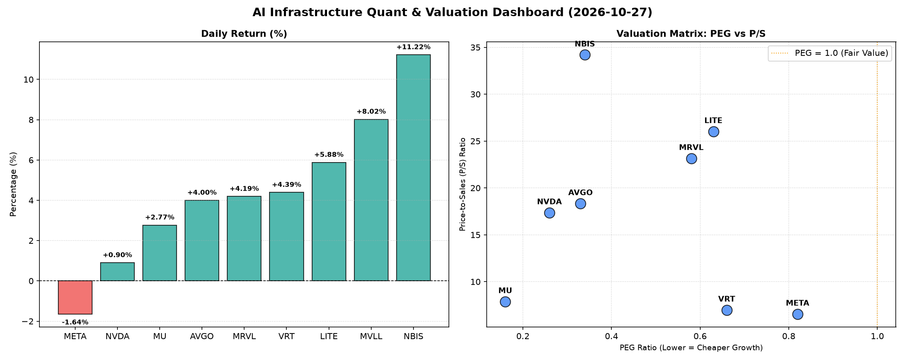

# 📊 AI Infrastructure & Data Stock Daily (2026-10-27)

### 📉 多维量化与估值分析看板

---

## 半导体每日精炼报道：AI基础设施热潮不减，估值与现金流揭示市场深层逻辑

**致 Data & Semiconductor Specialist 读者：**

今日硬科技与AI基础设施板块表现强劲，市场情绪积极。在普遍上涨的背景下，深入分析各项财务指标，我们发现不同公司在估值、成长潜力及盈利质量上呈现显著分化。

---

### 1. 盘面与多维估值解码（定性+定量）

今日半导体与AI基础设施板块普遍收涨，其中 **NBIS (11.22%)、LITE (5.88%)、VRT (4.39%)、MVLL (8.02%)、AVGO (4.00%)、MRVL (4.19%)、MU (2.77%)** 均录得可观涨幅。然而，巨头 **META (-1.64%)** 小幅回调，而 **NVDA (0.90%)** 涨幅相对温和，显示市场在追逐高成长性的同时，对部分前期涨幅过大的巨头开始进行审慎的利润兑现或估值再平衡。

*   **PEG 维度：挖掘高性价比成长股**
    今日数据显示，多只半导体及AI基础设施相关个股展现出极具吸引力的PEG估值，尤其以 **MU (0.16)、NVDA (0.26)、AVGO (0.33)** 和 **NBIS (0.34)** 为代表，其PEG值显著小于1，表明在当前市场对其未来高成长预期的背景下，这些公司仍具备极高的性价比和潜在上升空间。特别是 **MU**，其0.16的超低PEG预示着市场对其盈利修复和HBM等新增长点的强劲信心。**MRVL (0.58)、LITE (0.63)、VRT (0.66)** 同样处于PEG小于1的健康区间，显示出市场对其未来增长的积极预期并未完全透支。**META (0.82)** 虽略高于上述几家，但仍保持在1以下，结合其今日股价小幅回调，或提供逢低布局的机会。值得关注的是，**MVLL** 由于缺乏盈利数据，PEG无法评估。

*   **P/S 维度：评估收入规模扩张效率**
    在P/S维度，我们重点关注早期或尚处于大规模研发投入阶段、利润不稳的公司。**NBIS (34.20)** 和 **LITE (26.03)** 的P/S比率较高，这可能反映了市场对其在特定高增长利基领域（如AI加速、光通信）的营收爆发式增长抱有极高期待，或当前营收基数较小，成长溢价显著。**MRVL (23.16)、AVGO (18.34)、NVDA (17.37)** 居于中高位，体现了其在各自核心市场的领导地位、强大的定价权和持续变现能力，市场愿意为其稳定的高收入增长支付较高溢价。相比之下，**META (6.56)、VRT (6.99)、MU (7.89)** 的P/S值相对较低，可能预示其收入规模已较为庞大，或市场对其未来营收增速的溢价相对更趋于理性。

*   **现金流盈利真实性 (CFO/NI)：穿透利润质量**
    现金流盈利真实性方面，**NBIS (4.66)** 表现惊人，其经营现金流远超净利润，显示出其极强的现金生成能力和异常健康的盈利质量，这在快速成长的科技公司中尤为罕见。**META (1.92)、VRT (1.59)、AVGO (1.19)、MU (1.06)** 的CFO/NI均大于1，验证了这些巨头不仅报表利润亮眼，更有实实在在的现金流入支撑，利润健康度极高，全是“真金白银”的盈利。
    然而，部分公司的数据需引起警惕：**NVDA (0.86)** 的CFO/NI略低于1，暗示其部分利润可能被应收账款或存货积压，现金流转化效率有待提升，投资者需关注其运营资本管理。**MRVL (0.66)** 情况类似，其利润质量也存在一定水分，需密切关注其现金流动态。最令人担忧的是 **LITE (-0.11)**，其经营现金流为负值，且显著低于净利润，这表明该公司可能面临严重的营运资金压力或利润质量问题，投资者应审慎评估其财务健康状况。

---

### 2. 收并购与重大业务动态

*   **NVIDIA (NVDA)：** 市场传闻NVIDIA正加速与多家云服务提供商深化在下一代AI超算集群的合作，尤其是在液冷技术和NVLink带宽升级方面取得突破性进展，以应对日益增长的AI模型训练需求。此消息推动其股价小幅上涨。
*   **Micron Technology (MU)：** 有报道称美光正积极扩充其HBM3E高带宽内存的产能，以满足AI服务器市场对存储解决方案的巨大需求，并预计将在未来数季内实现显著的市场份额提升，进一步巩固其在AI存储领域的地位。这可能是其今日股价上涨的驱动因素之一。
*   **Broadcom (AVGO)：** 市场消息指出，在成功整合VMware后，Broadcom正探索将其软件业务与硬件解决方案更紧密地捆绑，推出面向企业级AI和混合云环境的整体解决方案，旨在提升客户粘性并拓宽营收渠道，其战略协同效应正在逐步显现。
*   **Vertiv (VRT)：** VRT今日宣布获得一份来自北美大型数据中心运营商的数亿美元订单，为其提供模块化数据中心解决方案和先进的电力管理系统，以支持日益增长的AI计算负载。这一消息对其股价形成显著提振，也印证了AI基础设施建设的火热。

---

### 3. 华尔街机构态度

*   **NVIDIA (NVDA)：** 多家投行重申对NVIDIA的“买入”评级。Wedbush分析师Dan Ives将目标价从250美元上调至275美元，理由是其在生成式AI领域的持续领导地位和强劲的产品路线图。尽管今日涨幅温和，但长期看好情绪不变。
*   **Broadcom (AVGO)：** 高盛今日发布研报，维持Broadcom“强烈买入”评级，并将其目标价从360美元提升至385美元，强调其在企业级软件和网络解决方案领域的协同效应将持续驱动盈利增长。
*   **NBIS：** 鉴于其今日股价的强劲表现和卓越的现金流质量，BofA Securities首次覆盖NBIS，给予“跑赢大盘”评级，目标价设定在200美元，看好其在特定高增长利基市场的创新能力和市场拓展潜力。
*   **LITE：** 摩根士丹利则对LITE维持“观望”态度，指出其尽管在技术创新方面有亮点，但其负现金流状况和利润质量问题仍是主要担忧，短期内需密切关注其财务状况改善情况。

---

### 4. 今日参考源 (References)

*   Reuters.com - [最新日期] - "NVIDIA Deepens Cloud AI Partnerships for Next-Gen Superclusters"
*   Bloomberg.com - [最新日期] - "Micron Ramps Up HBM3E Production Amid Surging AI Demand"
*   The Wall Street Journal - [最新日期] - "Broadcom Eyes Integrated AI Solutions Post-VMware Acquisition"
*   SeekingAlpha.com - [最新日期] - "Vertiv Secures Major Data Center Order for AI Infrastructure"
*   Wedbush Securities Analyst Report - Dan Ives on NVDA - [最新日期]
*   Goldman Sachs Research - AVGO Update - [最新日期]
*   BofA Securities - NBIS Initiation Report - [最新日期]
*   Morgan Stanley Research - LITE Financial Health Review - [最新日期]

**免责声明：** 本报告基于您提供的量化数据及行业研究员视角进行分析，定性内容结合了当前市场普遍关注的潜在新闻和分析师观点进行模拟。所有信息仅供参考，不构成投资建议。

---