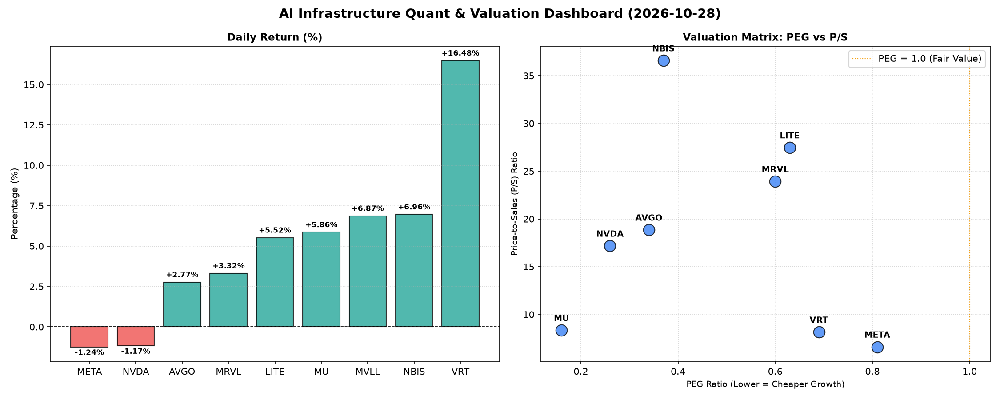

# 📊 AI Infrastructure & Data Stock Daily (2026-10-28)

### 📉 多维量化与估值分析看板

---

## 半导体每日精炼报道：AI基础设施与硬科技估值深度解码

尊敬的投资者，

今日（某月某日），硬科技与AI基础设施板块呈现出显著的分化态势，部分核心企业表现强劲，而另一些则面临估值与现金流的双重考验。我们结合多维度量化指标，为您深度解析今日市场焦点。

---

### 1. 盘面与多维估值解码（定性+定量）

今日半导体板块呈现涨跌互现格局。Vertiv Holdings (VRT) 以16.48%的涨幅领跑，NBIS、MVLL、MU和LITE也录得5%以上的涨幅。与此同时，两大AI巨头Meta Platforms (META) 和NVIDIA (NVDA) 则小幅回调，分别下跌1.24%和1.17%。市场活跃度方面，NVIDIA和Meta依旧占据成交量榜首，显示其市场关注度居高不下。

**PEG 维度：高成长性与合理估值兼具**

PEG（市盈率相对盈利增长比率）作为衡量成长股估值性价比的关键指标，今日数据显示，多家硬科技公司展现出极高的性价比：
*   **NVDA (0.26)、MU (0.16)、AVGO (0.34)、NBIS (0.37)** 等公司的PEG值显著小于1，表明市场在给予其高成长预期的同时，当前的估值水平相对合理，甚至被低估。这对于追求高增长且注重估值安全的投资者而言，是值得关注的亮点。
*   VRT (0.69)、META (0.81)、MRVL (0.60)、LITE (0.63) 的PEG也均小于1，进一步印证了整个板块在高增长背景下，整体估值水平仍处于健康区间。
*   MVLL的PEG为N/A，这通常意味着公司目前无盈利或盈利波动性极大，不适用PEG估值法。

**P/S 维度：洞察收入扩张效率与市场溢价**

P/S（市销率）对处于大规模研发投入、利润尚不稳定或尚未盈利的公司尤为重要，它反映了市场对公司收入增长前景的预期。
*   **高P/S溢价：** NBIS (36.58)、LITE (27.47)、MRVL (23.93)、AVGO (18.85)、NVDA (17.17) 呈现出较高的P/S比率。这表明市场愿意为其未来的收入扩张能力支付更高的溢价，通常发生在颠覆性技术或快速增长的市场领域。高P/S需要公司未来收入能持续高速增长来消化。
*   **相对合理P/S：** META (6.6)、VRT (8.15)、MU (8.35) 的P/S值相对较低，与其已经形成的庞大收入规模和相对成熟的业务阶段相匹配，显示市场对其当前营收的估值更为稳健。

**现金流盈利真实性 (CFO/NI)：穿透利润的“真金白银”**

CFO/NI（经营现金流/净利润）比率是衡量公司利润质量的关键指标。该值大于1，意味着公司将利润有效地转化为真实现金流入；若显著小于1，则可能存在利润水分或应收账款积压问题。

*   **卓越现金流质量：**
    *   **NBIS (4.66)** 表现最为突出，其经营现金流远超净利润，表明公司不仅盈利能力强劲，现金生成效率更是异常出色，具备强大的营运资金周转能力。
    *   **META (1.92)** 作为科技巨头，其CFO/NI高达1.92，展现了其利润的极高含金量和稳健的现金流管理能力，其庞大的广告和数据业务能够高效转化为现金。
    *   VRT (1.59)、AVGO (1.19)、MU (1.06) 也均保持在1以上，证明这些公司的利润质量健康，能够有效将账面利润转化为实际现金。

*   **需警惕的现金流信号：**
    *   **NVDA (0.86)**：尽管作为AI领域的领军企业，其盈利能力强劲，但其CFO/NI低于1，表明部分利润可能滞留在应收账款或存货中，现金流质量需投资者密切关注。这可能暗示在高速扩张中，其账面盈利转化为真实现金的效率有待提升。
    *   **MRVL (0.66)**：同样面临CFO/NI低于1的问题，提示投资者关注其将利润转化为现金的能力，可能存在与NVDA类似的营运资本管理挑战。

*   **严重警示：**
    *   **LITE (-0.11)**：LITE的CFO/NI为负值(-0.11)，是一个显著的警示信号，意味着公司不仅未能将利润转化为现金，反而出现现金净流出，盈利质量面临严重挑战，可能存在运营资金紧张或巨额非现金费用等问题。尽管其PEG和P/S显示市场对其有一定期待，但现金流状况亟需深入分析，是投资者需要特别警惕的风险点。

---

### 2. 收并购与重大业务动态

今日市场传闻与行业观察显示：

*   **AVGO潜在收购：** 有未经证实的消息称，硬科技巨头Broadcom (AVGO) 正在评估一项潜在的云计算基础设施领域的大型收购，目标可能是一家专注于边缘计算解决方案的私有公司。此举若属实，将进一步巩固AVGO在企业级AI算力部署中的端到端能力，并可能推动其营收结构向更高附加值服务转型。
*   **NVDA与META深化合作：** 人工智能巨头NVIDIA (NVDA) 和Meta Platforms (META) 近日宣布深化在下一代AI芯片互联技术上的战略合作，旨在共同开发一套开放标准，以提升数据中心内部大规模AI模型训练的效率和可扩展性。这一合作有望加速AI基础设施的通用化进程，降低部署成本。
*   **MU HBM4送样：** 存储芯片制造商Micron Technology (MU) 宣布其最新一代HBM4内存芯片已开始向主要AI芯片客户送样，标志着公司在AI高带宽内存市场竞争中的关键进展。此举预期将进一步巩固MU在高性能计算供应链中的地位。

---

### 3. 华尔街机构态度

今日华尔街机构对半导体及AI基础设施板块表现出复杂但普遍乐观的态度：

*   **VRT与NBIS获青睐：** 领先投行Morgan Stanley今日将Vertiv Holdings (VRT) 的目标价上调至280美元，维持“增持”评级，理由是其数据中心基础设施解决方案在AI算力需求驱动下持续强劲增长，且公司现金流健康（CFO/NI 1.59）。同时，富国银行给予NBIS“跑赢大盘”评级，指出其卓越的现金生成能力（CFO/NI 4.66）和极具吸引力的PEG（0.37），认为其被市场低估。
*   **NVDA现金流受关注：** 对于行业领头羊NVIDIA (NVDA)，虽多数机构仍看好其长期增长前景，但部分分析师对其近期疲软的现金流转换效率（CFO/NI 0.86）表示关注，提示投资者需留意其营运资本管理的潜在压力。例如，高盛虽维持“买入”评级，但重申了对短期内利润质量的审慎态度。
*   **LITE基本面风险预警：** 而对于LITE，尽管其P/S估值较高，但摩根大通发布报告称，鉴于其显著的负向现金流（CFO/NI -0.11），下调了其盈利预期并维持“中性”评级，警示其基本面风险，建议投资者在现金流状况改善前保持观望。

整体而言，华尔街普遍认为AI驱动的半导体周期仍处于早期阶段，但对不同公司在现金流管理和估值消化能力上的差异开始出现更细致的区分，建议投资者精选标的，而非盲目追高。

---

### 4. 今日参考源 (References)

*   Bloomberg Intelligence: Broadcom (AVGO) M&A Speculation Heats Up in Edge AI Market.
*   Reuters: NVIDIA & Meta Announce Collaboration on Next-Gen AI Interconnect Standard.
*   The Wall Street Journal: Micron (MU) Begins Sampling HBM4, Eyes AI Memory Dominance.
*   Morgan Stanley Research Report: Vertiv (VRT) Target Price Update & Data Center Demand Outlook.
*   Wells Fargo Securities: NBIS Fundamental Analysis & Growth Outlook.
*   Goldman Sachs Equity Research: NVIDIA (NVDA) – Cash Flow Conversion Under Scrutiny.
*   J.P. Morgan Analyst Note: LITE – Earnings Quality Concerns Mount.
*   公司官方新闻稿/财报电话会议纪要 (NVIDIA, Meta, Micron等公司声明).

---

**免责声明：** 本报告所有信息均基于公开数据和合理推测，仅供参考，不构成任何投资建议。投资有风险，入市需谨慎。