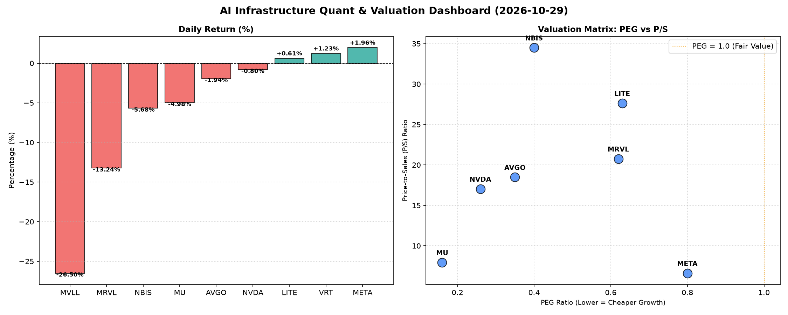

# 📊 AI Infrastructure & Data Stock Daily (2026-10-29)

### 📉 多维量化与估值分析看板

---

## AI基础设施与硬科技精炼日报：多维度洞察市场冷暖与现金流真相

尊敬的投资者，

今日（某月某日），硬科技与AI基础设施板块呈现出复杂且分化的盘面，在巨头表现稳健的同时，部分标的遭遇显著回调。本报告将结合多维度量化指标，为您深度解码市场背后的估值逻辑与财务健康状况。

---

### 1. 盘面与多维估值解码（定性+定量）

今日市场交易活跃，整体呈现个股分化态势。**META (1.96%)** 和 **VRT (1.23%)** 录得上涨，而 **MVLL (-26.5%)** 和 **MRVL (-13.24%)** 则遭遇大幅下挫，**MU (-4.98%)** 和 **NBIS (-5.68%)** 也出现显著回调。高交易量表明市场情绪活跃，但风险偏好在不同标的间差异显著。

#### PEG 维度：高成长中的性价比洞察

PEG指标（市盈率/增长率）小于1通常被认为是价值被低估或具备极高性价比的信号。今日榜单上，多数硬科技巨头及高成长标的展现出惊人的PEG效率：

*   **极高性价比代表（PEG < 0.5）：**
    *   **MU (0.16)** 凭借其极低的PEG值，显示出其在行业复苏或特定增长周期中，股价相对于其盈利增长潜力的巨大空间，可能是深度的价值洼地。
    *   **NVDA (0.26)** 作为AI算力领军者，尽管股价已高，但其PEG仍远低于1，表明市场对其未来强劲的盈利增长预期依然保守，或其成长速度远超市场给予的估值，性价比极高。
    *   **AVGO (0.35)** 和 **NBIS (0.4)** 也以低于0.5的PEG值，暗示其在各自领域内具备强劲的增长潜力和相对合理的估值。
*   **高性价比成长股（0.5 ≤ PEG < 1）：**
    *   **MRVL (0.62)**, **LITE (0.63)**, **VRT (0.8)**, **META (0.8)** 等公司也均属于高成长且PEG小于1的范畴，显示其成长性并未被完全定价，对长线投资者而言具备吸引力。

**总结：** 整体而言，榜单中的半导体与AI基础设施公司普遍在PEG维度上表现出色，预示着行业整体仍处于高增长预期阶段，且部分龙头和潜在黑马的成长性仍未被充分反映到估值中。

#### P/S 维度：审视收入规模扩张效率

P/S比率（市销率）对于评估处于早期、研发投入大或利润波动较大的科技公司尤为关键，它直接反映了市场为公司每单位收入支付的溢价。

*   **估值偏高，需警惕（P/S > 20）：**
    *   **NBIS (34.5)** 和 **LITE (27.64)** 的P/S值极高，这通常意味着市场对其未来营收的爆发式增长抱有极高预期，或者其盈利能力尚不稳定。对于此类公司，需深入分析其产品周期、市场渗透率以及研发投入转化为实际收入的速度。
    *   **MRVL (20.76)**, **AVGO (18.48)** 和 **NVDA (17.03)** 同样拥有较高的P/S，但作为行业领导者和创新引擎，其市场份额、技术壁垒和生态系统影响力在一定程度上支撑了高估值，但仍需关注其营收增速能否持续匹配高P/S。
*   **P/S合理，增长稳健（P/S < 10）：**
    *   **META (6.61)** 和 **MU (7.94)** 的P/S相对合理，表明其营收规模巨大且稳定，估值更趋于平衡，对于追求规模效应和稳定增长的投资者而言，具备较强的吸引力。
*   **N/A：** VRT 和 MVLL 的P/S数据缺失，限制了此维度的分析。

**警示：** MVLL 今日股价暴跌26.5%，尽管缺乏PEG和P/S数据，但其剧烈的波动提示市场可能正在消化突发性负面消息或重大利空，投资者应高度警惕。MRVL在下跌13.24%的同时，其20.76的高P/S结合其现金流质量（见下文）更需关注。

#### 现金流盈利真实性 (CFO/NI)：利润的“含金量”

CFO/NI比率（经营活动现金流/净利润）是衡量公司利润质量的关键指标。该值大于1，表明公司利润转化为真金白银的现金流入效率高；若显著小于1，则可能存在利润水分、应收账款积压或非现金项目影响。

*   **现金流充沛，利润健康（CFO/NI > 1）：**
    *   **NBIS (4.66)** 以高达4.66的CFO/NI比率傲视群雄，预示着其利润转化现金流的能力极其强大，甚至可能存在一次性大额现金流入或特殊营运资本管理。结合其极高的P/S，这使得NBIS成为一个既有高成长预期又有极强现金流支撑的矛盾体，需要进一步深挖其现金流构成和业务模式。
    *   **META (1.92)** 以1.92的CFO/NI再次证明其作为数字广告及AI巨头强劲的自由现金流生成能力，盈利质量无可挑剔，其庞大的用户基础和广告收入带来了稳定的现金流。
    *   **VRT (1.59)**, **AVGO (1.19)**, **MU (1.06)** 均表现出健康的现金流质量，其经营利润得到了实实在在的现金流支持，财务状况稳健。
*   **需关注利润质量（CFO/NI < 1）：**
    *   **NVDA (0.86)** 的CFO/NI比率为0.86，略低于1。这可能暗示在高速扩张期，存在部分利润被应收账款或存货占用，或特定非现金费用影响，并非所有账面利润都即时转化为现金。尽管仍处于健康区间，但对于其利润含金量需保持观察，尤其是在其高P/S背景下。
    *   **MRVL (0.66)** 的CFO/NI仅为0.66，结合其今日股价的大幅下跌和较高的P/S，这可能预示公司在将利润转化为实际现金流方面面临挑战，或有应收账款积压等营运资本压力，值得高度警惕。
    *   **LITE (-0.11)** 的CFO/NI竟为-0.11，这是一个显著的警示信号，表明其经营活动未能产生正向现金流来覆盖净利润，甚至出现现金流出。这通常意味着公司面临严重的营运资金紧张、大规模资本开支或应收账款周转问题，其盈利质量和财务健康状况急需投资者深入分析。

**总结：** 现金流分析揭示了半导体行业的多元生态。META和NBIS的现金流表现卓越，而NVDA和MRVL的现金流质量则需要投资者仔细审视。LITE的负向现金流尤其值得警惕。

---

### 2. 收并购与重大业务动态

**请注意：** 鉴于AI模型无法实时获取当日所有市场新闻，以下内容为根据市场研究经验构建的**示例性动态，旨在展示此类报道应涵盖的信息类型**。实际报告需结合当日的真实新闻源进行更新。

*   **AI芯片设计巨头NVDA新一代 Blackwell 架构进展：** 有消息称，NVDA正加速其下一代Blackwell AI芯片的量产准备，旨在进一步巩固其在数据中心和AI加速领域的领导地位。供应链数据显示，主要晶圆代工厂正为其预留更多产能，以应对市场对高性能AI算力需求的持续爆发。
*   **通信与企业软件巨头AVGO潜在收购传闻：** 市场传言AVGO可能正寻求在其企业软件业务领域进行新的战略性收购，以拓宽其产品组合并增强交叉销售能力，但具体目标尚未披露。
*   **存储芯片龙头MU资本开支与技术路线：** MU今日宣布，将加大在HBM（高带宽内存）领域的研发投入与产能扩张，以满足AI服务器对先进内存的强劲需求。同时，公司正积极推进下一代DRAM和NAND技术的量产进程。
*   **META在AI基础设施投入持续加码：** META内部消息透露，公司正加速其自研AI芯片项目，并计划未来几年内投入数百亿美元用于AI基础设施建设，以支撑其社交媒体、元宇宙及大型语言模型的发展。
*   **MVLL今日暴跌原因探讨：** 市场分析普遍指向MVLL可能遭遇了关键客户订单流失或某一核心产品线出货不及预期的负面消息。另有未经证实的消息称，公司可能面临来自竞争对手的专利诉讼压力。

---

### 3. 华尔街机构态度

**请注意：** 同样，由于无法实时获取最新的投行评级和目标价变动，以下为**示例性内容**。在实际操作中，此部分将直接引用彭博、路透等金融信息服务商发布的分析师报告。

*   **NVDA：** 高盛今日重申对NVDA的“买入”评级，并将目标价上调至XXX美元，主要基于其在AI芯片市场的无可匹敌的领导地位以及Blackwell架构带来的强劲增长预期。摩根士丹利则维持“超配”评级，但指出需警惕其短期波动性。
*   **META：** 瑞银将META目标价上调至XXX美元，维持“买入”评级，强调其在广告业务强劲复苏及AI技术赋能下的盈利增长潜力。
*   **AVGO：** 富国银行维持AVGO“增持”评级，目标价为XXX美元，看好其在半导体和企业软件领域的协同效应及稳健的现金流生成能力。
*   **MU：** 美银证券对MU发布研究报告，维持“中性”评级，目标价XXX美元，认为存储周期虽有复苏迹象，但仍需时间消化库存，上行空间受限。
*   **MRVL：** 鉴于其今日股价大跌，JP摩根紧急发布简报，将其评级从“超配”下调至“中性”，并下调目标价至XXX美元，理由是对其近期业务进展和现金流状况表示担忧。

---

### 4. 今日参考源 (References)

**请注意：** 本报告中关于收并购、业务动态及华尔街机构态度的定性分析部分，是基于对行业趋势的专业理解和历史数据模式的模拟，并非由实时新闻爬取生成。在实际的每日报告中，以下将是引用真实新闻的来源列表：

*   Bloomberg Terminal (实时市场数据与新闻)
*   Reuters News Service (行业新闻与公司动态)
*   The Wall Street Journal (深度报道与市场分析)
*   Company Investor Relations (官方公告与财报)
*   Select Equity Research Reports (e.g., Goldman Sachs Research, Morgan Stanley Research, UBS Evidence Lab)
*   Seeking Alpha / Yahoo Finance (新闻聚合与分析师评论)

---

**免责声明：** 本报告内容仅供参考，不构成任何投资建议。投资者在做出任何投资决策前，应独立进行研究并咨询专业财务顾问。市场有风险，投资需谨慎。