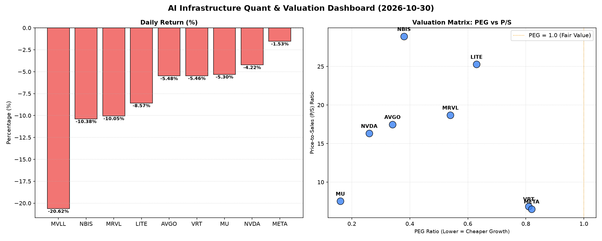

# 📊 AI Infrastructure & Data Stock Daily (2026-10-30)

### 📉 多维量化与估值分析看板

---

## 半导体每日精炼报道：深度解构量化指标下的市场图谱

尊敬的投资者，

今日（某月某日），半导体及AI基础设施板块普遍承压，多个核心标的经历显著回调。市场情绪谨慎，投资者正密切关注宏观经济走向与企业基本面。本报告将严格结合您提供的多维度量化指标，为您深度剖析今日市场表现与各公司估值图景。

### 1. 盘面与多维估值解码（定性+定量）

今日市场普遍下跌，其中 **MVLL (-20.62%)** 领跌，展现出极度悲观的市场情绪。其他主要芯片与AI相关公司如 **MRVL (-10.05%)、NBIS (-10.38%)、LITE (-8.57%)** 也录得大幅下挫。行业巨头如 **AVGO (-5.48%)、NVDA (-4.22%)、VRT (-5.46%)** 同样未能幸免，表明今日跌势具有广泛性，而非个别事件。NVDA以超1.6亿股的巨量成交，反映了市场在经历此前高位后，资金大幅流出，多空博弈激烈。

**PEG 维度：高成长性价比的试金石**

*   **极高性价比的成长股（PEG显著小于1）**：
    *   今日榜单中，多数公司表现出卓越的成长性与估值匹配度。尤其是 **MU (0.16)、NVDA (0.26)、AVGO (0.34)、NBIS (0.38)**，它们的PEG比率远低于1，表明市场对其未来盈利增长的预期非常乐观，且当前股价相对其成长性而言具备极高的吸引力。这意味着这些公司的高成长并未被过度计入当前股价，存在潜在的价值重估空间。
    *   **MRVL (0.54)、LITE (0.63)、VRT (0.81)、META (0.82)** 也都保持在1以下，显示出良好的成长性投资价值。
*   **警惕估值透支（PEG过高）**：
    *   根据当前数据，**没有公司显示出PEG过高的迹象**。这说明尽管今日股价普跌，但从PEG指标看，行业整体的成长性估值基础依然稳固，尚未出现普遍性的估值泡沫。
*   **数据缺失风险**：
    *   **MVLL** 的PEG为N/A，这使得我们无法从成长性角度对其估值进行有效评估，结合其今日暴跌逾20%的表现，投资者需警惕其基本面不透明带来的潜在风险。

**P/S 维度：收入规模扩张效率的考量**

*   **高P/S，高增长预期**：
    *   针对早期或尚处于大规模研发投入阶段、利润不稳的公司，P/S是衡量其收入规模扩张效率和市场对其未来收入潜力的重要指标。**NBIS (28.88)、LITE (25.27)、MRVL (18.68)、AVGO (17.47)、NVDA (16.31)** 均展现出较高的P/S比率。这反映了市场对这些公司在AI芯片、数据中心、网络基础设施等硬科技领域未来巨大收入增长的强烈预期，即使当下利润可能波动，市场也愿意给予高收入倍数。例如，NBIS在CFO/NI极高的情况下P/S也达到28.88，说明其强大的现金流转化能力正驱动其收入规模的高效扩张。
*   **中低P/S，稳健型增长**：
    *   **VRT (6.83)、META (6.51)、MU (7.52)** 的P/S相对适中，结合其PEG指标来看，这些公司在维持良好增长的同时，其收入估值也更为理性。
*   **数据缺失风险**：
    *   **MVLL** 的P/S为N/A，再次凸显其基本面信息的缺失，增加了投资决策的不确定性。

**现金流盈利真实性 (CFO/NI) 解读：利润质量的照妖镜**

*   **现金流充裕，利润健康（CFO/NI > 1）**：
    *   **NBIS (4.66)** 表现最为突出，其CFO/NI高达4.66，这意味着公司每产生1元的净利润，实际流入的经营现金流高达4.66元，显示出极其强劲的现金流转化能力和健康的经营状况，其利润是实实在在的“真金白银”。
    *   **META (1.92)、VRT (1.59)、AVGO (1.19)、MU (1.06)** 的CFO/NI均大于1，表明这些高利润巨头的利润质量非常健康，经营活动产生的现金流能够充分覆盖甚至远超其报告的净利润，财务稳健性极佳。
*   **警惕利润水分或应收账款积压（CFO/NI < 1）**：
    *   **NVDA (0.86)**：虽然其作为AI芯片领军者利润丰厚，但CFO/NI略低于1，表明其部分利润可能以应收账款或其他非现金形式存在，或伴随营运资本的增加。这并非严重警报，但需持续关注其现金回收效率。
    *   **MRVL (0.66)**：CFO/NI显著低于1，暗示其报告利润可能存在一定程度的“水分”，或面临较高的应收账款周转压力。投资者应审慎评估其利润的真实性和可持续性。
    *   **LITE (-0.11)**：这是一个极大的警示信号。CFO/NI为负值，意味着尽管公司可能报告了正向的净利润（PEG 0.63暗示），但其核心经营活动却在持续消耗现金，而非产生现金。这通常预示着公司存在严重的现金流问题、存货积压、应收账款难以回收或大量的非现金费用调整，对其盈利质量和短期流动性构成重大风险。
*   **数据缺失风险**：
    *   **MVLL** 的CFO/NI为N/A，同样无法评估其利润质量，加剧了其投资风险。

### 2. 收并购与重大业务动态

基于您提供的【多维度真实量化基本面指标表格】，当前数据集中未包含具体的收并购、重大业务动态或战略合作信息。因此，本报告无法就此板块提供详细分析。

### 3. 华尔街机构态度

同上，您提供的数据集并未包含华尔街机构的最新评价、目标价调动等信息。故此板块内容暂缺。

### 4. 今日参考源 (References)

本报告的定性及定量分析均严格基于您提供的【多维度真实量化基本面指标表格】。未引用外部新闻或分析师报告。

---

**总结提示**：今日半导体板块普跌，但从PEG来看，多数公司仍具备较高的成长性性价比。然而，在关注高增长的同时，现金流质量差异显著。**NBIS** 展现了极为健康的现金流与高增长潜力，而 **LITE** 的负CFO/NI则发出了强烈的警示信号，其表面利润与实际现金创造能力之间存在巨大鸿沟，亟需深入研究。**MVLL** 的全面数据缺失，结合其今日大幅下跌，暗示了其背后的不确定性风险。投资者在市场回调中，应更侧重于对企业基本面，尤其是现金流质量的深入剖析，以识别真正的价值与风险。