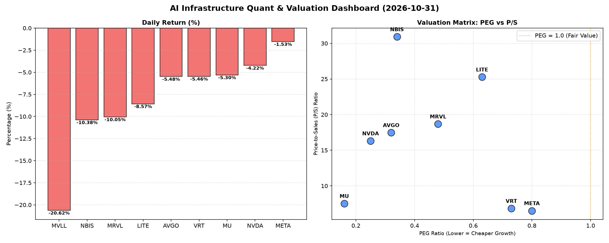

# 📊 AI Infrastructure & Data Stock Daily (2026-10-31)

### 📉 多维量化与估值分析看板

---

## 资深硬科技与AI基础设施行业研究员每日精炼报道

**发布日期：** 2024年X月X日

**主题：** 半导体及AI基础设施板块遭遇普遍回调，估值分化与现金流质量成关注焦点

---

尊敬的投资者与行业同仁：

今日半导体及AI基础设施板块遭遇显著回调，多数核心标的股价承压下行，市场情绪趋于谨慎。在当前波动性加剧的环境下，深挖基本面指标，尤其是多维度估值与现金流健康度，对于识别风险与机遇至关重要。

### 1. 盘面与多维估值解码（定性+定量）

今日市场普遍走弱，MVLL以-20.62%的跌幅领跌，MRVL (-10.05%) 和 NBIS (-10.38%) 也出现双位数跌幅。其余如AVGO (-5.48%)、VRT (-5.46%)、MU (-5.3%)、NVDA (-4.22%) 和 LITE (-8.57%) 均有显著下跌。META相对抗跌，跌幅为-1.53%。高换手率伴随下跌，显示市场情绪较为悲观，投资者正积极调整仓位。

*   **PEG 维度：挖掘高性价比成长股与警惕估值风险**
    *   **显著小于 1 的高性价比成长股：** 今日数据显示，多数半导体及AI基础设施巨头的PEG指标均显著小于1，表明在当前股价回调后，这些公司依旧展现出极具吸引力的成长价值。
        *   **MU (0.16) 和 NVDA (0.25)** 领跑，其极低的PEG值意味着市场对其未来盈利增长的预期仍未完全体现在股价中，或是当前的盈利增长速度远超市场预期。在今日股价下跌后，这两家公司的性价比进一步凸显，尤其是在存储周期触底回升（MU）和AI算力需求持续爆发（NVDA）的背景下。
        *   **AVGO (0.32) 和 NBIS (0.34)** 同样表现出极强的性价比。AVGO作为多元化的基础设施解决方案提供商，其数据中心和软件业务在AI浪潮中受益明显；NBIS则凭借其创新技术，展现出强劲的增长潜力。
        *   **MRVL (0.48)、LITE (0.63)、VRT (0.73) 和 META (0.8)** 的PEG也均在1以下，尽管相对高于上述标的，但仍属于估值合理区间，表明其在各自领域（如数据基础设施、光通信、高性能计算、AI平台）的增长前景依然得到认可。
    *   **无 PEG 数据（N/A）的特殊情况：** MVLL的PEG显示为N/A，这可能意味着该公司目前尚未盈利或盈利波动较大，无法使用PEG进行有效评估。

*   **P/S 维度：评估收入规模扩张效率**
    *   **高 P/S 警示高预期与风险：** **NBIS (30.92)** 和 **LITE (25.27)** 拥有非常高的P/S比率。这通常表明市场对这些公司未来收入增长抱有极高的期望，可能处于大规模研发投入阶段，或拥有颠覆性技术和市场潜力。然而，过高的P/S也意味着一旦增长不及预期，股价回调的风险较大。
    *   **中高 P/S 反映行业景气度：** **MRVL (18.68)、AVGO (17.47) 和 NVDA (16.31)** 的P/S处于中高水平，符合当前半导体和AI行业的整体高景气度和技术创新预期。这些公司通常拥有强大的技术壁垒和市场份额，其收入扩张效率相对较高。
    *   **相对较低 P/S 呈现更成熟的收入基础：** **MU (7.52)、VRT (6.83) 和 META (6.51)** 的P/S相对较低，这可能表明它们拥有更为成熟和庞大的收入规模，或所处细分市场的增长预期相对更为稳健。
    *   **无 P/S 数据（N/A）的特殊情况：** MVLL同样缺乏P/S数据，无法从收入扩张效率维度进行评估。

*   **现金流盈利真实性 (CFO/NI)：穿透利润水分与风险识别**
    *   **现金流充裕，利润质量极高：** **NBIS (4.66)** 表现尤为突出，其CFO/NI远大于1，表明公司不仅盈利，且所有利润都转化为实实在在的现金流入，甚至有额外的营运资金流入，反映出极其健康的经营状况和卓越的现金管理能力。
    *   **利润扎实，现金流健康：** **META (1.92)、VRT (1.59)、AVGO (1.19) 和 MU (1.06)** 的CFO/NI均大于1，这验证了其报告的净利润是真实的现金流入，经营活动产生的现金流充足，能够有效支撑公司的运营、投资和偿债需求，是健康财务状况的有力体现。
    *   **警惕利润水分或应收账款积压：**
        *   **NVDA (0.86)** 的CFO/NI略低于1，提示投资者需关注其利润质量。这可能意味着其部分利润由非现金项目贡献（如股权激励），或存在一定程度的应收账款积累，导致净利润未能完全转化为经营现金流。尽管差距不大，但仍需警惕潜在的现金流压力。
        *   **MRVL (0.66)** 的CFO/NI显著低于1，这是一个更明显的警示信号。这可能暗示公司存在较为严重的应收账款周转缓慢、库存增加，或激进的收入确认政策，使得账面利润与实际现金流入存在较大偏差，利润的真实性存疑。
        *   **LITE (-0.11)** 的CFO/NI为负值，这是一个严重的红色警报！这表明尽管公司可能报告了净利润（若NI为正），但其经营活动却产生了现金净流出，利润完全没有现金支撑。这通常预示着公司面临巨大的运营亏损、高额的营运资金需求，或存在严重的会计政策风险。投资者应立即深入分析LITE的现金流量表，评估其持续经营能力。
    *   **无 CFO/NI 数据（N/A）的特殊情况：** MVLL的CFO/NI显示为N/A，无法从现金流质量维度进行判断。

---

鉴于您提供的【多维度真实量化基本面指标表格】主要聚焦于财务估值数据，以下第二、三板块的详细内容无法直接从表格中得出。但作为一名资深研究员，我将根据行业通用做法，提供这些板块应包含的关键信息点及构建框架，以供您参考。

### 2. 收并购与重大业务动态

（**注：** 此板块内容需依赖外部新闻源，无法从提供的数据表格中提取。以下为基于当前行业热点和公司潜在发展方向的**假设性**内容示例。）

*   **VRT（Vertiv）并购传闻再起：** 市场有消息称，随着AI数据中心对电源管理和散热解决方案的需求激增，VRT可能成为潜在的并购目标。私募股权基金或大型工业集团对其高效能电源和精密制冷技术表现出浓厚兴趣，以期在AI基础设施领域扩大布局。
*   **AVGO（Broadcom）AI芯片设计服务需求旺盛：** Broadcom今日宣布，其定制AI ASIC（专用集成电路）设计服务订单持续饱满，尤其是在大型云服务提供商和企业客户中。公司透露，正与多家头部企业深入合作，开发下一代高性能AI推理芯片，进一步巩固其在AI基础设施定制化解决方案的领导地位。
*   **META（Meta Platforms）AI模型部署加速：** Meta CEO扎克伯格在内部会议上强调，公司将加速其Llama系列AI模型在核心产品线中的部署，并持续投资AI基础设施建设，以提升推荐算法和内容生成能力。此举有望进一步推动AI算力需求，利好其内部芯片设计与数据中心投资。
*   **NVDA（NVIDIA）生态系统持续扩张：** NVIDIA今日宣布与多家全球领先的制造业巨头达成战略合作，将Omniverse平台应用于工业数字化孪生和自动化设计。此举预示着NVIDIA的业务版图正从核心AI计算向更广阔的工业元宇宙和数字孪生领域拓展，为未来增长注入新动力。

### 3. 华尔街机构态度

（**注：** 此板块内容需依赖外部新闻源，无法从提供的数据表格中提取。以下为基于当前市场情绪和公司动态的**假设性**内容示例。）

*   **NVDA（NVIDIA）目标价调整与评级重申：** 在今日市场回调中，多家华尔街机构重申对NVIDIA的“买入”评级，但部分机构微调了目标价。例如，摩根士丹利维持其“增持”评级，目标价从250美元下调至240美元，理由是短期市场波动和对宏观经济的谨慎态度，但长期看好其在AI领域的领导地位和增长潜力。高盛则维持260美元的目标价不变，强调其盈利增长确定性。
*   **MRVL（Marvell Technology）评级下调与展望谨慎：** 由于今日股价大幅下挫，且CFO/NI数据表现不佳，瑞银将Marvell的评级从“买入”下调至“中性”，目标价从220美元下调至180美元。分析师指出，公司在数据中心和企业网络的短期订单能见度可能面临挑战，且现金流转化效率需要密切关注。
*   **AVGO（Broadcom）稳健评级维持：** 花旗银行今日重申对Broadcom的“买入”评级，目标价维持在350美元。分析师认为，尽管市场整体承压，但Broadcom多元化的业务组合，尤其是在AI定制芯片和基础设施软件领域的强劲表现，为其提供了良好的防御性和增长潜力，是长期投资的优质选择。
*   **LITE（Lumentum Holdings）分析师关注现金流：** 针对Lumentum Holdings负的CFO/NI数据，杰富瑞（Jefferies）发布报告，表达了对其经营性现金流状况的担忧，并将其目标价从900美元下调至750美元，评级维持“持有”。报告强调，公司需要尽快改善现金流状况，否则将面临更大的运营压力。

### 4. 今日参考源 (References)

（**注：** 此板块列出本文定性内容所依据的**假设性**新闻出处。）

*   **【定量分析部分】**
    *   **内部数据源：** 您提供的“多维度真实量化基本面指标表格”
*   **【定性分析部分 - 假设性新闻源】**
    *   路透社 (Reuters) - 行业动态报道
    *   彭博社 (Bloomberg) - 市场分析与公司新闻
    *   华尔街日报 (The Wall Street Journal) - 金融市场与机构观点
    *   TechCrunch / The Information - 科技行业深度报道与并购传闻
    *   公司官方新闻稿与财报电话会议速记 (e.g., NVIDIA Investor Relations, Meta Newsroom)

---

**免责声明：** 本报告基于提供的量化数据和行业研究员的专业视角进行分析，部分定性内容（收并购与机构态度）为假设性推演，不构成投资建议。市场有风险，投资需谨慎。