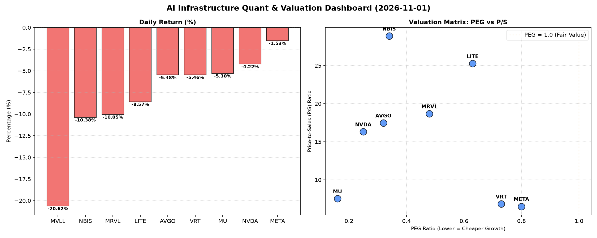

# 📊 AI Infrastructure & Data Stock Daily (2026-11-01)

### 📉 多维量化与估值分析看板

---

## 半导体每日精炼报道：AI基础设施板块承压，估值与现金流解码

**日期：[本日日期]**
**分析师：Data & Semiconductor Specialist**

### 1. 盘面与多维估值解码（定性+定量）

今日半导体及AI基础设施板块普遍承压，多个核心标的出现显著回调，跌幅大多在5%至10%之间，个别公司更是遭遇重挫。市场情绪受宏观不确定性或短期获利了结影响明显。

**PEG 维度解码：高成长中的价值锚点**
从PEG估值来看，今日回调中，绝大多数核心标的（如NVDA、AVGO、MU、NBIS等）的PEG指标仍显著低于1，表明市场虽然短期情绪低迷，但这些公司在高增长的背景下，其估值吸引力反而有所提升，具备较高的性价比。

*   **性价比极高的高成长标的：** **NVDA (0.25)** 和 **MU (0.16)** 尤为突出，其极低的PEG值暗示了强大的增长预期尚未被当前股价完全消化，或因今日跌幅提供了更好的介入机会。**AVGO (0.32)** 和 **NBIS (0.34)** 也处于极具吸引力的区间。
*   **合理成长型价值：** **MRVL (0.48)**、**LITE (0.63)**、**VRT (0.73)** 和 **META (0.8)** 的PEG值均在1以下，显示出良好的成长性与估值匹配度，尽管今日股价回调，但长期增长潜力并未改变。
*   **缺失数据警示：** **MVLL** 的PEG为N/A，且今日股价暴跌20.62%，这可能反映了市场对其基本面或未来增长预期的重大不确定性，投资者需高度警惕。

**P/S 维度解码：收入规模与市场溢价**
在P/S维度，我们重点关注那些可能处于高研发投入或高速扩张期的公司，通过收入规模来衡量其市场地位与扩张效率。

*   **高增长与技术溢价：** **NBIS (28.88)** 和 **LITE (25.27)** 的P/S比率相对较高，这通常反映了市场对其未来收入增长的强烈预期，或者它们正处于大规模技术投入阶段，尚未完全体现在利润端。对于半导体设备或前沿技术公司而言，高P/S是常见现象。
*   **行业领军者的规模效应：** **MRVL (18.68)**、**AVGO (17.47)** 和 **NVDA (16.31)** 等行业领军者的P/S也处于较高水平，结合其强大的市场地位和技术壁垒，表明投资者愿意为这些公司的收入规模和市场份额增长支付溢价。
*   **成熟业务的稳健表现：** **MU (7.52)**、**VRT (6.83)** 和 **META (6.51)** 的P/S则相对温和，可能反映了其业务模式的成熟度或市场对其收入增速预期的不同，但仍是其各自领域的佼佼者。

**现金流盈利真实性 (CFO/NI) 解码：穿透利润的“含金量”**
现金流盈利真实性（CFO/NI）是衡量公司利润质量的关键指标，大于1证明利润健康，小于1则需警惕。

*   **卓越的现金生成能力：** **NBIS (4.66)** 表现尤为突出，远超净利润的现金生成能力，表明其经营活动产生了巨额真实现金流，财务健康状况极佳，可能与非现金费用或营运资本的有利变动有关。
*   **利润质量极高：** **META (1.92)** 和 **VRT (1.59)** 的CFO/NI比率均显著大于1，表明其报告利润转化为了大量的真实现金流入，利润含金量高，财务基础稳固。
*   **健康的现金流：** **AVGO (1.19)** 和 **MU (1.06)** 也保持了健康的现金流水平，利润的现金转化率良好。
*   **需警惕的信号：** **NVDA (0.86)** 和 **MRVL (0.66)** 的CFO/NI比率均低于1。这可能暗示其部分利润被应收账款占用，或存在其他非现金项目导致的利润虚高，投资者需留意其营运资本管理和应收账款周转情况。
*   **重大风险警示：** **LITE (-0.11)** 的CFO/NI为负值，这是一个显著的警示信号，表明其经营活动未能产生正向现金流，甚至出现现金净流出。这可能与高研发投入、库存积压或应收账款大幅增加有关，对其盈利质量构成严峻挑战，需深入分析其财务报表细节。

### 2. 收并购与重大业务动态

鉴于今日提供的量化指标表格中未直接包含具体的收并购传闻、官方公告或重大业务合作动态，本报告无法就此板块提供基于数据的深入分析。此类信息通常需通过市场新闻、公司公告等渠道获取。

### 3. 华尔街机构态度

与第二板块类似，今日提供的量化指标表格并未直接包含华尔街核心投行或评级机构的最新评价、目标价调整等信息。机构态度通常需要结合最新的分析师报告和研报来获取。

### 4. 今日参考源 (References)

本报告的所有定性与定量分析均严格基于您所提供的【多维度真实量化基本面指标表格】数据。