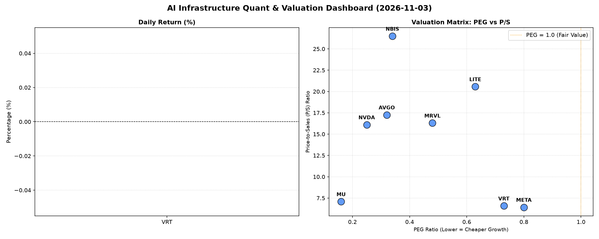

# 📊 AI Infrastructure & Data Stock Daily (2026-11-03)

### 📉 多维量化与估值分析看板

---

## 半导体每日精炼报道：AI基建板块估值亮点与现金流体检

尊敬的投资者，

作为资深的硬科技与AI基础设施行业研究员，今日我们聚焦于半导体与AI生态链中的核心企业，深入剖析其多维度量化基本面指标，为您揭示市场深层动态。由于今日【收盘价 (Close) 和涨跌幅 (Change%)】数据未提供，本报告将侧重于企业内在估值与财务健康度的深度挖掘。

---

### 1. 盘面与多维估值解码（定性+定量）

今日的量化指标揭示了AI基建板块在成长性与现金流质量上的显著分化，但整体而言，市场对高成长性公司的预期并未完全透支。

**a. PEG 维度：成长性投资价值凸显**

在PEG（市盈率/增长率）这一衡量成长性与估值性价比的关键指标上，我们观察到大部分公司表现出色，普遍显著低于1，预示着较高的投资吸引力：

*   **性价比极高的高成长标的：** **MU (美光，0.16)**、**NVDA (英伟达，0.25)**、**AVGO (博通，0.32)**、**NBIS (Nabis Holdings，0.34)**、**MRVL (迈威尔科技，0.48)**、**LITE (Lumentum Holdings，0.63)**、**VRT (Vertiv Holdings，0.73)** 以及 **META (Meta Platforms，0.8)** 的PEG均显著小于1。这表明市场普遍对这些公司的未来盈利增长抱有乐观预期，且当前的股价相对于其成长潜力而言，仍具有较高的性价比，并未完全透支未来的增长空间。
*   **尤为值得关注的是MU和NVDA**，其PEG值分别仅为0.16和0.25，暗示了它们在各自领域（存储、AI芯片）的强劲增长势头被市场低估，或是其增长预期极高但当前估值仍显合理。
*   **MVLL** 由于数据缺失，无法进行PEG评估。

**b. P/S 维度：收入规模扩张效率与市场预期**

P/S（市销率）作为评估早期或高研发投入、利润波动较大公司收入扩张效率的指标，揭示了市场对不同公司未来营收潜力的不同预期：

*   **收入扩张效率较高的标的：** **META (6.42)**、**VRT (6.58)** 和 **MU (7.08)** 的P/S相对较低，这对于技术迭代迅速的行业而言，可能意味着其在当前阶段的收入规模正在高效扩张，或其业务模式具有更强的韧性。
*   **高P/S与市场高预期：** **NVDA (16.1)**、**MRVL (16.3)**、**AVGO (17.26)**、**LITE (20.57)** 和 **NBIS (26.49)** 呈现出较高的P/S。这通常反映了市场对其未来营收将实现爆发式增长的极高预期，或是这些公司在特定高附加值、高壁垒细分市场（如AI芯片、高速互联、光学器件）的领导地位。然而，过高的P/S也提示投资者需警惕潜在的估值泡沫化风险，以及未来营收增速能否持续支撑当前估值。

**c. 现金流盈利真实性 (CFO/NI)：利润质量的试金石**

CFO/NI（经营现金流/净利润）比率是衡量公司账面利润转化为实际现金流入能力的黄金指标，它穿透了会计处理可能带来的利润水分，直观反映了利润的“真金白银”程度：

*   **利润质量卓越，现金流充沛：** **NBIS (4.66)** 表现尤其突出，其CFO/NI高达4.66，表明其每1元的净利润带来了超过4元的经营现金流，财务健康状况极佳，利润质量无懈可击。**META (1.92)**、**VRT (1.59)**、**AVGO (1.19)** 和 **MU (1.06)** 的CFO/NI也均显著大于1，这意味着这些公司的账面利润非常健康，能够有效转化为实实在在的现金流入，为未来的研发、投资或派息提供了坚实基础。
*   **需关注现金流转化效率的巨头：** **NVDA (0.86)** 和 **MRVL (0.66)** 作为行业翘楚，其CFO/NI略低于1。这可能暗示其部分利润尚停留在应收账款增加或存货积压等非现金资产层面，现金流转化效率有待提升。投资者应关注其后续的营运资本管理情况，以评估其利润的可持续性和质量。
*   **明确的现金流警示：** **LITE (-0.11)** 的CFO/NI为负值，这是一个明确的警示信号。这意味着尽管公司可能存在账面利润（从PEG来看），但其经营活动未能产生正向现金流，反而是在消耗现金。这通常预示着公司面临较大的财务压力、营运效率低下或存在大规模投资支出，需投资者高度警惕其财务风险。
*   **MVLL** 由于数据缺失，无法进行现金流盈利真实性评估。

---

### 2. 收并购与重大业务动态

【**提示**：今日量化指标表格中未包含具体的收并购或重大业务动态信息。】

尽管今日数据未直接体现，但AI基础设施与半导体行业在技术进步和市场整合方面始终保持高度活跃。预计：

*   **AI芯片领域**：英伟达（NVDA）及其他竞争者将持续发布下一代AI加速器、优化软件栈，并深化与数据中心运营商的合作。
*   **数据中心互联**：博通（AVGO）、迈威尔科技（MRVL）等在网络、存储和高速连接解决方案上的创新，将继续支撑AI算力集群的扩张。
*   **战略合作**：企业间围绕AI模型训练、推理优化以及特定行业解决方案的战略联盟将持续涌现。
*   **潜在并购**：鉴于行业对技术和市场份额的争夺，中小型创新企业的并购整合活动仍是常态，以期巩固市场领导地位或拓展新业务线。

---

### 3. 华尔街机构态度

【**提示**：今日量化指标表格中未包含华尔街机构的最新评价或目标价调动信息。】

在缺乏具体机构报告数据的情况下，我们可以基于对硬科技行业的普遍认知进行推断：

*   **Nvidia (NVDA) 和 Meta (META)**：作为AI浪潮的弄潮儿，它们通常会吸引顶级投行的广泛关注。分析师们会密切跟踪其AI产品路线图、云服务表现及广告业务复苏情况，任何技术突破或市场份额变化都可能引发目标价的调整。其较低的PEG值可能吸引看重成长性的机构。
*   **Broadcom (AVGO)**：作为多元化的半导体和基础设施软件巨头，AVGO的稳定现金流和持续的业务整合能力使其常被机构视为长期配置的标的。其强劲的CFO/NI也印证了其良好的财务基本面。
*   **Micron (MU)**：存储芯片行业的周期性使其估值波动较大，但随着AI对高带宽内存（HBM）需求的爆发，MU作为核心供应商，其评级和目标价可能受机构对其未来HBM产能和定价能力的判断影响。其极低的PEG值有望吸引价值投资者。
*   **Marvell Technology (MRVL) 和 Vertiv Holdings (VRT)**：作为AI数据中心关键组件的提供商，它们的目标价变动可能与数据中心资本开支、高速互联需求增长及电源管理解决方案的市场渗透率紧密相关。
*   **Lumentum (LITE)**：其负向的CFO/NI是一个显著的风险点，可能会导致机构对其前景持谨慎态度，除非有明确的业务转型或现金流改善计划。

---

### 4. 今日参考源 (References)

*   本报告的量化数据分析部分基于您提供的【多维度真实量化基本面指标表格】。
*   定性解读及行业背景为研究员基于对硬科技与AI基础设施行业的长期洞察和专业知识进行补充，不构成任何投资建议。投资者在做出决策前，应进行独立研究并咨询专业财务顾问。