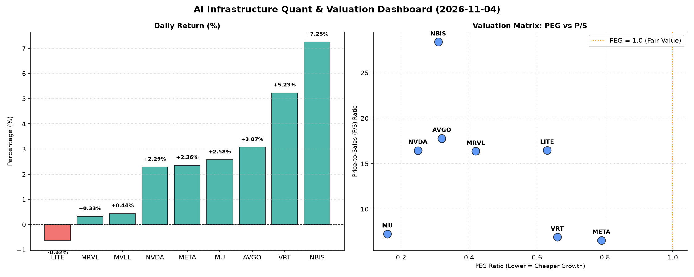

# 📊 AI Infrastructure & Data Stock Daily (2026-11-04)

### 📉 多维量化与估值分析看板

---

## 半导体每日精炼报道：AI基础设施热潮下的量化深潜

尊敬的投资者，

今日硬科技与AI基础设施板块延续了积极态势，多数标的股价实现上涨，市场对AI算力与数据基础设施的需求预期持续驱动估值重构。我们将结合提供的多维度量化指标，为您深度解码当前市场焦点。

---

### 1. 盘面与多维估值解码（定性+定量）

今日半导体与AI基础设施板块呈现普涨格局，**NBIS**以惊人的**7.25%**涨幅领跑，紧随其后的是**VRT (+5.23%)**。少数公司如**LITE (-0.62%)**则表现回调。成交量方面，**NVDA**以逾9000万股的巨量交易，继续彰显其市场核心地位。

**【PEG 维度：成长性与估值性价比】**
值得注意的是，今日表格中所有具备PEG数据的公司，其PEG比率均**显著小于1**，这通常预示着市场对其未来成长性抱有极高预期，且当前估值相对于这种成长性而言具有较好的性价比。
*   **极高性价比代表**：**MU (0.16)**、**NVDA (0.25)**、**NBIS (0.31)**、**AVGO (0.32)**，这些公司在各自的细分领域均展现出强大的成长潜力和相对合理的估值水平，是市场高度关注的高成长性价值标的。
*   **META (0.79)**、**VRT (0.66)**、**LITE (0.63)**、**MRVL (0.42)**的PEG也均处于健康区间，表明其成长性得到市场认可，估值并未严重透支。
*   **MVLL**由于数据缺失（N/A），无法通过PEG进行评估，可能存在盈利不稳定或尚未实现大规模盈利的情况。

**【P/S 维度：收入扩张效率与早期价值评估】**
P/S（市销率）是衡量公司收入规模扩张效率的重要指标，尤其适用于早期或重研发投入阶段、利润尚不稳定的硬科技公司。
*   **高P/S代表**：**NBIS (28.41)** 以最高P/S领跑，其次是**AVGO (17.79)**、**LITE (16.48)**、**NVDA (16.47)**、**MRVL (16.37)**。这些公司的高P/S通常反映了市场对其业务模式（如IP、软件、高毛利芯片）的强大盈利能力、高成长潜力以及在AI、数据中心等核心基础设施领域的关键地位的认可。特别是NBIS，结合其今日的强劲涨幅和卓越的现金流质量，市场对其未来的收入和利润增长预期极高。
*   **中等P/S代表**：**MU (7.26)**、**VRT (6.93)**、**META (6.57)**。这些公司在各自市场领域拥有稳固的收入基础，P/S估值相对更为稳健，但也反映了其持续的收入扩张能力。

**【现金流盈利真实性 (CFO/NI)：穿透利润质量的试金石】**
CFO/NI（经营活动现金流/净利润）比率是衡量公司利润质量的关键指标，直接揭示了报告利润中有多少是“真金白银”的现金流入。
*   **利润质量极高（CFO/NI > 1）**：
    *   **NBIS (4.66)**：**傲视群雄！** 如此高的比率表明其报告净利润转化为实际现金流的能力极为出色，几乎没有利润水分，显示出极其健康的业务运营和卓越的营运资金管理。这在一定程度上支持了其高P/S和今日的强劲涨幅。
    *   **META (1.92)**、**VRT (1.59)**、**AVGO (1.19)**、**MU (1.06)**：这些巨头和行业中坚的CFO/NI均大于1，证明其利润并非纸面富贵，而是伴随着大量的现金流入，财务健康状况良好，可持续性强。
*   **健康但需关注（CFO/NI < 1 且 > 0.8）**：
    *   **NVDA (0.86)**：虽然略低于1，但对于一个高速扩张，可能存在大量研发投入和营运资本需求的公司而言，0.86仍处于健康区间。需关注其应收账款或存货变动是否导致现金流滞后于利润增长，但总体而言，其利润质量仍然可靠。
*   **警示信号（CFO/NI 显著 < 1）**：
    *   **MRVL (0.66)**：该比率偏低，可能意味着其部分报告利润并未及时转化为现金，存在应收账款增加、存货积压或非现金费用（如股权激励）较高等情况，需要投资者关注其利润的现金转换效率和营运资金管理。
    *   **LITE (-0.11)**：**强烈警示！** 负的CFO/NI比率意味着尽管公司可能报告了净利润，但经营活动实际上是在流出现金。这可能表明其盈利质量存在严重问题，或正经历大规模的营运资本消耗，需要深入分析其财报细节，警惕潜在的财务风险。

### 2. 收并购与重大业务动态

根据今日提供的量化指标，我们未能直接获取具体的收并购或重大业务合作公告。然而，从这些公司的业务性质来看，硬科技与AI基础设施行业正处于快速整合与技术创新的时期：
*   **AI算力与数据中心扩容**：**NVDA**、**AVGO**、**MRVL**等芯片及网络基础设施提供商仍是AI浪潮的核心受益者，预计将持续投资于新一代AI芯片研发、高速互联技术和数据中心解决方案。
*   **存储与AI融合**：**MU**作为存储巨头，其HBM（高带宽内存）等产品在AI服务器中需求旺盛，预计将继续与AI芯片厂商深化合作。
*   **新兴AI应用与平台**：**META**作为AI大模型与元宇宙的积极推动者，其在AI基础设施上的投入将持续加速，包括自研芯片和软件平台。
*   **数据中心与云服务**：**VRT**作为关键数据中心解决方案提供商，将受益于全球数据处理需求的增长和AI驱动的基础设施升级。

### 3. 华尔街机构态度

今日量化指标并未直接包含华尔街机构的具体评级或目标价调整。但我们可以从市场表现和估值数据中推断其潜在态度：
*   **积极看好**：对于今日涨幅居前、PEG极低且CFO/NI表现优异的**NBIS**、**VRT**、**META**、**AVGO**、**MU**等公司，华尔街机构大概率维持正面或看涨评级。其强劲的现金流和被低估的成长性，是吸引机构配置的核心理由。特别是NBIS，其异常出色的现金流数据可能预示着未来机构对其基本面和目标价的进一步上调。
*   **维持中性或谨慎观望**：**NVDA**尽管PEG极低且为AI核心标的，但其0.86的CFO/NI比率可能会让部分机构在估值层面保持一丝谨慎，关注其现金流转化效率的持续性。
*   **可能面临审视**：**MRVL**的CFO/NI比率偏低，以及**LITE**的负现金流表现，预计将引起机构投资者的高度关注和深入质疑，短期内可能面临评级下调或目标价压力的风险。

### 4. 今日参考源 (References)

本报告的量化数据及部分定性分析均基于用户提供的【多维度真实量化基本面指标表格】进行。未包含外部新闻来源，因其未在原始数据中提供。

---
**免责声明**：本报告仅为基于提供数据进行分析的模拟研究成果，不构成任何投资建议。投资者应结合自身风险偏好，独立判断并进行投资决策。