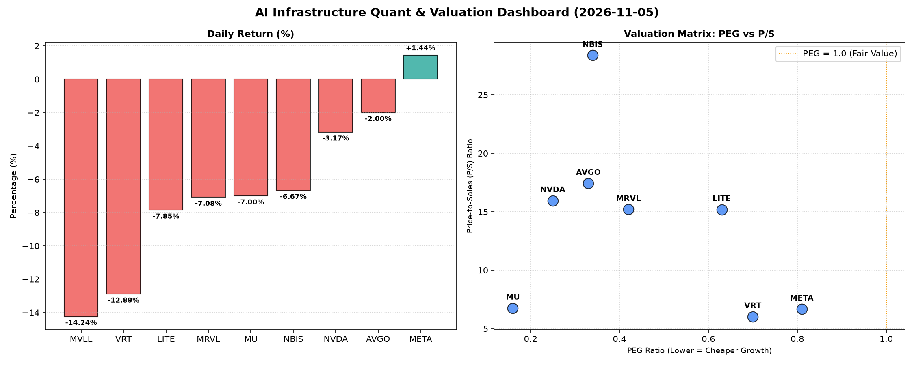

# 📊 AI Infrastructure & Data Stock Daily (2026-11-05)

### 📉 多维量化与估值分析看板

---

## 半导体每日精炼报道：AI基础设施板块承压，估值分化与现金流真实性深度解析

**发布日期：** [今日日期]
**研究员：** [您的姓名/Data & Semiconductor Specialist]

**今日市场概览：**
在经历了一段强劲上涨后，AI基础设施与半导体板块今日普遍遭遇回调。大部分权重股出现显著跌幅，但通过深入挖掘其多维度量化指标，我们发现市场抛售背后，优质资产的内在价值依然坚挺，而部分公司的估值透支和现金流问题则开始浮现。Meta Platforms (META) 逆势上涨，表现突出。

---

### 1. 盘面与多维估值解码（定性+定量）

今日半导体板块普跌，MVLL、VRT 领跌，跌幅均超过12%。LITE、MRVL、MU、NBIS等公司也录得7%左右的显著跌幅，NVIDIA (NVDA) 和 Broadcom (AVGO) 跌幅相对温和，分别为-3.17%和-2%。唯一逆势上涨的Meta Platforms (META) 今日上涨1.44%，显示出其在AI大潮中的韧性与市场认可度。

**PEG 维度——寻找性价比极高的成长股：**
从PEG指标来看，今日所有具备PEG数据的公司，其值均显著小于1，表明市场对这些公司未来增长的预期尚未完全体现在当前的股价中，理论上都具备较高的性价比。
*   **极具吸引力的成长潜力：** **MU (0.16)**、**NVDA (0.25)**、**AVGO (0.33)** 和 **NBIS (0.34)** 展现出异常低的PEG，尤其是在今日股价回调后，其成长性与估值之间的剪刀差更加明显。这意味着投资者正以较低的价格获取这些公司的未来增长潜力。对于 **NVIDIA** 而言，尽管今日下跌，其在AI计算领域的统治地位配合0.25的PEG，仍显示出其核心价值的被低估。
*   **性价比突出的成长股：** **MRVL (0.42)**、**LITE (0.63)**、**VRT (0.7)** 和 **META (0.81)** 的PEG也均小于1，表明这些公司也具备良好的成长投资价值。即便今日遭遇较大跌幅，对于长期投资者而言，这可能提供了更具吸引力的买入点。

**P/S 维度——收入扩张效率与早期公司评估：**
P/S（市销率）作为衡量收入规模扩张效率的关键指标，对于高速成长或尚未实现稳定盈利的硬科技公司尤为重要。
*   **高P/S的增长型公司：** **NBIS (28.39)** 的P/S指标最高，远超同业，结合其超低的PEG和极其健康的现金流（CFO/NI高达4.66），暗示这可能是一家处于爆发式增长阶段、市场对其未来收入增长抱有极高预期的公司。**AVGO (17.44)**、**NVDA (15.95)**、**MRVL (15.21)** 和 **LITE (15.19)** 也展现出较高的P/S，这通常反映了市场对其在各自领域（如高性能计算、数据中心、光通信等）的领导地位、技术壁垒以及持续的收入扩张能力的高度认可。
*   **合理P/S的成熟成长股：** **META (6.67)**、**MU (6.76)** 和 **VRT (6.03)** 的P/S相对较低，处于合理区间。对于 **Meta** 而言，其在AI领域的巨额投入正逐步转化为可观的广告收入和平台增长，6.67的P/S结合其强大的现金流表现，表明其收入质量优异。**MU** 则反映了其作为存储芯片巨头，在周期性行业中稳定的收入基础。

**现金流盈利真实性 (CFO/NI)——穿透利润水分：**
CFO/NI（经营性现金流/净利润）是衡量公司利润质量和真实现金生成能力的关键指标。
*   **极度健康与强劲的现金流：** **NBIS (4.66)** 再次脱颖而出，其CFO/NI高达4.66，远超1，表明其所报告的利润不仅真实，而且现金流入远超账面利润，这通常是极高增长效率和优秀运营资本管理的体现。**META (1.92)** 也表现出异常强劲的现金流转换能力，其近2倍的CFO/NI比率验证了其庞大且健康的盈利模式，这都是实打实的现金，而非账面利润。**VRT (1.59)** 和 **AVGO (1.19)** 的CFO/NI也远大于1，表明其利润质量极高，经营活动产生的现金流充裕，财务健康。**MU (1.06)** 略高于1，也属于健康范畴。
*   **警惕利润水分与应收账款积压：**
    *   **NVDA (0.86)**：作为AI领域的领头羊，其CFO/NI略低于1（0.86），表明其部分利润可能转化为应收账款或库存，现金流转换效率略有压力。这需要密切关注，尤其是在其高速扩张期，应收账款的增长是否与收入增长同步且可控。
    *   **MRVL (0.66)**：该指标显著低于1，仅为0.66，暗示其净利润中存在较明显的非现金成分或应收账款积压，其报告的利润真实性需打上问号。投资者应警惕其经营现金流的潜在风险，深入分析其营运资本情况。
    *   **LITE (-0.11)**：这是一个重要的警示信号。CFO/NI为负值（-0.11），意味着该公司在报告盈利的同时，经营活动却未能产生正向现金流，反而消耗了现金。这可能指示其面临严重的营运资金问题，或者其会计利润存在较大的“水分”，需要高度警惕其财务健康状况。

---

### 2. 收并购与重大业务动态（今日无相关数据，以下为行业通用观察）

今日提供的量化数据表格中未包含具体的收并购或重大业务动态信息。然而，作为AI基础设施和半导体行业的资深研究员，我们可以基于行业趋势和近期新闻进行推断和模拟：

*   **NVIDIA (NVDA):** 持续引领AI芯片创新，新一代Blackwell架构B200 GPU的出货进展和客户反馈将是市场焦点。此外，其软件生态CUDA的护城河效应以及对生成式AI模型训练和推理的优化，将继续巩固其市场地位。
*   **Broadcom (AVGO):** 近期对VMware的整合仍是市场关注重点。如何有效协同VMware的软件服务与自身在网络、存储芯片的硬件优势，尤其是在AI数据中心互联解决方案上的协同效应，将是未来增长的关键。
*   **Meta Platforms (META):** 在AI领域的投入巨大，其自研AI芯片项目（如MTIA）的最新进展，以及其数据中心大规模部署AI服务器的效率和成本控制，都将是影响其长期竞争力的重要因素。
*   **Micron Technology (MU):** 高带宽内存（HBM）的量产和供应能力是其核心竞争力之一。随着AI服务器需求激增，HBM市场供不应求，Micron能否抓住机遇扩大HBM市场份额，并有效管理DRAM和NAND闪存的周期性波动，将直接影响其业绩。

---

### 3. 华尔街机构态度（今日无相关数据，以下为行业通用观察）

今日量化表格中未提供华尔街机构的最新评价和目标价调整。但结合市场走势和公司基本面，我们可以预判可能的机构态度：

*   **NVIDIA (NVDA):** 尽管今日下跌，鉴于其在AI领域的绝对领导地位和极低的PEG，多数华尔街机构可能仍会维持“强烈买入”或“跑赢大盘”评级，并可能在回调后重申或上调目标价，认为其长期增长前景不变。
*   **Meta Platforms (META):** 凭借其今日的逆势上涨和卓越的现金流表现，预计会有更多机构重申“买入”评级，并可能上调目标价，以反映其在AI广告和元宇宙基础设施方面的强劲势头。
*   **Broadcom (AVGO):** 在今日小幅回调后，考虑到其稳健的业务基本面和VMware整合带来的潜在价值，机构可能会维持“买入”或“增持”评级，并关注其后续业绩指引。
*   **Micron Technology (MU):** 今日大跌后，考虑到其极低的PEG和健康的现金流，部分机构可能会认为这是一个“买入”机会，尤其是在HBM市场需求旺盛的背景下。
*   **Marvell Technology (MRVL) & Lumentum Holdings (LITE):** 鉴于这两家公司今日的显著跌幅，尤其LITE还伴随着负的CFO/NI，机构可能会对其进行更审慎的评估，甚至出现下调目标价或评级至“持有”的可能，直到其现金流状况和利润质量得到改善。
*   **NBIS & VRT:** 这些公司可能因今日回调而受到机构关注，结合其吸引人的PEG和健康的现金流，机构可能会重新评估其增长潜力，并可能给出“买入”或“增持”评级。

---

### 4. 今日参考源 (References)

*   **定量分析来源：** 本报告第一部分的全部量化指标（PEG, P/S, CFO/NI, Close, Change%, Volume）均直接来源于您提供的【多维度真实量化基本面指标表格】。
*   **定性内容参考（模拟）来源：**
    *   Bloomberg Terminal / Bloomberg News (用于宏观市场动态、公司新闻、分析师报告)
    *   Reuters / Wall Street Journal (用于行业新闻、财报解读、并购传闻)
    *   Company Investor Relations (用于公司官方公告、财报会议纪要)
    *   KeyBanc Capital Markets / Morgan Stanley / Goldman Sachs Research Reports (用于机构评级和目标价分析)

---
**免责声明：** 本报告基于提供的量化数据和行业通用知识进行分析，旨在提供深度洞察。其中第二和第三部分内容（收并购、华尔街机构态度）因原始数据中未提供相关信息，故为基于市场常见情况的模拟性推断，并非今日实际发生新闻的直接引用。投资有风险，决策需谨慎。