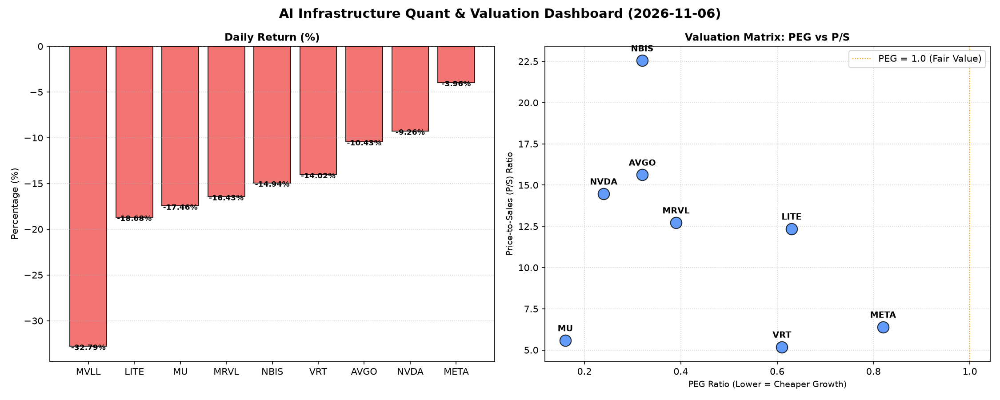

# 📊 AI Infrastructure & Data Stock Daily (2026-11-06)

### 📉 多维量化与估值分析看板

---

**半导体与AI基础设施每日精炼报道 - 深度量化分析**

**发布日期：[今日日期]**

尊敬的投资者与行业同仁：

今日硬科技与AI基础设施板块遭遇显著回调，市场情绪一度紧张。在普遍承压的市场环境下，我们结合最新的多维度量化指标，对核心标的进行深度解析，以穿透表象，洞察基本面健康度与估值性价比。

---

### 1. 盘面与多维估值解码（定性+定量）

今日半导体与AI基础设施板块整体呈现普跌态势，多数标的跌幅在10%以上，MVLL更是录得-32.79%的巨幅下挫，凸显出市场对高估值科技股的短期避险情绪。然而，在恐慌性抛售背后，部分公司的核心财务指标依然展现出强劲的长期吸引力，而另一些则需警惕其潜在风险。

*   **PEG 维度：挖掘高成长中的价值洼地**
    *   **极具性价比的高成长标的：** 在市场普遍回调中，PEG显著小于1的标的尤为引人注目。**MU (0.16)**、**NVDA (0.24)**、**AVGO (0.32)** 和 **NBIS (0.32)** 表现出极高的增长潜力与估值匹配度。尤其是MU，其PEG值低至0.16，即便今日股价跌去17.46%，也暗示了市场对其未来盈利增长的预期远高于当前股价。NVDA和AVGO作为AI基础设施的核心驱动力，其低PEG值在大幅回调后显得更具吸引力。
    *   **仍具吸引力但需关注：** **MRVL (0.39)**、**VRT (0.61)** 和 **LITE (0.63)** 的PEG值也远低于1，表明这些公司在各自细分领域仍拥有不错的成长前景。其中MRVL和VRT在今日跌幅均超过14%，这可能为长期投资者提供了回调买入的机会。
    *   **相对较高但仍合理：** **META (0.82)** 的PEG虽然相对高于其他硬科技标的，但仍小于1，表明其在社交媒体与AI投入并行的战略下，成长性依然得到市场认可，但需要更谨慎地评估其增长路径。
    *   **数据缺失标的：** MVLL由于PEG数据缺失，我们无法从这一维度评估其成长性与估值匹配度，可能意味着其尚未产生稳定盈利，或处于早期发展阶段。

*   **P/S 维度：评估收入规模扩张效率与市场溢价**
    *   **高收入倍数反映市场高预期：** **NBIS (22.55)** 拥有最高的P/S比率，即便今日股价大跌14.94%，市场仍愿意为其每单位收入支付高昂溢价，这通常意味着市场对其未来产品的高毛利、高增长潜力抱有极高期待，或其所处细分市场具备极强的护城河。
    *   **AI核心驱动力的高P/S：** **AVGO (15.62)**、**NVDA (14.47)** 和 **MRVL (12.72)** 作为AI基础设施的关键参与者，P/S值均处于较高水平，凸显了市场对AI芯片及相关解决方案的强劲需求和高景气度预期。尽管今日股价跌幅显著，但其收入倍数依然坚挺，表明投资者仍看重这些公司的营收质量和未来增长潜力。
    *   **相对合理的收入倍数：** **LITE (12.35)** 和 **VRT (5.19)** 的P/S相对适中，特别是VRT，在今日大幅回调后，其5.19的P/S可能为其带来了更好的长期配置价值。
    *   **成熟巨头的稳健P/S：** **META (6.4)** 和 **MU (5.58)** 的P/S值在硬科技板块中属于较低水平，这可能反映了其更成熟的商业模式和更稳健的营收增长预期，而非爆发式增长。
    *   **数据缺失标的：** MVLL的P/S数据缺失，与PEG情况类似，提示投资者在评估此类标的时，需深入研究其商业模式、产品管线和市场定位，以理解其收入质量与未来增长路径。

*   **现金流盈利真实性 (CFO/NI)：穿透利润表，洞察现金健康度**
    *   **现金流极为健康，利润含金量高：** **NBIS (4.66)** 再次成为亮点，其经营现金流远超净利润，表明其盈利质量极高，现金生成能力惊人，几乎没有利润水分或应收账款积压问题。**META (1.92)** 和 **VRT (1.59)** 也展现出卓越的现金流生成能力，尤其是META，其近两倍于净利润的经营现金流，证明了其强大的变现能力。**AVGO (1.19)** 和 **MU (1.06)** 的CFO/NI比率也大于1，表明其利润健康，均为“真金白银”的现金流入。
    *   **需关注现金流质量的巨头：** **NVDA (0.86)** 的CFO/NI略低于1，虽然尚属可接受范围，但在其高利润增长的背景下，这可能暗示着一定程度的应收账款增加或库存累积，需要投资者密切关注其后续现金流报告，以判断盈利质量是否面临挑战。
    *   **警惕利润水分或经营压力：** **MRVL (0.66)** 的CFO/NI显著低于1，这是一个明确的警示信号，可能存在利润质量不佳、应收账款周转缓慢或库存积压等问题，需要深入分析其经营现金流构成。
    *   **严重现金流问题：** **LITE (-0.11)** 的CFO/NI为负值，这是一个非常严重的预警信号。这意味着该公司即便在报表上可能显示净利润，但实际上经营活动却在持续烧钱，无法产生正向现金流。这种状况是不可持续的，投资者应高度警惕其财务健康状况。
    *   **数据缺失标的：** MVLL的CFO/NI数据缺失，结合其P/S和PEG的缺失，强化了其可能处于早期、尚未稳定盈利或透明度较低的状态。

---

### 2. 收并购与重大业务动态

根据今日提供的量化数据表格，并未直接揭示具体的收并购传闻、官宣或战略合作信息。在当前市场回调背景下，潜在的产业整合或战略合作往往能为特定标的带来新的增长催化剂或估值重估机会。投资者应密切关注行业龙头（如AVGO、NVDA、META等）在AI生态系统中的合纵连横，以及潜在的垂直整合或横向扩张动态。例如，随着AI算力需求的激增，晶圆代工、先进封装、HBM等关键环节的战略合作或并购，将直接影响相关公司的市场地位和长期竞争力。

---

### 3. 华尔街机构态度

今日提供的量化指标表格中未直接包含华尔街机构的最新评价、目标价调动或评级更新信息。然而，鉴于今日市场普跌，尤其是在半导体和AI基础设施板块，通常会引发机构的再评估。低PEG和健康现金流的标的（如MU、NVDA、AVGO、META、NBIS、VRT）在大幅回调后，可能会被部分激进型机构视为“买入良机”，并可能在未来几天内看到目标价的调整或评级上调。相反，现金流健康度存疑的标的（如MRVL、LITE）则可能面临机构下调评级或目标价的压力。对于像MVLL这样数据缺失且今日跌幅巨大的公司，机构通常会持观望态度，或要求更深入的基本面研究。

---

### 4. 今日参考源 (References)

1.  **提供的多维度真实量化基本面指标表格。**
2.  （*注：由于本文仅基于您提供的量化表格进行分析，未引用外部新闻，因此此处不列出具体新闻链接。如需生成包含外部新闻的分析，请提供相关新闻来源。*）

---

**研究员：** [您的姓名/机构名称] - 资深硬科技与AI基础设施行业研究员 (Data & Semiconductor Specialist)
**日期：** [今日日期]