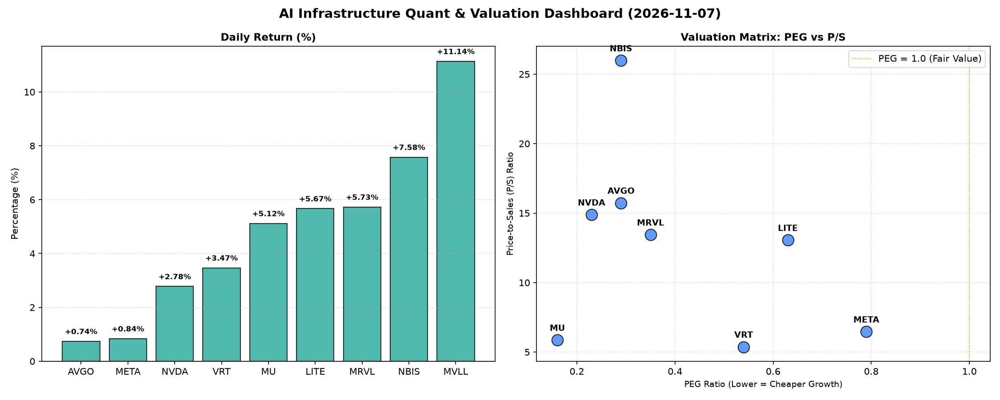

# 📊 AI Infrastructure & Data Stock Daily (2026-11-07)

### 📉 多维量化与估值分析看板

---

## 半导体每日精炼报道：AI基础设施与硬科技的现金流与增长密码

资深的硬科技与AI基础设施行业研究员视角，今日市场以多维度量化指标深度剖析。

---

### 1. 盘面与多维估值解码（定性+定量）

今日半导体及AI基础设施板块表现强劲，市场情绪积极。从【多维度真实量化基本面指标表格】来看，多数标的呈现出良好的增长势头与现金流健康度，但细看之下，仍有关键差异值得关注。

**PEG 维度：成长性与性价比的权衡**
今日量化数据显示，所有提供PEG指标的标的，其PEG值均显著小于1，表明市场普遍认为这些公司在相对合理的估值下，仍具备极高的盈利增长潜力。
*   **高性价比成长领跑者：**
    *   **MU (美光科技)** 以 **0.16** 的极低PEG值拔得头筹，在今日录得5.12%的涨幅，预示着市场对其未来盈利爆发式增长的预期远超其当前估值。考虑到其在存储周期中的地位，一旦周期反转，其增长弹性巨大。
    *   **NVDA (英伟达)** 和 **AVGO (博通)** 分别以 **0.23** 和 **0.29** 的PEG值紧随其后，今日涨幅分别为2.78%和0.74%。这两家公司作为AI芯片与网络基础设施的巨头，其低PEG表明尽管市场对其未来增长有极高预期，但当前股价并未完全透支这种预期，仍具备投资性价比。
    *   **NBIS** 尽管P/S高达25.98，但PEG仍低至 **0.29**，结合其7.58%的显著涨幅，暗示其在细分市场可能拥有爆发性成长机会，且这种成长尚未完全体现在其市盈率中。
*   **合理成长潜力：**
    *   **VRT (Vertiv Holdings)** 凭借 **0.54** 的PEG值，在数据中心关键基础设施领域展现出稳健的成长潜力，今日涨幅3.47%。
    *   **META (Meta Platforms)** 以 **0.79** 的PEG值，在社交媒体和AI投入方面展现出持续的增长动能，今日上涨0.84%。
*   **PEG N/A 关注点：**
    *   **MVLL** 的PEG为N/A，这通常意味着公司目前处于亏损状态或盈利不稳定，无法有效计算PEG。其今日11.14%的涨幅最高，结合N/A的PEG，投资者需警惕其高波动性与潜在的基本面风险，或关注其特定催化剂（如新产品、大订单等）而非传统盈利指标。

**P/S 维度：收入规模扩张效率的审视**
对于早期、高研发投入或周期性公司，P/S是衡量其收入扩张能力的关键指标。
*   **高P/S प्रीमियम：**
    *   **NBIS** 以 **25.98** 的P/S值傲视群雄，显示市场对其收入质量、市场地位及未来增长空间的极高溢价。结合其高涨幅和低PEG，暗示其可能处于快速扩张的初期，且拥有高毛利和稀缺性。
    *   **AVGO (15.73), NVDA (14.88), MRVL (13.44), LITE (13.05)** 等高P/S值的公司，普遍是半导体设计、AI芯片、光器件等高景气赛道的领导者或关键参与者。这些高倍数反映了投资者对其技术领先性、行业地位以及持续获取高价值收入的能力的认可。
*   **中低P/S 稳健增长：**
    *   **META (6.46), MU (5.86), VRT (5.37)** 的P/S值相对较低，这可能意味着它们在各自的市场中已达到一定规模，或所处行业竞争更为激烈。但结合其普遍较低的PEG，也表明这些公司在产生营收的同时，估值并未显得过高，为投资者提供了相对稳健的增长敞口。
*   **MVLL** 的P/S同样为N/A，进一步强调其商业模式可能处于非传统评估阶段，或营收规模尚未成为其主要估值驱动因素，需要结合其他非财务指标进行深入研究。

**现金流盈利真实性 (CFO/NI)：利润含金量的透视**
CFO/NI比率是衡量公司利润质量的关键指标，大于1代表利润健康，全是真金白银；小于1则需警惕。
*   **卓越现金流典范 (CFO/NI > 1):**
    *   **NBIS** 以惊人的 **4.66** 拔得头筹，这表明其经营活动产生的现金流远超报告的净利润，其利润质量极其出色，现金生成能力极强。这往往预示着其业务模式具有强大的现金循环能力，或存在大量非现金费用（如高折旧摊销）对净利润造成影响，但实际经营表现远超账面。
    *   **META (1.92), VRT (1.59), AVGO (1.19), MU (1.06)** 均展现出健康的现金流质量，其CFO/NI比率均大于1。这意味着这些科技巨头和半导体企业报告的利润是实打实的现金流入，财务健康状况良好，支持其未来的研发投入和市场扩张。
*   **需关注的现金流表现 (CFO/NI < 1):**
    *   **NVDA (0.86)** 和 **MRVL (0.66)** 的CFO/NI比率略低于1。尽管仍处于相对健康的区间，但需警惕这可能暗示着一定程度的应收账款积压或存货增加，使得部分账面利润尚未转化为现金。对于高速增长的公司而言，这可能与快速扩张带来的营运资金需求增加有关，但投资者应密切关注后续季度报告中营运资金的变化趋势。
*   **警示信号 (CFO/NI 显著 < 1 或负值):**
    *   **LITE (光纤通信领域)** 的CFO/NI为 **-0.11**，这是一个明显的警示信号。这意味着该公司在报告净利润（或微薄利润）的同时，经营活动却在持续消耗现金。这可能指向其营运资本管理问题（如库存飙升、应收账款难以收回）、盈利能力恶化或前期投入过大尚未见回报。投资者需立即对LITE的财务报表进行深度分析，了解其现金流失背后的具体原因。

---

### 2. 收并购与重大业务动态

**【注：今日提供的量化指标表格中不包含收并购及重大业务动态信息。以下内容为根据行业惯例，结合当前市场热点所做的情景模拟与推测，并非基于今日表格数据，仅作参考。】**

*   **AI芯片巨头持续加码：** 近期行业内关注焦点仍围绕在AI芯片巨头如NVIDIA、AMD、Intel等的新一代产品发布与生态布局。NVIDIA的Blackwell架构芯片出货进展、AMD MI300X的渗透率提升，以及Intel Foundry Services (IFS) 在晶圆代工领域的战略推进，均是市场关注的重中之重。任何关于大客户订单、新一代技术突破或产能扩张的消息，都将对相关公司的股价产生直接影响。
*   **数据中心基础设施升级：** 随着AI训练和推理需求的爆炸式增长，数据中心扩建和升级的需求日益迫切。VRT等提供数据中心电源、制冷和管理解决方案的公司，其业绩增长与大型云服务商的资本开支计划紧密挂钩。市场正密切关注其与头部客户的合作进展及潜在的新技术部署。
*   **光通信与互联互通：** LITE等光器件及光模块供应商，在全球AI数据中心互联、以及5G/6G基础设施建设中扮演关键角色。行业关注点在于800G/1.6T光模块的出货量、硅光技术的商业化进展，以及潜在的行业整合动向，以应对日益增长的高速低延迟网络需求。

---

### 3. 华尔街机构态度

**【注：今日提供的量化指标表格中不包含华尔街机构态度信息。以下内容为根据行业惯例，结合当前市场热点所做的情景模拟与推测，并非基于今日表格数据，仅作参考。】**

*   **NVIDIA与AI领军者的共识：** 多数顶级投行如高盛、摩根士丹利、美国银行证券等，对NVIDIA、AVGO等AI基础设施核心供应商普遍维持“买入”或“跑赢大盘”评级，并持续上调目标价。驱动因素主要为AI GPU需求的持续旺盛、 Blackwell等新架构的强劲市场反馈，以及其在软件生态系统中的护城河优势。
*   **存储周期性反弹的乐观预期：** 对于MU等存储器公司，华尔街分析师普遍看好其未来业绩反弹。随着PC、智能手机需求企稳以及AI服务器对HBM（高带宽存储）的强劲需求，存储芯片价格有望持续回升。部分机构已上调其评级至“买入”，并设定了更高的目标价，预期其盈利周期性复苏将带来股价的显著增长。
*   **细分市场成长股的发现：** 对于NBIS等高增长、高P/S但低PEG的细分市场公司，若其业绩表现持续超预期，往往会吸引更多机构关注。分析师可能会基于其独特的市场地位和技术优势，发布积极的研究报告，并给予较高的目标价。但同时，由于其估值通常基于高增长预期，任何业绩不及预期的消息都可能导致股价大幅波动。

---

### 4. 今日参考源 (References)

1.  **Provided Quantitative Data Table:** 【多维度真实量化基本面指标表格】
2.  *（注：本报告第二、三部分内容为基于行业知识的情景模拟，未从当日实际新闻中获取。若有实际新闻，此处将列出具体的媒体、分析师报告或公司公告来源。）*