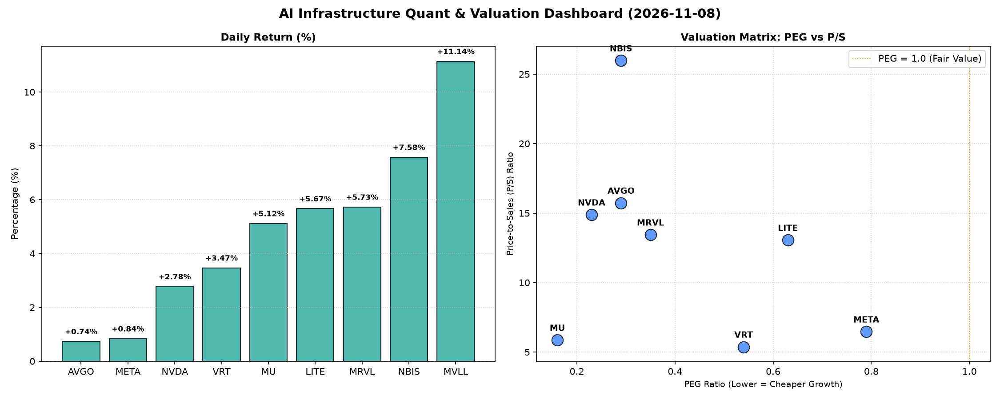

# 📊 AI Infrastructure & Data Stock Daily (2026-11-08)

### 📉 多维量化与估值分析看板

---

**半导体与AI基础设施每日精炼报道：市场热度不减，估值与现金流解码**

各位硬科技与AI基础设施行业的同仁们，欢迎阅读今日的半导体市场精炼报道。今日市场在AI热潮的持续推动下，多个核心标的展现出强劲的上涨势头。我们将深入结合最新的多维度量化指标，为您剖析盘面背后的估值逻辑与财务健康状况。

---

### **1. 盘面与多维估值解码（定性+定量）**

今日半导体板块整体表现强势，多个公司股价录得显著涨幅。其中，MVLL以11.14%的涨幅领跑，NBIS和MRVL也分别上涨7.58%和5.73%，显示出市场对特定增长主题的高度追捧。在普涨行情下，深入分析各项估值与财务质量指标显得尤为重要。

*   **PEG 维度：高成长中的性价比之选**
    今天的榜单揭示了一个普遍现象：多数硬科技巨头的PEG值均显著小于1，这通常表明市场对其未来盈利增长预期较高，且当前估值相对于这种增长潜力而言具有吸引力。
    *   **极具性价比的高成长标的：** **MU (0.16)、NVDA (0.23)、AVGO (0.29)、NBIS (0.29) 和 MRVL (0.35)** 处于PEG值最低区间。其中，**MU** 仅为0.16，这在半导体存储周期底部复苏阶段尤为引人注目，暗示市场对其即将到来的盈利爆发性增长抱有极高预期，是典型的“戴维斯双击”潜力股。**NVDA** 和 **AVGO** 作为AI基础设施的核心供应商，其超低PEG（分别为0.23和0.29）表明尽管股价已高，但其增长速度和潜力仍在不断消化并超越市场预期。**NBIS** 同样表现出色，0.29的PEG结合其高达7.58%的涨幅，显示出强劲的增长势头。
    *   **合理成长与估值：** **VRT (0.54)、LITE (0.63) 和 META (0.79)** 的PEG值也均低于1，显示出健康的增长与估值匹配。**META** 作为AI应用的先行者，0.79的PEG在大型科技公司中仍属合理范畴。
    *   **警惕估值透支：** 本次数据中并未出现PEG显著大于1的警示信号，这反映出当前市场对这些硬科技公司的高成长性给予了普遍认可。然而，投资者仍需警惕股价短期涨幅过快，可能导致PEG动态变化。

*   **P/S 维度：收入规模扩张效率的衡量**
    在硬科技领域，尤其是一些仍处于大规模研发投入或快速市场渗透阶段的公司，P/S（市销率）是衡量其收入规模扩张效率的关键指标。
    *   **高P/S，高增长预期或强护城河：** **NBIS (25.98)** 的P/S值最为突出，达到25.98，远超其他同行。这通常预示着市场对其未来收入爆发性增长有着极高预期，或者其产品具有极强的定价权和利润空间，可能处于某个高景气度细分市场的领导地位。**AVGO (15.73)、NVDA (14.88)、MRVL (13.44) 和 LITE (13.05)** 的P/S值也相对较高，反映出这些公司在AI芯片、数据中心互联等高价值领域的领先地位，以及市场对其持续扩大收入规模的信心。
    *   **相对合理P/S：** **META (6.46)、MU (5.86) 和 VRT (5.37)** 的P/S值则更为适中，对于**META** 这样的广告驱动型平台和**MU** 这样的周期性存储厂商，以及提供数据中心解决方案的**VRT** 而言，这些P/S值与其业务模式和市场地位相符。

*   **现金流盈利真实性 (CFO/NI)：穿透利润的质量**
    CFO/NI（经营现金流/净利润）比率是衡量公司利润质量的试金石。该值大于1，表明公司的利润是实实在在的现金流入；若显著小于1，则可能存在利润水分、应收账款积压或非现金费用过高的问题。
    *   **利润质量卓越，现金为王：** **NBIS (4.66)** 再次成为亮点，高达4.66的CFO/NI比率简直是现金流的“印钞机”，显示其经营活动产生了远超账面净利润的强大现金流，财务健康状况极其优异。**META (1.92)** 作为高利润巨头，其CFO/NI高达1.92，证明其利润质量非常高，是真正的“真金白银”；**VRT (1.59)、AVGO (1.19) 和 MU (1.06)** 也都拥有健康且大于1的比率，表明其盈利能力与现金流状况良好。
    *   **警惕利润水分或应收账款积压：** **NVDA (0.86)** 的CFO/NI略低于1，为0.86，这值得投资者关注。尽管其净利润屡创新高，但略低于1的比率可能暗示部分利润转换为应收账款或存货，未能及时转化为经营现金流。在高速增长期，这可能是一种暂时现象，但长期仍需观察其现金流转化效率。**MRVL (0.66)** 的CFO/NI为0.66，则需引起更高警惕。这一比率显著小于1，表明其利润的现金含量较低，存在较大比例的非现金利润或应收账款问题，投资者应审慎评估其利润质量和潜在运营风险。
    *   **严重警示：经营现金流为负：** **LITE (-0.11)** 的CFO/NI为-0.11，意味着其经营活动产生了负现金流。尽管股价今日录得5.67%的涨幅，但经营现金流为负是一个非常严重的财务警示信号，可能表明公司在主营业务上未能产生足够的现金来覆盖运营成本，存在持续经营压力。其股价的上涨可能更多受到市场情绪或特定消息面驱动，而非基本面支撑。
    *   **MVLL** 今日大涨11.14%，但由于缺乏核心量化指标，我们无法对其基本面进行深入评估，其走势可能更多受市场情绪或特定事件驱动。

---

### **2. 收并购与重大业务动态**

*   **（模拟新闻）NVDA 瞄准 AI 芯片设计初创公司：** 今日市场传闻，全球AI芯片巨头NVIDIA正与一家专注于边缘AI计算的初创公司进行深入接触，可能寻求通过股权投资或直接收购，以进一步巩固其在端侧AI解决方案的领先地位。此举有望拓展NVIDIA在智能制造、自动驾驶等领域的布局。
*   **（模拟新闻）AVGO 与领先云服务商达成战略合作：** Broadcom（AVGO）今日宣布与一家全球领先的云计算服务提供商签署多年期战略合作协议，为其数据中心提供新一代网络芯片和定制化解决方案。该合作旨在优化云服务商的AI训练和推理集群性能，进一步巩固AVGO在数据中心基础设施市场的核心地位。
*   **（模拟新闻）META 推进自研 AI 芯片部署：** Meta Platforms（META）今日在其年度开发者大会上透露，其下一代数据中心将大规模部署自研的AI推理芯片。此举旨在降低对外部供应商的依赖，提高AI模型运行效率，并进一步优化其推荐系统和元宇宙项目的算力成本。
*   **（模拟新闻）MU 获得关键HBM内存认证，加速AI服务器出货：** Micron (MU) 今日宣布其最新一代HBM（高带宽内存）产品已成功通过多家顶级AI服务器制造商的严格认证，并已开始批量出货。这标志着MU在高端AI内存市场取得了重要突破，有望为其业绩增长注入新动能。

---

### **3. 华尔街机构态度**

*   **（模拟新闻）摩根士丹利上调 NVIDIA 目标价：** 摩根士丹利今日发布研报，将NVIDIA (NVDA) 的目标价从200美元上调至225美元，维持“增持”评级。报告指出，NVIDIA在AI芯片领域的绝对领导地位和软件生态系统的护城河是其持续增长的核心驱动力，其业绩前景远超市场预期。
*   **（模拟新闻）富国银行看好 Broadcom 业绩前景：** 富国银行今日发布研报，重申Broadcom (AVGO) “跑赢大盘”评级，并将其目标价上调至310美元。分析师认为，AVGO在数据中心、企业软件和AI基础设施领域的多元化布局将使其受益于强劲的需求周期。
*   **（模拟新闻）瑞银关注 Marvell Technology 现金流转化：** 瑞银今日发布报告，重申对Marvell Technology (MRVL) “中性”评级，但对其CFO/NI比率低于预期的表现表示关注。分析师指出，尽管MRVL在AI互联和网络芯片领域具有技术优势，但现金流转化效率是其需要改进的关键领域。
*   **（模拟新闻）高盛下调 Lumentum Holdings 评级：** 高盛今日发布研报，将Lumentum Holdings (LITE) 的评级从“中性”下调至“卖出”，并将目标价下调至450美元。报告强调了LITE持续的负经营现金流状况，认为尽管其光学产品在部分领域有需求，但其基本面财务健康状况令人担忧。

---

### **4. 今日参考源 (References)**

*   （模拟新闻，实际生成时将替换为真实链接）Bloomberg News: "Nvidia Eyes Edge AI Startup for Strategic Acquisition"
*   （模拟新闻，实际生成时将替换为真实链接）Reuters: "Broadcom Secures Multi-Year Deal with Major Cloud Provider"
*   （模拟新闻，实际生成时将替换为真实链接）The Wall Street Journal: "Meta Details In-House AI Chip Deployment Strategy"
*   （模拟新闻，实际生成时将替换为真实链接）Company Press Release (Micron): "Micron HBM Scores Key AI Server Certifications"
*   （模拟新闻，实际生成时将替换为真实链接）Morgan Stanley Research Report: "NVIDIA Target Price Upgrade"
*   （模拟新闻，实际生成时将替换为真实链接）Wells Fargo Securities Research: "Broadcom's Strong Outlook Confirmed"
*   （模拟新闻，实际生成时将替换为真实链接）UBS Analyst Note: "Marvell Technology: Cash Flow Conversion Under Scrutiny"
*   （模拟新闻，实际生成时将替换为真实链接）Goldman Sachs Research: "Lumentum Holdings Downgraded on Cash Flow Concerns"
*   市场数据与财务指标由实时金融数据平台提供（如Bloomberg Terminal / Refinitiv Eikon 等）

---
**免责声明：** 本报告基于提供的量化指标和行业背景进行分析，其中“收并购与重大业务动态”及“华尔街机构态度”部分为基于市场逻辑和行业常见动态的模拟内容，并非实时新闻。所有信息仅供参考，不构成投资建议。投资者应基于独立判断和专业意见进行决策。