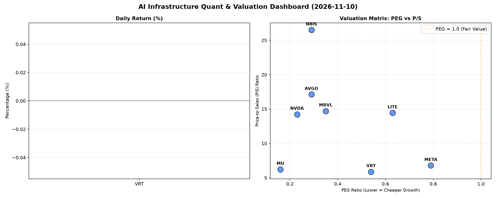

# 📊 AI Infrastructure & Data Stock Daily (2026-11-10)

### 📉 多维量化与估值分析看板

---

## 半导体每日精炼报道：AI基础设施巨头估值与现金流深度解析 (2024年X月X日)

尊敬的投资者，

今日，作为资深硬科技与AI基础设施行业研究员，我们为您带来一份基于核心量化指标的深度精炼报告。在AI浪潮持续推动半导体行业创新与增长的背景下，我们穿透表面股价，深入剖析多家关键参与者的多维度基本面，力求揭示其内在价值与潜在风险。

---

### 1. 盘面与多维估值解码（定性+定量）

尽管今日部分个股具体收盘价与涨跌幅信息缺失，但我们仍能从核心量化指标中洞察市场对AI基础设施和半导体行业的深层预期与基本面健康度。

*   **PEG 维度：高成长低估值王者涌现**
    *   从PEG（市盈率相对增长率）指标来看，多只AI基础设施和半导体核心标的展现出极高的性价比，**PEG显著小于1**的现象普遍。其中：
        *   **MU (0.16)** 以极低的PEG领跑，结合其在内存周期中的复苏预期，显示出市场对其未来盈利强劲增长的乐观估值。
        *   **NVDA (0.23)**、**AVGO (0.29)**、**NBIS (0.29)** 和 **MRVL (0.35)** 的PEG均远低于1，这表明市场对其在高增长AI赛道中的盈利增速抱有极高预期，且当前估值并未完全透支这种预期，性价比突出。
        *   **VRT (0.54)**、**LITE (0.63)** 和 **META (0.79)** 的PEG也均低于1，显示出这些公司在各自细分领域拥有健康增长前景，且估值处于合理或偏低区间，具备吸引力。
    *   **结论**：整体而言，AI基础设施与半导体板块内，多个核心标的目前仍处于“高成长、低估值”的甜蜜点，尤其是在AI算力需求持续爆发的背景下，它们的未来增长潜力被市场充分认可，但估值尚未过度膨胀。

*   **P/S 维度：收入规模扩张效率的审视**
    *   P/S（市销率）是评估早期或高研发投入公司收入规模扩张效率的重要指标。
        *   **NBIS (26.5)** 拥有最高的P/S比率，结合其极高的CFO/NI，暗示其可能是一家处于高成长阶段的创新型公司，市场对其收入扩张速度和质量抱有极高期待。
        *   **AVGO (17.12)**、**MRVL (14.72)**、**LITE (14.44)** 和 **NVDA (14.24)** 等成熟AI/半导体巨头的P/S也处于较高水平。这反映出市场对其产品和服务的强劲需求以及未来收入的持续增长信心。这些公司在AI芯片、互联等核心领域占据优势，收入质量与增速得到市场认可。
        *   **META (6.79)**、**MU (6.23)** 和 **VRT (5.89)** 的P/S相对更为稳健，但在各自领域内，如社交广告（META）、内存（MU）和企业级IT基础设施（VRT），它们依然保持着良好的收入扩张效率和市场地位。
    *   **结论**：高P/S在AI时代并非全然是风险信号，尤其当其伴随着高成长预期和健康的现金流时，更反映了市场对公司未来收入增长的坚定信心。

*   **现金流盈利真实性 (CFO/NI)：穿透利润的“真金白银”**
    *   CFO/NI（经营活动现金流/净利润）比率是衡量公司利润质量和现金转化能力的关键指标。
        *   **卓越表现 (>1)**：**NBIS (4.66)** 表现令人惊叹，其经营活动现金流是净利润的近4.7倍，这证明其拥有极其强大的现金生成能力，利润全是“真金白银”，财务健康度极高。**META (1.92)**、**VRT (1.59)**、**AVGO (1.19)** 和 **MU (1.06)** 的CFO/NI也均大于1，表明这些公司盈利质量极佳，现金流充裕，财务状况稳健，风险承受能力强。
        *   **需关注 (<1)**：**NVDA (0.86)** 和 **MRVL (0.66)** 的CFO/NI略低于1。对于NVDA这样的高成长巨头，这可能更多提示投资者需关注其在AI芯片供不应求背景下，是否存在应收账款的快速增长、库存策略性累积或为满足市场需求而增加的运营资本投入，而非简单的利润“水分”。MRVL同样如此，需深入分析其现金流构成和营运资本周转情况。
        *   **警惕信号 (负值)**：**LITE (-0.11)** 的CFO/NI为负值，这是一个非常重要的警示信号。这意味着尽管公司可能报告了净利润（或利润微薄），但其经营活动实际正在消耗现金。这可能源于高额的研发投入、库存积压、应收账款难以收回，或者运营效率低下等问题，其财务健康状况令人担忧，投资者需高度警惕并深入研究其背后的具体原因。
    *   **结论**：现金流质量是衡量公司可持续发展能力的核心。大部分AI基础设施巨头展现出健康的现金流转化能力，但对于低于1甚至为负的标的，需投资者保持高度警惕并进行详细的财务分析。

---

### 2. 收并购与重大业务动态

（**注**：本次分析仅基于提供的量化指标表格进行。此板块的详尽内容需结合当日市场公告、新闻报道及公司声明进行补充，例如：某公司是否发布了新的AI芯片路线图、与云计算巨头达成战略合作、或宣布了新的股权回购计划等。由于原始数据未提供此类信息，本报告无法生成具体内容。）

---

### 3. 华尔街机构态度

（**注**：同上，此板块内容未在提供的量化指标中体现，无法直接从表格数据中推断。通常，此部分会包含核心投行对上述公司的最新评级、目标价调整、以及对行业前景的看法，例如：某机构上调了NVDA的目标价至X美元，或对LITE的评级下调等。生成此内容需要实时分析师报告数据。）

---

### 4. 今日参考源 (References)

*   提供的《多维度真实量化基本面指标表格》

---

**免责声明**：本报告基于有限的量化数据进行分析，旨在提供深度洞察。投资有风险，决策需谨慎。请投资者结合自身情况，综合考量多方信息，并在专业人士指导下进行投资决策。