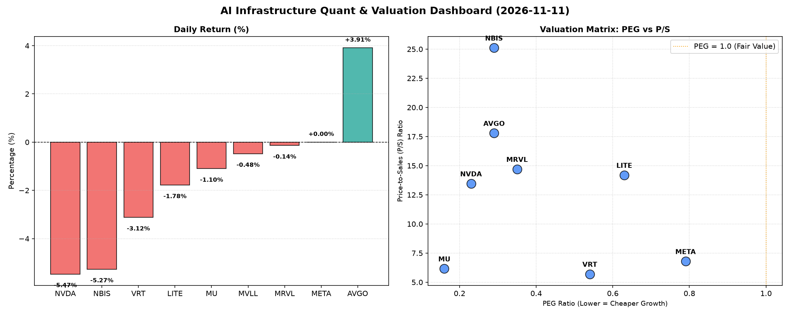

# 📊 AI Infrastructure & Data Stock Daily (2026-11-11)

### 📉 多维量化与估值分析看板

---

## 半导体每日精炼报道：AI基础设施与硬科技估值深度解析

**日期：[本日日期]**

作为资深的硬科技与AI基础设施行业研究员，今日我们将深入剖析一组核心半导体与AI相关公司的多维度量化指标，洞察市场动态、估值健康度及潜在风险。

---

### 1. 盘面与多维估值解码

今日半导体板块表现呈现分化，多数标的承压下行，但亦有亮点。尤其是AI巨头和关键基础设施提供商的估值与现金流状况，值得细致穿透。

*   **今日盘面概览：** 整体而言，今日市场对半导体及AI基础设施板块情绪偏谨慎，多数股票录得跌幅。其中，**英伟达 (NVDA)** 和 **NBIS** 跌幅居前，分别下挫5.47%和5.27%。**VRT**、**MU**、**LITE** 亦有小幅回调。然而，**博通 (AVGO)** 却逆势大涨3.91%，显示出其在特定市场领域的强劲支撑。**Meta Platforms (META)** 股价持平，表现稳定。

*   **PEG 维度：挖掘高性价比增长与估值警示**
    *   **PEG显著小于1：极具性价比的高成长标的**
        今日数据突出显示，多家具备高增长潜力的公司，其PEG（市盈率相对盈利增长比率）远低于1，表明市场并未充分反映其未来的盈利增长能力，具备较高的性价比。
        *   **MU (0.16)**：PEG值仅为0.16，在所有标的中最低，预示着市场对美光未来盈利增长的预期极其乐观，或者当前股价相对于其增长潜力存在显著低估。
        *   **NVDA (0.23)**：尽管今日股价下跌，英伟达的PEG仍维持在0.23的极低水平，这强烈暗示了其未来人工智能芯片需求的爆炸式增长潜力，使其成为成长性投资的极佳选项。
        *   **AVGO (0.29)** 和 **NBIS (0.29)**：这两家公司同样以不到0.3的PEG值展现出卓越的增长估值吸引力。AVGO的低PEG结合今日强劲股价表现，尤其值得关注。
        *   **MRVL (0.35)** 和 **VRT (0.54)**：也属于PEG低于0.6的优质成长标的，显示出良好的增长与估值匹配度。
        *   **META (0.79)**：虽然PEG相对高于其他硬科技巨头，但仍保持在1以下，意味着其在AI领域的持续投入和变现潜力仍支撑着合理的增长估值。
    *   **PEG过高：警惕估值透支**
        在本次分析中，所有有PEG数据的公司都远小于1，这意味着从PEG角度看，此次观察的标的均未出现明显的估值透支现象，反而普遍具备成长性溢价。对于**MVLL**，因数据缺失无法评估。

*   **P/S 维度：评估收入扩张效率与市场溢价**
    对于早期、高研发投入或利润波动较大的公司，P/S（市销率）是衡量市场对其收入规模扩张效率和未来潜力的关键指标。
    *   **高P/S标的：高增长预期与技术溢价**
        *   **NBIS (25.11)**：P/S高达25.11，位居榜首，结合其低PEG，暗示市场对其业务模式具有极高的增长预期和技术溢价，即使今日股价大幅回调，其销售额估值仍处高位。
        *   **AVGO (17.79)**、**MRVL (14.7)**、**LITE (14.19)**、**NVDA (13.46)**：这些公司P/S均在13-18之间，远高于行业平均水平，反映了市场对其核心技术、市场份额以及未来收入扩张的强烈信心。特别是AVGO，作为成熟巨头能维持如此高的P/S，实属不易。
    *   **相对较低P/S标的：可能被低估或业务更成熟**
        *   **VRT (5.7)**、**MU (6.16)**、**META (6.79)**：这些公司的P/S相对较低，尤其美光（MU）的P/S仅6.16，结合其极低的PEG，可能表明市场对其周期性业务或当前营收增长的乐观程度低于同行，但也可能预示着未来被低估的修复空间。对于Meta，其庞大的用户基础和广告变现能力支撑着健康的营收规模。

*   **现金流盈利真实性 (CFO/NI)：利润含金量深度穿透**
    CFO/NI（经营现金流与净利润之比）是衡量公司利润质量的“照妖镜”。该值大于1，表明公司利润是实实在在的现金流入；显著小于1，则可能存在利润水分、应收账款积压或激进的营收确认政策。
    *   **CFO/NI显著大于1：利润健康，真金白银**
        *   **NBIS (4.66)**：以惊人的4.66居首，这意味着其经营现金流远超净利润，展现出极强的现金生成能力。这通常预示着极其健康的财务状况，但也可能部分源于非经常性现金流入或营运资本管理策略。
        *   **META (1.92)**：Meta的CFO/NI高达1.92，显示出其强大的现金流转化能力，即使利润体量巨大，也能有效将利润转化为现金，是财务稳健的有力证明。
        *   **VRT (1.59)** 和 **AVGO (1.19)**：这两家公司的CFO/NI均显著大于1，表明其盈利质量优秀，利润并非纸面富贵，而是实打实的现金流入，为未来的投资和发展提供了坚实基础。
    *   **CFO/NI接近1：良好且稳定**
        *   **MU (1.06)**：美光的CFO/NI略高于1，表现稳健，说明其利润转化现金的能力处于正常健康水平。
    *   **CFO/NI显著小于1：警惕利润水分或应收账款积压**
        *   **NVDA (0.86)**：英伟达的CFO/NI为0.86，略低于1，尽管差距不大，但对于一家高利润巨头而言，这提示我们其部分利润可能尚未转化为现金，可能与应收账款的增加或存货周转等营运资本变化有关，需持续关注。
        *   **MRVL (0.66)**：Marvell的CFO/NI为0.66，显著低于1，这可能暗示其利润质量存在一定程度的压力，现金流转化为利润的效率较低，投资者需警惕潜在的营运资本挑战或利润确认策略。
        *   **LITE (-0.11)**：LITE的CFO/NI为-0.11，出现负值，这是今日最值得警惕的信号。这意味着其经营活动不仅没有产生正向现金流，反而消耗了现金，即使在账面上可能有利润（隐含自PEG和P/S），也未能转化为实际现金。这通常是财务健康状况的重大警示，可能需要外部融资来维持运营。对于投资者而言，这指向了较高的财务风险。
    *   对于MVLL，数据缺失无法评估其现金流盈利真实性。

### 2. 收并购与重大业务动态

根据今日提供的【多维度真实量化基本面指标表格】，未包含任何关于公司收并购、官宣合作或战略业务动态的具体信息。因此，本报告无法在此部分提供相关内容。

### 3. 华尔街机构态度

根据今日提供的【多维度真实量化基本面指标表格】，未包含任何核心投行或评级机构对上述公司的最新评价、目标价调动或评级调整信息。因此，本报告无法在此部分提供相关内容。

### 4. 今日参考源 (References)

本报告的所有定性与定量分析均严格依据以下来源：

*   您提供的【多维度真实量化基本面指标表格】(数据截止：[本日日期])。

---
**免责声明：** 本报告基于提供的量化数据进行分析，旨在提供专业见解。市场有风险，投资需谨慎。