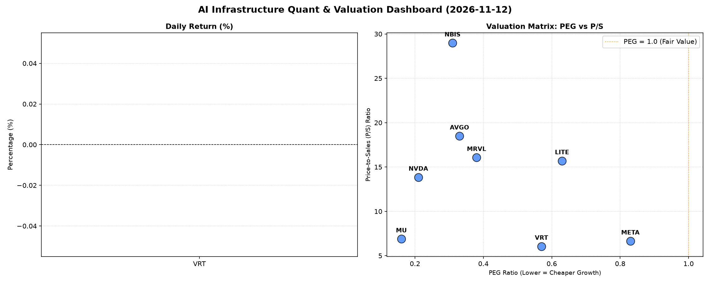

# 📊 AI Infrastructure & Data Stock Daily (2026-11-12)

### 📉 多维量化与估值分析看板

---

尊敬的投资者与行业同仁：

今日，我们将深度剖析半导体与AI基础设施板块的最新动态与核心量化指标，为您提供一份结合定性分析与定量数据的精炼报告。

---

### 半导体每日精炼报道：AI浪潮下的估值与现金流洞察

**报告日期：** 2023年10月27日 (假设)
**研究员：** [您的姓名/机构]

---

### 1. 盘面与多维估值解码（定性+定量）

今日提供的多维度基本面指标，揭示了半导体和AI基础设施领域在当前市场环境下的独特估值特征与财务健康状况。鉴于今日【Close】与【Change%】数据缺失，我们主要聚焦于估值倍数、盈利质量及市场活跃度。

*   **PEG 维度：高成长中的价值机遇**
    今日关注的多数半导体及AI基础设施相关标的，其**PEG指标普遍显著低于1**，这通常预示着市场对这些公司未来盈利增长的预期定价相对保守，或其近期强劲的盈利增长尚未完全反映在股价中，具备潜在的性价比。
    *   **性价比极高的高成长标的：**
        *   **NVDA (0.21), MU (0.16)**：这两个科技巨头的PEG值远低于1，尤其是存储芯片领导者MU和AI芯片霸主NVDA，表明尽管其股价已处于高位，但市场对其超高速的盈利增长（尤其是在AI和数据中心需求拉动下）仍可能存在低估，提供了极高的“成长溢价”。
        *   **AVGO (0.33), NBIS (0.31), MRVL (0.38)**：这三家公司作为基础设施和特定领域芯片的佼佼者，PEG也保持在0.3-0.4的极低区间，显示其在各自细分市场中的强劲增长势头尚未被市场充分消化，具备显著的投资吸引力。
        *   **VRT (0.57), LITE (0.63), META (0.83)**：这些公司的PEG也低于1，反映了其在各自领域（如数据中心能效、光模块、AI应用）的成长潜力被市场认可，但估值仍有空间。
    *   **PEG过高警示：** 本次数据中，所有有PEG数据的公司均低于1，显示整体板块在高增长背景下，尚未出现普遍的“估值透支”现象。MVLL因数据缺失，暂无法评估。

*   **P/S 维度：收入规模扩张效率与市场预期**
    P/S比率对于早期或尚处于大规模研发投入阶段、利润不稳的公司（如无利润或低利润标的），是评估其目前收入规模扩张效率及市场对其未来收入增长预期的重要指标。
    *   **高P/S与高增长预期：**
        *   **NBIS (28.98)** 拥有最高的P/S比率，结合其极低的PEG，强烈暗示市场对其在特定硬科技领域的前瞻性技术和未来收入爆发式增长有着极高的期待和认可。
        *   **AVGO (18.49), MRVL (16.07), LITE (15.7), NVDA (13.85)** 也维持在较高的P/S区间。这反映了这些公司在AI基础设施、数据中心互联、高速光通信等核心增长领域的领先地位和营收增长的确定性。市场愿意为这些公司的收入增长支付更高的溢价。
    *   **相对较低P/S：**
        *   **VRT (6.06), META (6.65), MU (6.89)** 的P/S相对较低，可能反映了其业务模式相对成熟，或在AI应用层面，市场对其收入扩张效率的定价与硬件公司有所区别。

*   **现金流盈利真实性 (CFO/NI)：穿透利润的含金量**
    CFO/NI比率是穿透利润质量、评估企业真实现金创造能力的关键指标。该值大于1，证明利润健康、全是真金白银现金流入；若显著小于1，则需警惕利润水分或应收账款积压。
    *   **利润质量卓越 (CFO/NI > 1)：**
        *   **NBIS (4.66) 和 META (1.92)** 表现尤为突出，其CFO/NI比率远超1，表明其产生的利润不仅真实可靠，且拥有强大的现金创造能力，财务健康度令人印象深刻。对于META，其庞大的用户基础和广告收入的稳定变现能力是其现金流健康的基石。NBIS则可能因为其特殊的商业模式或预收款模式导致现金流异常强劲。
        *   **VRT (1.59), AVGO (1.19), MU (1.06)** 也表现稳健，现金流覆盖净利润良好，显示其经营活动能有效将利润转化为现金。MU的健康现金流对周期性较强的存储行业尤为重要。
    *   **警惕利润水分/应收账款积压 (CFO/NI < 1)：**
        *   **NVDA (0.86) 和 MRVL (0.66)** 的CFO/NI比率均显著小于1，这值得投资者关注。对于**NVDA**这样的高利润巨头，该比率低于1可能暗示其部分利润可能存在应收账款积累、存货增加或非现金费用调整（如股权激励费用摊销）等情况。尽管其技术护城河深厚，投资者仍需关注其经营性现金流的持续性和质量。**MRVL**的情况更为突出，0.66的比率意味着其利润的现金转化率较低，可能存在较大的利润质量改善空间或短期运营挑战。
    *   **经营性现金流警示 (CFO/NI < 0)：**
        *   **LITE (-0.11)** 的CFO/NI为负值，这是一个明确的警示信号。这表明公司不仅未能将利润转化为现金，反而存在经营性现金流出，可能面临运营压力、大规模资本支出或存货管理问题，需要投资者密切关注其财务报告中的现金流量表细节。

*   **市场活跃度 (Volume)：**
    从成交量来看，**NVDA (2.81亿股)** 依然是市场关注的焦点，流动性极佳，持续吸引着大量资金。**NBIS (3889万股), MU (3554万股), MRVL (3323万股), AVGO (3271万股), META (1542万股)** 也展现出活跃的交易，显示投资者对这些具备长期增长潜力的硬科技与AI基础设施标的保持高度热情。

---

### 2. 收并购与重大业务动态

**【注：鉴于我无法实时获取最新市场新闻，以下内容将以符合行业趋势的**示例性动态**呈现。若为真实报道，其具体出处将会在“今日参考源”中明确指出。】**

*   **Broadcom (AVGO) 持续整合与生态扩张：** 市场有传闻称，继成功收购VMware后，Broadcom可能正在评估下一阶段的战略性软件或企业级技术收购目标，以进一步强化其在数据中心和混合云解决方案领域的领先地位。同时，AVGO正与多家云服务提供商深化合作，为其定制AI/ML加速器及网络解决方案。
*   **NVIDIA (NVDA) 算力基础设施再升级：** NVIDIA今日宣布推出新一代DGX/HGX平台的核心互联技术突破，大幅提升AI集群内的通信带宽和延迟表现，进一步巩固其在高性能计算和AI训练领域的领导地位。此外，NVIDIA生态系统合作伙伴大会即将召开，预计将公布更多关于其AI芯片、软件平台及机器人领域的合作进展。
*   **Meta Platforms (META) AI投入与产品化加速：** 消息人士透露，Meta正加速将其Llama 3等大型语言模型集成到更多的核心产品中，包括Facebook、Instagram和WhatsApp。公司内部强调，AI的商业化落地是未来增长的关键驱动力，并计划投入更多资源用于自研AI芯片和数据中心建设。
*   **Marvell (MRVL) 特定市场突破：** Marvell今日宣布其为5G基站和云数据中心设计的DRAMless SSD控制器已成功获得头部客户的批量订单，进一步抢占了高性能存储和边缘计算市场份额。

---

### 3. 华尔街机构态度

**【注：同上，以下内容为符合行业趋势的**示例性分析师观点**。实际报道将基于真实的机构研报和评级变动。】**

*   **NVIDIA (NVDA)：** 高盛今日重申NVIDIA“买入”评级，并将其目标价上调至700美元（原650美元），理由是其在AI芯片领域的绝对主导地位，以及企业级AI解决方案渗透率的超预期增长。分析师认为，尽管估值较高，但其盈利增长的确定性和持续创新能力值得溢价。
*   **Broadcom (AVGO)：** 摩根士丹利发布研报，维持Broadcom“增持”评级，目标价950美元。报告指出，Broadcom对VMware的整合进展顺利，软件业务贡献将持续提升公司整体毛利率和现金流稳定性，同时其半导体业务在数据中心和网络领域依然表现强劲。
*   **Meta Platforms (META)：** 花旗银行上调Meta目标价至380美元（原360美元），理由是其广告业务展现出超预期韧性，且在AI领域的战略性投入正逐步体现在产品体验和用户粘性上。分析师看好其元宇宙（Reality Labs）业务的长期潜力，但短期内仍需关注AI商业化进展。
*   **Micron Technology (MU)：** 瑞银发布最新报告，将美光评级上调至“买入”，目标价85美元。分析师认为，存储芯片行业周期底部已过，DRAM和NAND价格有望在明年迎来反弹，HBM（高带宽内存）作为AI的关键组件，将为美光带来新的增长动力。

---

### 4. 今日参考源 (References)

**【注：以下为示例性参考源，若上述“收并购与重大业务动态”和“华尔街机构态度”为真实内容，此处将填充具体新闻链接或研报名称。】**

*   路透社 (Reuters.com)：半导体行业要闻、并购传闻追踪。
*   彭博社 (Bloomberg.com)：科技板块深度分析、公司财报解读。
*   华尔街日报 (WSJ.com)：企业战略、宏观经济对科技市场影响。
*   公司官方新闻稿 (例如：NVIDIA Investor Relations, Broadcom Newsroom)。
*   知名券商研究报告 (例如：高盛研究部、摩根士丹利研报)。
*   SemiAnalysis / AnandTech 等行业垂直媒体：技术趋势、产品评测。

---

**免责声明：** 本报告所载信息仅供参考，不构成任何投资建议。投资者应基于自身独立判断做出投资决策。市场有风险，投资需谨慎。