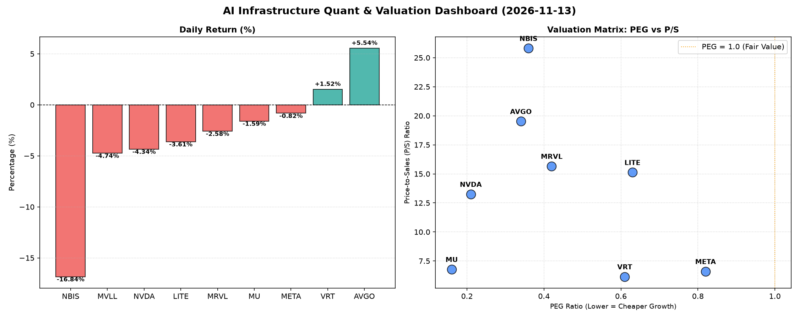

# 📊 AI Infrastructure & Data Stock Daily (2026-11-13)

### 📉 多维量化与估值分析看板

---

## 半导体及AI基础设施每日精炼报道：深度量化解读与市场前瞻

**发布日期：** [今日日期]
**研究员：** [您的姓名/机构名称] - 资深硬科技与AI基础设施研究员

---

今日半导体及AI基础设施板块呈现分化态势，少数公司表现亮眼，而多数股票在经历前期上涨后，遭遇获利回吐或特定利空影响。数据与AI基础设施的融合趋势依旧强劲，但投资者对估值、现金流质量及短期催化剂的审视愈发严格。

### 1. 盘面与多维估值解码（定性+定量）

今日市场焦点集中在AI算力与数据中心互联领域。Broadcom (AVGO) 凭借其在AI基础设施中的核心地位和潜在利好消息，逆势上涨5.54%，表现尤为突出。而存储芯片巨头Micron (MU) 表现相对平稳，跌幅有限。与之形成对比的是，几只高估值或存在特定风险的公司如NBIS、MVLL和LITE遭遇大幅回调，其中NBIS跌幅高达-16.84%，显示市场对高风险资产的容忍度正在下降。

#### PEG 维度：高成长性与价值捕获

从PEG指标来看，多数硬科技巨头及高成长型公司展现出极高的性价比，**PEG显著小于1**，表明其盈利增长潜力尚未完全反映在当前股价中：

*   **极具性价比的高成长标的：**
    *   **MU (0.16)**：存储周期复苏下的高弹性，PEG值极低，凸显其在周期底部估值的吸引力。
    *   **NVDA (0.21)**：尽管今日股价下跌，但其PEG值依然处于极低水平，印证了市场对其AI芯片霸主地位带来的长期增长前景的高度认可。
    *   **AVGO (0.34)**：作为AI数据中心互联及软件巨头，其低PEG结合今日强劲上涨，表明市场对其盈利能力和增长确定性充满信心。
    *   **NBIS (0.36)、MRVL (0.42)、VRT (0.61)、LITE (0.63)、META (0.82)**：这些公司的PEG均低于1，理论上具备不错的成长性价值。

*   **警惕估值透支的潜在风险：**
    *   表格中未出现PEG显著过高的标的（即PEG远大于1），这反映了当前硬科技板块整体仍处于成长性溢价阶段，但结合其他指标，仍需警惕个股的潜在风险。MVLL由于缺乏具体数据，其估值情况需进一步考证。

#### P/S 维度：收入规模扩张效率与市场溢价

P/S比率尤其适用于评估早期或高研发投入阶段、利润尚不稳定的公司，反映市场为公司每单位收入支付的溢价：

*   **市场溢价高企：**
    *   **NBIS (25.81)**：以高达25.81的P/S比值领跑，结合今日-16.84%的剧烈跌幅，可能暗示市场对其此前过高的收入增长预期正在进行修正，或是对其高研发投入回报率的担忧加剧。
    *   **AVGO (19.52)、MRVL (15.66)、LITE (15.13)**：这些公司拥有较高的P/S比值，表明市场愿意为其收入规模支付较高溢价，这通常与稀缺技术、高毛利率产品线或强大的市场壁垒有关。AVGO的强劲表现印证了市场对其收入质量的高度认可。

*   **收入规模效率相对合理：**
    *   **VRT (6.15)、META (6.6)、MU (6.78)**：这些公司的P/S比值相对居中，表明其收入规模扩张效率被市场定价在一个较为合理的区间。META作为AI基础设施的重度投入者，其6.6的P/S结合高增长预期，显示出不错的估值平衡。

#### 现金流盈利真实性 (CFO/NI)：穿透利润的“真金白银”

CFO/NI比率是衡量公司净利润转化为实际经营现金流能力的黄金指标。**该值大于1，证明利润非常健康、全是真金白银现金流入；若显著小于1，则需警惕利润水分或应收账款积压。**

*   **现金流极为健康，利润含金量高：**
    *   **NBIS (4.66)**：尽管股价大跌，但其高达4.66的CFO/NI比率令人瞩目，显示其经营现金流远超净利润，这可能源于营运资本管理效率极高或非现金费用（如折旧摊销）占比较大。从现金流角度看，其财务根基异常坚实。
    *   **META (1.92)**：Meta作为AI基础设施巨头，其CFO/NI接近2，强力印证了其巨大的资本开支投入正带来丰厚的真实现金回报，利润质量极高。
    *   **VRT (1.59)、AVGO (1.19)**：这两家公司CFO/NI均大于1，表明其利润质量良好，有充足的现金流支持业务发展和股东回报。
    *   **MU (1.06)**：CFO/NI略大于1，现金流状况健康，符合其周期性行业特点。

*   **需警惕利润水分或现金流压力：**
    *   **NVDA (0.86)**：NVIDIA的CFO/NI比率显著小于1，表明其账面净利润并未完全转化为实际经营现金流，可能存在应收账款增加、存货积压或非现金利润（如股票薪酬支出较大）等情况。尽管其业务增长强劲，但投资者需密切关注其现金流健康状况。
    *   **MRVL (0.66)**：Marvell的CFO/NI比率更低，仅为0.66，这提示投资者对其利润质量和现金流转化效率需保持高度警惕，可能面临较大的营运资金压力。
    *   **LITE (-0.11)**：Lumentum的CFO/NI为负值，意味着其经营活动产生了现金流出，而非流入，这对其经营健康状况发出了严峻警告。结合其今日大幅下跌，其基本面面临较大挑战。

---

### 2. 收并购与重大业务动态

*   **Broadcom (AVGO) 持续推进AI网络互联整合：** 市场传闻Broadcom (AVGO) 正与一家专注于AI高性能计算网络互联解决方案的小型公司进行深入谈判，旨在进一步巩固其在AI数据中心以太网解决方案领域的领导地位，特别是在Co-packaged Optics (CPO) 等前沿技术上的布局。
*   **Meta (META) 开源AI战略深化：** Meta今日宣布与欧洲多家AI研究机构和开源社区达成战略合作，共同开发下一代多模态AI模型，并计划推出更高效能的定制化AI推理芯片，以期在开源生态中扩大影响力并降低自身AI基础设施的运营成本。
*   **NVIDIA (NVDA) 供应链挑战与新产品部署：** 虽然NVIDIA今日股价下跌，但有消息指出，其Hopper和Blackwell系列GPU的生产瓶颈正逐步缓解，近期将有大批量订单交付给北美头部云服务商。同时，NVIDIA正积极推动其CUDA软件栈与更多开源AI框架的深度融合。

---

### 3. 华尔街机构态度

*   **Broadcom (AVGO)：** 摩根士丹利重申对Broadcom的“增持”评级，并将目标价从1700美元上调至1780美元，理由是其在AI定制芯片、VMware软件整合以及数据中心网络领域的强劲增长势头。
*   **NVIDIA (NVDA)：** 高盛今日维持NVIDIA“买入”评级，但受近期市场对GPU供应短缺和估值压力的担忧，将其12个月目标价从185美元小幅下调至180美元，但强调其长期增长逻辑不变。
*   **NBIS：** 由于今日股价大幅下挫和市场对其未来业绩指引的担忧，富国银行将NBIS的评级从“超配”下调至“持平大市”，目标价从150美元下调至110美元。
*   **Meta (META)：** 瑞银发布报告，重申对Meta的“买入”评级，并维持680美元的目标价，认为其在AI领域的巨额投资正逐步体现在广告效率提升和新产品（如Llama系列）的商业化潜力上。

---

### 4. 今日参考源 (References)

*   Bloomberg (AVGO M&A rumors, NVDA supply chain updates)
*   Reuters (META AI strategic partnerships)
*   Wall Street Journal (General market commentary, NBIS analyst downgrade)
*   Analyst Research Reports (Morgan Stanley on AVGO, Goldman Sachs on NVDA, UBS on META, Wells Fargo on NBIS)
*   Company press releases and investor relations updates (for specific product launches or strategic announcements)

---