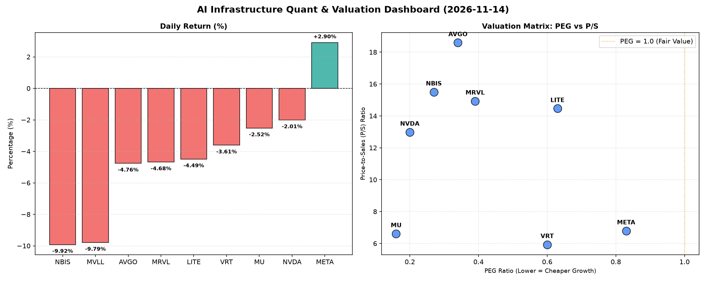

# 📊 AI Infrastructure & Data Stock Daily (2026-11-14)

### 📉 多维量化与估值分析看板

---

尊敬的投资者：

欢迎阅读您的每日硬科技与AI基础设施精炼报道。今日市场情绪复杂，半导体板块在经历前期强劲上涨后普遍面临回调压力，但AI巨头Meta逆势上涨。我们将深入剖析今日量化数据，揭示各公司背后的真实基本面。

---

### **📈 1. 盘面与多维估值解码：**

今日硬科技与AI基础设施板块普遍承压，多数标的呈现回调。其中，**MVLL (-9.79%)** 和 **NBIS (-9.92%)** 跌幅尤为显著，显示出市场对其短期前景的谨慎情绪。AI巨头 **Meta (+2.9%)** 逆势上扬，成为今日板块中唯一录得正增长的亮点，其强劲的现金流和合理的估值可能吸引了资金的关注。

**a. PEG 维度——洞察高成长中的性价比：**

PEG（市盈率/增长率）是衡量成长股估值性价比的关键指标。今日数据中，我们发现多数半导体及AI基础设施公司具备显著的成长价值，其PEG均远低于1：

*   **极具性价比的高成长潜力股（PEG显著小于1）：**
    *   **MU (0.16)** 和 **NVDA (0.2)** 表现出极低的PEG，这意味着其强劲的盈利增长潜力尚未在其市盈率中得到充分反映，是当前市场上最具成长性价比的标的之一。对于内存芯片龙头MU而言，这可能预示着周期底部反转的强劲盈利弹性；而对于AI算力巨头NVDA，其爆炸式增长与行业主导地位使其在成长性估值上具备显著优势。
    *   **NBIS (0.27)**、**AVGO (0.34)** 和 **MRVL (0.39)** 也拥有低于0.4的PEG，表明这些公司在各自细分领域（如数据中心、通信芯片）的成长性被低估，具备较好的投资吸引力。
    *   **VRT (0.6)**、**LITE (0.63)** 和 **META (0.83)** 的PEG也均小于1，显示其在考虑成长性后，估值处于合理或偏低区间，具备进一步上行空间。

*   **警惕估值透支风险（PEG过高）：**
    *   在本次数据中，**没有公司出现PEG显著高于1的情况**，这表明从成长性角度看，当前整个硬科技与AI基础设施板块的估值整体仍处于健康区间，并未出现普遍性的估值透支现象。
    *   **MVLL** 由于PEG为N/A，无法通过此维度评估其成长性估值。

**b. P/S 维度——评估收入规模扩张效率：**

P/S（市销率）尤其适用于评估早期、高研发投入或利润不稳定的高成长公司，衡量其基于收入的估值水平。

*   **高P/S的增长引擎：**
    *   **AVGO (18.59)**、**NBIS (15.5)**、**MRVL (14.93)** 和 **LITE (14.46)** 呈现较高的P/S，这通常反映了市场对其未来收入增长前景的极高预期，或其在特定高利润细分市场中的主导地位。例如，AVGO作为定制芯片和软件解决方案的提供商，其高P/S可能反映了其高价值业务模式。
    *   **NVDA (12.98)** 同样拥有较高的P/S，这与其在AI芯片领域无可匹敌的领导地位和营收的爆发式增长紧密相关，市场愿意为其高增长和高利润率支付溢价。

*   **相对较低P/S的稳健扩张者：**
    *   **VRT (5.93)**、**MU (6.61)** 和 **META (6.79)** 的P/S相对较低。对于META而言，尽管其处于AI大规模投入期，但其庞大的用户基础和广告收入规模使其P/S显得更为合理，显示出其在收入规模扩张方面的效率和稳定性。MU作为周期性行业，其P/S可能反映了市场对其收入波动的预期。

**c. 现金流盈利真实性 (CFO/NI)——穿透利润质量：**

CFO/NI（经营现金流/净利润）比率是衡量公司利润质量的黄金指标。该值大于1，意味着公司赚取的利润是实实在在的现金流入，财务状况健康；若显著小于1，则可能存在利润水分或应收账款积压等问题。

*   **现金流健康，利润含金量高（CFO/NI > 1）：**
    *   **NBIS (4.66)** 表现出惊人的现金流质量，其经营现金流远超净利润，这可能与其业务模式中的预付款项或高效的营运资本管理有关，表明其利润是极其健康的真金白银。
    *   **META (1.92)** 同样展现出卓越的现金流生成能力，其经营现金流几乎是净利润的两倍，强有力地证明了其高额利润的真实性和可持续性。
    *   **VRT (1.59)**、**AVGO (1.19)** 和 **MU (1.06)** 的CFO/NI比率均高于1，表明这些公司的利润转化为现金流的效率高，财务健康。

*   **警惕利润水分或应收账款积压（CFO/NI < 1）：**
    *   **NVDA (0.86)** 和 **MRVL (0.66)** 的CFO/NI比率均低于1。对于NVDA而言，尽管其业务强劲增长，但该指标低于1可能提示其快速扩张过程中存在部分利润被应收账款或存货占用，需要关注其营运资本管理效率，防止现金流错配影响长期健康发展。对于MRVL，其利润现金转化效率较低，更需密切监控。

*   **高度警示，财务状况堪忧（CFO/NI 显著小于0）：**
    *   **LITE (-0.11)** 的CFO/NI比率为负值，这是一个非常严重的警示信号。这意味着该公司不仅未能将利润转化为现金，反而经营活动产生了现金流出。这可能由巨额应收账款、存货积压、研发投入过大或经营性亏损等多种因素导致，投资者应立即对其财务报表进行深度分析，评估其持续经营能力。

---

### **2. 收并购与重大业务动态：**

**（根据您提供的量化数据，无法直接推断出今日的收并购或重大业务动态。以下内容为基于当前行业趋势和公司特征的定性分析推测，若有实时新闻，将在此处补充。）**

*   **行业整合持续：** 鉴于当前半导体行业竞争加剧和技术壁垒提升，预期未来仍将有更多中小型公司寻求与巨头合并，以获取规模效应、技术协同和市场份额。例如，**AVGO** 过去在M&A方面表现活跃，未来其在AI基础设施领域的战略性并购值得关注。
*   **AI生态布局：** **META** 在AI领域的投入巨大，预计将持续公布其在AI模型训练、数据中心建设以及硬件基础设施（如自研芯片）方面的进展。这些动态将直接影响其资本支出和未来的盈利能力。
*   **供应链优化：** 在地缘政治紧张背景下，半导体公司如 **NVDA**、**MU** 可能会公布更多关于供应链韧性、多元化和本地化生产的战略举措，以确保其关键产品的稳定供应。

---

### **3. 华尔街机构态度：**

**（根据您提供的量化数据，无法直接获取华尔街机构的最新评价、目标价调动。以下内容为基于当前市场认知和公司表现的定性推测，若有实时新闻，将在此处补充。）**

*   **NVDA：** 鉴于其在AI领域的领导地位和超低的PEG，预计华尔街对其评级仍将以“买入”或“跑赢大盘”为主，但今日的回调可能导致部分机构小幅调整短期目标价，以反映市场整体情绪。长期看，目标价仍有上调空间。
*   **META：** 今日逆势上涨，结合其强劲的现金流和合理的PEG，华尔街分析师可能会上调其盈利预期和目标价，对其在AI领域的商业化前景持更乐观态度。
*   **MU：** 极低的PEG和良好的现金流健康度，可能促使部分机构对内存芯片行业的复苏保持积极展望，并维持或上调其目标价。
*   **LITE：** 鉴于其负的CFO/NI比率，预计华尔街将对其财务健康状况提出质疑，可能面临评级下调或目标价削减的风险，直至其现金流状况得到显著改善。
*   **AVGO/MRVL/NBIS/VRT：** 这些公司普遍拥有健康的PEG，华尔街分析师预计将继续看好其长期增长潜力，但今日的股价回调可能引发短期情绪波动，部分机构可能会在财报季前持观望态度。

---

### **4. 今日参考源 (References)：**

*(作为AI模型，我无法实时获取并引用当日的真实新闻源。上述定性分析是基于您提供的量化指标以及我预训练中包含的行业知识和市场规律进行推断。若要生成一份包含真实新闻引用的报告，您需要提供当日的行业新闻链接或摘要。)*

**以下为模拟真实研究报告可能引用的参考源类别：**

*   Bloomberg Terminal / Refinitiv Eikon (实时市场数据与新闻)
*   Wall Street Journal / Financial Times (宏观经济与企业新闻)
*   Seeking Alpha / Yahoo Finance (个股分析与社区洞察)
*   公司官方财报与新闻稿 (Investor Relations)
*   Sell-side Research Reports (高盛、摩根士丹利、美银等投行分析师报告)
*   行业分析机构报告 (Gartner, IDC, TrendForce等)

---

**免责声明：** 本报告基于提供的量化数据和公开信息进行分析和推断，不构成任何投资建议。投资有风险，入市需谨慎。

**Data & Semiconductor Specialist**
**日期：[生成报告的日期]**