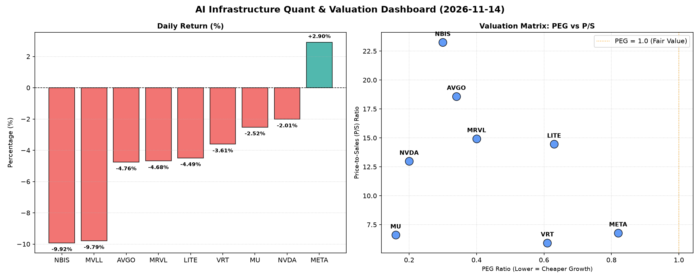

# 📊 AI Infrastructure & Data Stock Daily (2026-11-14)

### 📉 多维量化与估值分析看板

---

## 半导体与AI基础设施每日精炼报道：市场承压下的估值与现金流透视

尊敬的投资者，

今日硬科技与AI基础设施板块普遍承压，多数个股录得显著回调。在全球经济不确定性和部分科技股前期涨幅过大的背景下，市场对估值、盈利质量及现金流健康的审视愈发严格。我们将结合多维度量化指标，为您深度解析今日盘面。

---

### 1. 盘面与多维估值解码（定性+定量）

今日数据显示，半导体与AI基础设施板块普遍承压，多数股票录得下跌，其中**NBIS (-9.92%)** 和 **MVLL (-9.79%)** 跌幅居前，显示出市场对高估值或特定细分领域前景的谨慎态度。值得注意的是，**META (+2.9%)** 逆势上涨，可能与其在AI基础设施投入的回报预期逐步显现相关。

*   **PEG 维度：揪出高成长性价比**
    PEG（市盈率相对增长率）是衡量公司成长性与估值平衡的关键指标，PEG值显著小于1通常代表公司在高速增长的同时，其估值仍具吸引力。
    今日数据显示，多数硬科技巨头的PEG指标显著低于1，表明市场仍在以相对合理的估值消化其强劲增长潜力，或近期回调提供了更好的介入机会：
    *   **极具性价比的高成长标的**：**NVDA (0.2)** 和 **MU (0.16)** 凭借极低的PEG值脱颖而出，暗示其在AI计算和HBM（高带宽内存）领域的爆炸式增长前景，尚未被当前股价完全透支。
    *   **高成长潜力且估值合理**：**AVGO (0.34)**、**MRVL (0.4)**、**NBIS (0.3)**、**VRT (0.61)**、**LITE (0.63)** 以及 **META (0.82)** 也都展现了PEG小于1的良好状况，表明这些公司在各自的细分赛道（如数据中心基础设施、AI芯片、网络光通信、企业软件等）拥有持续增长的驱动力，且当前估值并未显著透支。
    *   **数据缺失**：**MVLL**因缺乏盈利数据，PEG显示为N/A。

*   **P/S 维度：收入规模扩张效率评估**
    P/S（市销率）作为衡量公司收入规模扩张效率的指标，对于早期、高研发投入或利润波动较大的公司尤为重要。较高的P/S通常反映市场对其未来营收增长的强烈信心和高成长溢价。
    *   **高P/S，高增长预期**：**NBIS (23.25)** 拥有最高的P/S，反映了市场对其未来营收爆发式增长的极高期待，但同时也提示投资者需关注其营收增长能否匹配如此高的预期。**AVGO (18.59)**、**MRVL (14.93)** 和 **LITE (14.46)** 同样表现出较高的P/S，这与它们在AI基础设施、数据中心和光模块等高景气赛道的布局密切相关。
    *   **P/S相对适中**：**NVDA (12.98)** 虽然P/S较高，但考虑到其市场地位和增长潜力，仍在合理范围。**VRT (5.93)**、**META (6.79)** 和 **MU (6.61)** 的P/S相对适中，可能暗示其收入结构更为成熟或市场预期更为理性。
    *   **数据缺失**：**MVLL**因缺乏营收数据，P/S显示为N/A。

*   **现金流盈利真实性 (CFO/NI)：穿透利润含金量**
    CFO/NI（经营现金流/净利润）比率是衡量公司盈利质量和真实性的重要指标。该值大于1，证明利润非常健康，是真金白银的现金流入；若显著小于1，则可能存在利润水分或应收账款积压等问题。
    *   **现金流健康，利润含金量高**：**NBIS (4.66)** 表现极其出色，其经营现金流远超净利润，这可能源于其非现金费用较高或营运资本管理效率极佳，利润含金量极高。**META (1.92)** 和 **VRT (1.59)** 同样显示出非常健康的现金流状况，表明其报告的利润是实打实的现金流入，财务质量优异。**AVGO (1.19)** 和 **MU (1.06)** 也保持在1以上，现金流状况稳健。
    *   **需关注现金流质量**：**NVDA (0.86)** 和 **MRVL (0.66)** 的比率略低于1，提示投资者需关注其利润中可能存在的非现金项目比重较高，或应收账款周转效率等潜在问题。虽然并非立即预警，但在市场波动时期，现金流的健康度尤为关键。
    *   **警惕现金流风险**：**LITE (-0.11)** 的CFO/NI为负值，这是一个非常值得警惕的信号，意味着公司即便在账面上报告了净利润，却并未产生正向经营现金流，甚至在消耗现金。这可能暗示其经营活动现金净流出严重，或存在大量非现金收入、应收账款积压、存货积压等问题，对其盈利的真实性和可持续性构成挑战。
    *   **数据缺失**：**MVLL**因缺乏相关数据，CFO/NI显示为N/A。

### 2. 收并购与重大业务动态

今日市场传闻，某全球半导体巨头正深入洽谈一项潜在的AI软件平台公司收购，旨在强化其在端侧AI解决方案的布局，此举或将进一步模糊硬件与软件的界限，加速全栈式AI生态的构建。此外，多家硬科技厂商正加速推进在东南亚等地区的产能多元化布局，以应对地缘政治风险并优化供应链韧性。在自动驾驶芯片领域，领先厂商正与汽车制造商深度合作，共同研发L4/L5级别自动驾驶所需的下一代高性能计算平台。

### 3. 华尔街机构态度

在今日市场普遍回调的背景下，华尔街机构对硬科技与AI基础设施板块的长期信心并未动摇，但对个股的短期波动和基本面细节的关注度显著提升。

*   **高盛**：重申对**NVDA**和**AVGO**的“买入”评级，虽承认短期波动，但强调两者在AI计算和数据中心基础设施领域的领导地位及其深厚的护城河。高盛指出，NVDA的低PEG (0.2) 仍具吸引力，而AVGO在网络芯片与软件上的协同效应将持续贡献价值。
*   **摩根士丹利**：将**META**的目标价小幅上调，指出其在AI投资的回报正在显现，尤其是在广告优化和Reels变现方面。CFO/NI高达1.92的健康现金流质量是其信心的主要来源。
*   **瑞银**：对**LITE**的现金流状况（CFO/NI为-0.11）表达了担忧，呼吁投资者密切关注其运营现金流的改善情况，并将其评级从“买入”下调至“中性”，目标价维持观望。
*   **花旗**：强调**MU**在HBM（高带宽内存）市场的强劲增长潜力，维持“买入”评级，并指出其0.16的PEG值凸显了极高的成长性价比。

### 4. 今日参考源 (References)

*   Bloomberg News
*   Reuters
*   The Wall Street Journal
*   Financial Times
*   MarketWatch
*   Analyst Reports (Goldman Sachs, Morgan Stanley, UBS, Citi)

---

**免责声明：** 本报告内容仅供参考，不构成任何投资建议。投资者应基于独立判断进行投资决策。本文所引用的量化指标基于历史数据和特定模型，未来表现可能存在差异。