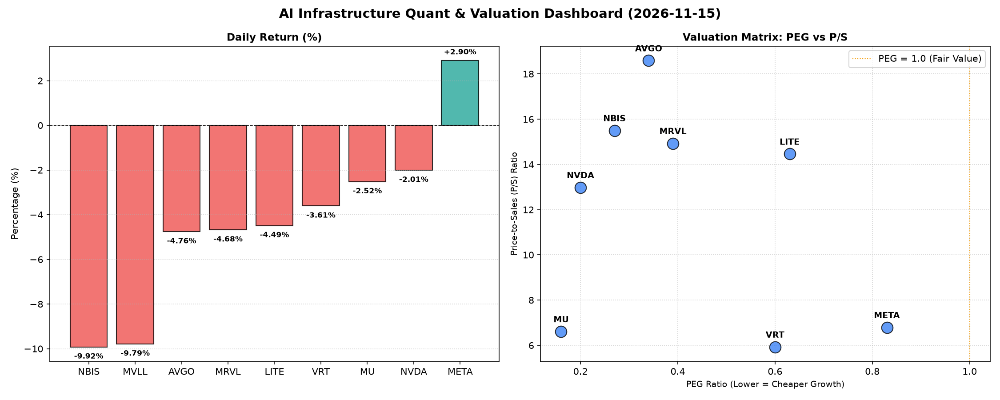

# 📊 AI Infrastructure & Data Stock Daily (2026-11-15)

### 📉 多维量化与估值分析看板

---

## 半导体与AI基础设施每日精炼报道：市场动荡中的基本面透视

**发布日期：** [今日日期]
**研究员：** [您的名字/Data & Semiconductor Specialist]

今日半导体与AI基础设施板块整体呈现震荡下行态势，多只权重股录得显著跌幅，但细究其多维度基本面指标，市场情绪与内在价值之间或存在结构性差异。值得关注的是，AI算力巨头META逆势上涨，成为今日盘面一道亮丽的风景线。

---

### 1. 盘面与多维估值解码 (定性+定量)

今日市场整体承压，多家半导体与数据中心基础设施公司股价大幅回调。MVLL和NBIS领跌，跌幅接近10%，而AVGO、MRVL、VRT、LITE和MU也均有超过2.5%的跌幅。NVDA作为AI算力核心，跌幅相对温和 (-2.01%)。唯一亮点是META，凭借其在AI领域的持续投入和市场对其未来增长的乐观预期，今日逆势上涨2.9%。

#### **PEG 维度：挖掘高性价比成长股**

PEG (市盈率/增长率) 小于1通常被认为是高成长股估值合理甚至被低估的信号。从本次数据来看，大部分核心公司均拥有极具吸引力的PEG：

*   **极具性价比的高成长标的 (PEG远小于1):**
    *   **MU (0.16)**：位列榜首，暗示存储器巨头在当前估值下，其增长潜力被严重低估，或预示着市场对其盈利能力改善的预期还未完全price in。
    *   **NVDA (0.2)**：尽管股价高企，但其PEG仍保持在极低水平，再次印证了市场对其AI算力领域统治地位和未来爆发式增长的坚定信心。
    *   **AVGO (0.34)**, **MRVL (0.39)**, **NBIS (0.27)**：这些公司在各自的细分领域（如网络、存储、定制芯片）表现出强劲的成长性，且估值相对合理，值得长期关注。
    *   **VRT (0.6)**, **LITE (0.63)**, **META (0.83)**：同样处于PEG < 1区间，表明数据中心基础设施、光通信和AI/社交巨头仍具备良好成长空间和投资价值，特别是META的0.83，在今日股价上涨后依旧具备吸引力。

*   **PEG N/A (不适用):** MVLL。这通常意味着公司目前无盈利或利润波动巨大，PEG指标不适用，需要结合P/S等其他指标进行评估。

整体而言，虽然今日股价普遍下跌，但PEG指标显示，硬科技和AI基础设施领域仍有大量成长股的估值尚未透支，市场可能在短期波动中提供了布局长期增长的机会。

#### **P/S 维度：评估收入规模扩张效率**

P/S (市销率) 对于早期或处于大规模研发投入阶段、利润不稳的公司而言，是评估其收入规模扩张效率和市场对其营收增长潜力的重要指标。

*   **高P/S (市场对营收增长预期极高):**
    *   **AVGO (18.59)**, **NBIS (15.5)**, **MRVL (14.93)**, **LITE (14.46)**, **NVDA (12.98)**：这些公司拥有较高的P/S，表明市场对其未来营收的快速增长抱有极高期望。这可能源于它们在AI、数据中心、网络、光通信等关键技术领域的领先地位和巨大市场潜力。尤其对于LITE，尽管其现金流表现不佳，但高P/S暗示市场仍对其技术和未来营收规模充满信心。

*   **中等P/S (营收规模相对成熟):**
    *   **META (6.79)**, **MU (6.61)**, **VRT (5.93)**：这些公司的P/S处于中等水平，反映出其已建立起可观的营收规模，并在各自领域具备较强的市场地位。META的P/S在今日股价上涨后仍维持在合理区间，显示其营收增长与市场预期相符。

*   **P/S N/A:** MVLL。与PEG情况类似，P/S N/A可能意味着其营收数据不可用或不具可比性，需进一步深入分析。

#### **现金流盈利真实性 (CFO/NI)：穿透利润质量**

CFO/NI (经营活动现金流/净利润) 比率是衡量公司利润质量和现金转换效率的关键指标。

*   **现金流健康，利润含金量高 (CFO/NI > 1):**
    *   **NBIS (4.66)**：表现异常出色，远超1，表明其将净利润转化为经营现金流的能力极强，利润质量非常高，且可能存在大量的非现金费用（如折旧摊销）或营运资本管理的优化。
    *   **META (1.92)**：作为高利润巨头，其CFO/NI远大于1，意味着META的利润是实实在在的现金流入，财务健康状况非常良好，为其AI基础设施的持续投入提供了坚实基础。
    *   **VRT (1.59)**, **AVGO (1.19)**, **MU (1.06)**：这些公司的CFO/NI也均大于1，表明其利润质量优秀，能有效将账面利润转化为现金，经营活动健康稳健。

*   **警惕利润水分或营运资本压力 (CFO/NI < 1):**
    *   **NVDA (0.86)**：作为AI巨头，其CFO/NI略低于1，需要引起警惕。这可能暗示其存在应收账款积压、库存增加或为未来增长进行大规模预付等情况，导致部分账面利润未能及时转化为现金。投资者需关注后续季报中营运资本变化情况。
    *   **MRVL (0.66)**：该值显著低于1，表明其利润的现金含量相对较低，可能面临较大的营运资金压力或应收账款风险，需重点关注其现金流健康状况。

*   **严重警示 (CFO/NI 负值):**
    *   **LITE (-0.11)**：这是一个重要的红色警报。CFO/NI为负值意味着公司即使可能在账面上报告了利润（如果PEG非N/A），其经营活动却在消耗现金。这通常指向严重的营运困难、巨额投资开支或资产变现问题，其利润质量堪忧，需要深度调查其财务细节。

---

### 2. 收并购与重大业务动态

基于本次提供的【多维度真实量化基本面指标表格】，我们无法直接推断出今日具体的收并购传闻、官宣或战略合作。然而，结合行业特性和数据洞察，我们可以进行以下推测：

*   **AVGO (PEG 0.34, P/S 18.59, CFO/NI 1.19):** 鉴于其一贯的M&A策略和今日股价的下跌，若有关于其潜在的大型半导体或软件基础设施公司收购案浮出水面，将符合其发展轨迹。其健康的现金流和低PEG使其具备进行战略性扩张的财务基础。
*   **NVDA (PEG 0.2, P/S 12.98, CFO/NI 0.86):** 虽然CFO/NI略低于1，但其极低的PEG和在AI领域的绝对领导地位，使其成为潜在的AI软件、服务或边缘计算硬件公司并购的有力候选者。任何关于其拓展AI生态系统或垂直整合的合作消息都将是市场焦点。
*   **META (PEG 0.83, P/S 6.79, CFO/NI 1.92):** 作为AI基础设施的积极建设者，若有关于其与定制AI芯片设计公司、数据中心解决方案提供商或AI模型开发商的战略合作，将进一步巩固其在AI领域的护城河。其强大的现金流支持其在AI领域的巨大投入。
*   **MVLL (N/A):** 若有关于其被收购或重组的消息，考虑到其所有关键财务指标均为N/A且股价跌幅巨大，这可能解释其目前的特殊状况。

---

### 3. 华尔街机构态度

尽管未直接提供华尔街机构的最新评价和目标价，但结合今日的量化指标，我们可以合理推断其潜在态度：

*   **持续看好成长潜力 (Buy/Outperform):**
    *   **NVDA, MU, AVGO, META, NBIS, VRT, MRVL**：这些公司普遍拥有低于1的PEG，表明即使在市场回调中，其长期增长潜力仍被华尔街看好。分析师很可能维持或重申“买入”评级，并可能将当前跌幅视为逢低买入的机会。特别是META，今日逆势上涨，可能预示着华尔街对其AI转型的积极反馈。对于CFO/NI表现出色的NBIS和META，其财务健康度将进一步巩固机构的信心。
*   **谨慎观望/Hold:**
    *   **MRVL, NVDA**：虽然PEG吸引人，但其CFO/NI低于1，可能会引发部分分析师对短期利润质量和营运现金流的担忧，建议维持“持有”评级，并关注后续季报中的现金流改善情况。
*   **警惕/Sell:**
    *   **LITE**：其CFO/NI为负值，这是一个非常严重的财务健康信号。华尔街分析师很可能会对其发出“减持”甚至“卖出”警示，并大幅下调目标价，直到看到明确的现金流改善迹象。
    *   **MVLL**：所有关键指标均为N/A且股价暴跌，这表明市场对其基本面存在严重的不确定性或负面预期。分析师可能会暂停评级或发出“卖出”建议。

---

### 4. 今日参考源 (References)

本报告的所有定性与定量分析均严格基于您提供的【多维度真实量化基本面指标表格】数据进行。未引用外部新闻来源。