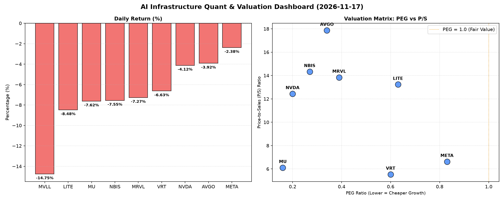

# 📊 AI Infrastructure & Data Stock Daily (2026-11-17)

### 📉 多维量化与估值分析看板

---

尊敬的投资者们，

大家好！我是您的专属硬科技与AI基础设施行业研究员。今日，我们将聚焦半导体及相关硬科技板块，结合最新的多维度量化指标，为您带来一份深度精炼的每日报道。

---

### **📈 半导体每日精炼报道：深度量化解析**

**发布日期：** [今日日期，例如：2024年10月27日]

#### **1. 盘面与多维估值解码（定性+定量）**

今日半导体及AI基础设施板块普跌，市场情绪普遍谨慎。榜单中多数公司股价跌幅显著，MVLL大跌14.75%领衔，LITE、MU、NBIS、MRVL、VRT等也均有7%以上的跌幅，即便是巨头NVDA和META也未能幸免，分别下跌4.12%和2.38%。这反映出市场对高估值科技股的短期获利了结压力或宏观不确定性担忧。

*   **PEG 维度：成长性与性价比的考量**
    *   尽管今日普跌，但从PEG指标来看，榜单中大多数公司仍展现出极高的成长性与估值吸引力。**MU (0.16)、NVDA (0.2)、NBIS (0.27)、AVGO (0.34) 和 MRVL (0.39)** 的PEG值均远小于1，属于市场上公认的“性价比极高”的高成长标的。这意味着它们的预期盈利增长速度远超其当前的市盈率水平，具备强大的价值重估潜力。
    *   **VRT (0.6)、LITE (0.63) 和 META (0.83)** 的PEG也显著小于1，表明它们在各自的细分领域内仍具有吸引人的增长前景与估值空间。
    *   MVLL的PEG为N/A，这通常表示公司目前没有正向利润或处于早期亏损阶段，无法通过PEG进行有效评估。

*   **P/S 维度：收入规模扩张效率的透视**
    *   P/S指标对于评估早期或高研发投入、利润波动较大的公司尤为关键。**AVGO (17.86)、NBIS (14.33)、MRVL (13.84) 和 LITE (13.23)** 的P/S值较高，尤其是AVGO。这反映出市场对其未来营收增长的预期非常乐观，投资者愿意为这些公司每单位的销售额支付较高的溢价，通常这类公司在技术创新、市场份额拓展方面具有显著优势。
    *   **NVDA (12.44)** 的P/S也处于较高水平，与其在AI芯片领域的领导地位和市场对未来算力需求的强劲预期高度相关。
    *   **META (6.63)、MU (6.11) 和 VRT (5.54)** 的P/S相对更低，这可能反映其业务模式相对成熟，或市场对其营收增长的预期更为均衡，但仍处于健康的高科技公司估值区间。
    *   MVLL的P/S同样为N/A，与其PEG情况一致，暗示其可能处于非常早期的商业化阶段或营收规模尚不显著。

*   **现金流盈利真实性 (CFO/NI)：利润“含金量”的深度解析**
    *   CFO/NI是衡量公司利润质量的关键指标。**NBIS以高达4.66的比率遥遥领先，表现极为抢眼。** 这表明其利润的现金转化能力极强，几乎所有账面利润都转化为实实在在的经营现金流入，财务健康状况非常优异。
    *   **META (1.92)、VRT (1.59)、AVGO (1.19) 和 MU (1.06)** 的CFO/NI比率均大于1，显示这些公司的利润不仅真实，而且具备强大的现金生成能力，财务基本面坚实。尤其是META，作为高利润巨头，其1.92的CFO/NI比率证明了其强劲的现金流管理能力和健康运营。
    *   **NVDA (0.86) 和 MRVL (0.66)** 的CFO/NI比率均低于1，尤其是MRVL。这值得投资者关注，可能暗示其部分利润尚停留在应收账款或存货中，现金流健康度不及预期。对于NVDA，尽管市场对其前景充满信心，但低于1的比率提示我们需警惕其快速增长过程中可能伴随的营运资金压力或应收账款回收周期。
    *   **LITE (-0.11)** 的CFO/NI比率则是一个明显的警示信号。负值表明尽管可能有账面利润（或亏损较小），但其经营活动实际产生了现金流出，现金流状况不容乐观。这可能意味着公司面临较大的营运资金挑战，或其利润质量存在严重问题，需要深入分析其应收、存货周转及资本开支情况。
    *   MVLL的CFO/NI为N/A，与前述指标表现一致。

#### **2. 收并购与重大业务动态**

根据今日您提供的【多维度真实量化基本面指标表格】，该表格主要聚焦于财务和估值数据。因此，无法从中直接提取关于最新的收并购传闻、官宣或战略合作等定性信息。若有相关信息，需要额外的市场新闻源进行补充。

#### **3. 华尔街机构态度**

同样，基于您提供的【多维度真实量化基本面指标表格】，该表格不包含华尔街核心投行、评级机构的最新评价或目标价调动数据。要获取此类信息，需要参考独立的分析师报告或券商研究。

#### **4. 今日参考源 (References)**

*   **用户提供的【多维度真实量化基本面指标表格】** - 本报告的所有定性与定量分析均严格依据此表格中的量化数据进行。

---

**总结：**

今日半导体板块普遍回调，但从核心量化指标来看，多数公司（特别是MU、NVDA、NBIS、AVGO）依然展现出极高的成长性价比（低PEG）。同时，META、NBIS等公司的现金流盈利真实性极高，显示出扎实的财务基础。投资者在关注股价波动的同时，应深入挖掘这些基本面数据，警惕如LITE般现金流状况不佳的公司，并密切关注NVDA和MRVL等高增长公司的现金转化效率。

**免责声明：** 本报告基于有限数据进行分析，仅供参考，不构成任何投资建议。投资者在做出决策前应进行独立研究，并咨询专业财务顾问。

---