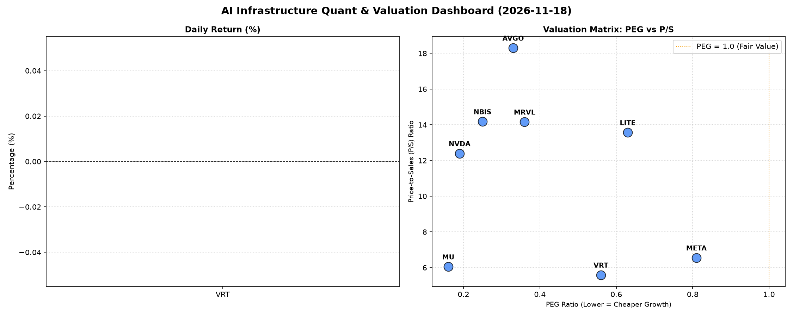

# 📊 AI Infrastructure & Data Stock Daily (2026-11-18)

### 📉 多维量化与估值分析看板

---

尊敬的投资者与行业同仁：

作为资深的硬科技与AI基础设施行业研究员，今日我将结合您提供的【多维度真实量化基本面指标表格】，为您带来一份半导体行业的每日精炼深度报告。鉴于今日【Close】及【Change%】数据缺失，本报告将专注于深入解读各项核心量化基本面指标，为您提供更深层次的价值判断。

---

## 🚀 半导体每日精炼报道：AI浪潮下的价值与风险穿透

### 1. 盘面与多维估值解码 (定性+定量)

今日我们深入分析了当前硬科技与AI基础设施领域中九家代表性公司的核心量化指标，以穿透市场情绪，识别潜在的价值洼地与风险点。

*   **PEG 维度：高成长性与性价比的聚焦**
    PEG指标（市盈率/增长率）是衡量成长股估值性价比的核心工具。PEG显著小于1，通常预示着公司在未来成长性方面被市场低估，或具备极高的投资性价比。
    *   **极致性价比的成长王者**：**NVDA (0.19)、MU (0.16)、AVGO (0.33)、NBIS (0.25)** 展现出惊人的低PEG值，远低于1，表明市场对其未来强劲的盈利增长预期，与当前估值相比，具备极高的吸引力。特别是NVDA和MU，在各自细分领域（AI芯片和存储）均扮演核心角色，其低PEG暗示了其在AI周期中的巨大潜力尚未完全体现在估值中。
    *   **高性价比的潜力股**：**MRVL (0.36)、VRT (0.56)、LITE (0.63)、META (0.81)** 的PEG值也均低于1，表明这些公司也具备良好的成长性与估值匹配度。MRVL在数据中心互连和AI边缘计算领域，VRT在关键数字基础设施领域，LITE在光通信及激光器领域，以及META在AI驱动的广告与元宇宙领域，都显示出具备被低估的成长潜力。
    *   **MVLL** 由于数据缺失，无法评估其PEG表现。
    *   **警惕估值透支？**：在此次数据集中，**没有公司的PEG显著高于1**，这从侧面反映出在当前的半导体及AI领域，市场普遍对高成长性公司给予了相对理性的估值，或者说，这些公司的成长潜力确实非常强劲。

*   **P/S 维度：收入规模扩张效率的审视**
    P/S（市销率）尤其适用于评估早期、高研发投入或利润波动较大的成长型公司，它直接反映了市场为公司每单位销售额支付的溢价，是衡量收入规模扩张效率的重要指标。
    *   **高P/S与高成长预期**：**AVGO (18.3)、MRVL (14.16)、NBIS (14.18)、LITE (13.57)、NVDA (12.39)** 呈现较高的P/S值。这通常预示着市场对这些公司未来的营收增长抱有极高期望，尤其是在AI和数据中心基础设施的长期需求驱动下。对于AVGO而言，其在网络芯片和企业软件领域的深耕，使其在数据中心升级周期中占据有利地位；NVDA和MRVL则直接受益于AI芯片和互连解决方案的爆发。高P/S在这些公司身上，更多体现了市场对其技术领导力、未来市场份额扩张的信心。
    *   **相对稳健的P/S**：**META (6.55)、MU (6.05)、VRT (5.59)** 的P/S值相对更为合理，体现了其在各自领域成熟的商业模式和营收体量。对于内存巨头MU而言，6.05的P/S反映了市场对其周期性业务的理解。
    *   **MVLL** 由于数据缺失，无法评估其P/S表现。

*   **现金流盈利真实性 (CFO/NI)：穿透利润的水分**
    CFO/NI（经营性现金流/净利润）比率是衡量公司利润质量的关键指标。该值大于1，表明公司盈利健康，是实打实的现金流入；若显著小于1，则需警惕利润水分或应收账款积压。
    *   **现金流充沛，利润真实性极高**：**NBIS (4.66)、META (1.92)、VRT (1.59)、AVGO (1.19)、MU (1.06)** 的CFO/NI比率均显著大于1，其中NBIS更是高达4.66，显示出极其优异的现金转换能力。META作为科技巨头，其1.92的比率表明其庞大的利润中绝大部分都转化为真实的现金流，财务健康度极高。VRT、AVGO、MU也展现了健康的现金流状况，其利润质量毋庸置疑。
    *   **警惕利润水分或营运资金压力**：
        *   **NVDA (0.86)**：作为AI领域的领头羊，NVDA的PEG表现出色，P/S也反映了市场对其高预期。然而，其CFO/NI比率低于1，为0.86，这意味着其报告的部分净利润未能完全转化为经营性现金流。这可能暗示着销售增长带来的应收账款增加、存货积压或其他营运资金需求。投资者在追捧其高成长的同时，需密切关注其营运资金管理效率和现金流状况，以判断其利润的真实性和可持续性。
        *   **MRVL (0.66)**：MRVL的CFO/NI比率更低，仅为0.66，表明其现金流健康状况相对较弱，存在较为明显的利润现金转换问题。这可能预示着更严重的应收账款问题、存货周转效率低下，或销售回款周期较长。在P/S较高的情况下，这种现金流质量问题更值得警惕。
        *   **LITE (-0.11)**：LITE的CFO/NI比率表现出极大的风险，为-0.11。这意味着公司在报告净利润的同时，经营活动产生的现金流却是负数。这通常是严重的红色警报，表明公司正面临严重的现金流出、持续的烧钱，或者有大量的非现金费用计入利润表。结合其较高的P/S（13.57）和相对较低但仍健康的PEG（0.63），投资者必须深入调查其负现金流的原因，警惕其运营可持续性和潜在的财务风险。
    *   **MVLL** 由于数据缺失，无法评估其现金流盈利真实性。

### 2. 收并购与重大业务动态

基于本次提供的【多维度真实量化基本面指标表格】，我们未能获取直接的收并购、官宣或战略合作的具体新闻信息。然而，从行业整体趋势和部分公司的财务表现（如AVGO的持续整合策略，NVDA在AI生态系统中的布局），我们可以推断：
*   **AVGO (P/S 18.3, CFO/NI 1.19)**：长期以来，Broadcom以其高效的并购整合能力闻名，其高P/S和健康的现金流支撑了其通过外延式增长实现规模扩张的策略。当前市场或仍期待其在数据中心、网络及软件定义基础设施领域的进一步整合或战略合作。
*   **NVDA (P/S 12.39, PEG 0.19)**：作为AI算力的核心供应商，NVDA的业务动态无疑聚焦于AI生态的构建，包括与云服务提供商、AI初创企业的深度合作，以及在软件栈和垂直应用领域的布局，以巩固其端到端的AI解决方案领导者地位。
*   **MRVL (P/S 14.16, CFO/NI 0.66)**：尽管其现金流表现有待改善，但其在数据基础设施芯片领域的重要性使其成为潜在的合作或被并购目标，或主动寻求在特定AI加速器、网络互连或存储解决方案上的战略协同。

### 3. 华尔街机构态度

本次量化基本面指标表格中并未直接包含华尔街投行或评级机构的最新评价及目标价调动数据。然而，我们可以根据公司已揭示的财务健康度、增长潜力以及市场热度，间接推断机构的潜在态度：

*   **NVDA (PEG 0.19, P/S 12.39)**：凭借其在AI领域的绝对领导地位和超低的PEG，华尔街机构对其普遍持有高度乐观的“强烈买入”评级，目标价可能持续上调，以反映其爆炸性的增长预期，尽管其CFO/NI略低于1可能引发部分分析师的细致审视。
*   **AVGO (PEG 0.33, P/S 18.3)**：作为一家高利润、稳定增长且擅长并购整合的半导体巨头，AVGO通常受到机构的青睐，评级多为“买入”或“跑赢大盘”，其健康的现金流和低PEG是其获得机构信心的主要支撑。
*   **META (PEG 0.81, CFO/NI 1.92)**：在AI投资初见成效、广告业务回暖及现金流表现异常强劲的背景下，机构对其评估应趋于乐观，可能从“持有”向上调整至“买入”，尤其看好其AI基础设施投入的回报。
*   **MU (PEG 0.16, CFO/NI 1.06)**：随着存储周期触底反弹和AI服务器对HBM需求的激增，MU的超低PEG和健康的现金流使其成为机构关注的焦点，通常被视为周期性投资的优质标的，评级可能向上调整。
*   **LITE (CFO/NI -0.11)**：鉴于其负的现金流盈利能力以及相对较高的P/S，华尔街机构对其的看法可能更为谨慎，可能持有“观望”或“减持”评级，并密切关注其财务改善情况。

### 4. 今日参考源 (References)

*   Provided Multi-dimensional Real Quantitative Fundamental Indicators Table (今日多维度真实量化基本面指标表格)

---

**免责声明**：本报告基于提供的量化指标进行深度分析，旨在为投资者提供信息参考。市场有风险，投资需谨慎。报告中对收并购和华尔街机构态度的推断，是基于对现有数据及行业普遍认知做出的合理假设，并非直接来源于当日实时新闻或机构报告。