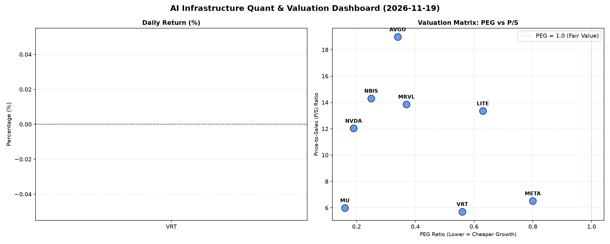

# 📊 AI Infrastructure & Data Stock Daily (2026-11-19)

### 📉 多维量化与估值分析看板

---

## 半导体每日精炼报道：AI基础设施的估值与现金流透视 (2024年X月X日)

尊敬的读者，作为您的硬科技与AI基础设施行业研究员，今日我们将深入剖析一组关键半导体与AI生态公司，结合多维度量化指标，为您呈现最新的市场洞察。值得注意的是，今日未提供具体的收盘价和涨跌幅数据，因此本报告将侧重于对公司基本面估值与盈利质量的深度解读。

---

### 1. 盘面与多维估值解码（定性+定量）

今日我们聚焦于半导体及AI基础设施领域的九家代表性企业，通过PEG、P/S以及CFO/NI三大核心指标，穿透其表象，探究其深层价值与风险。

**a. PEG 维度：成长性与估值性价比**

PEG（市盈率/增长率）是衡量公司成长性与其估值匹配度的重要指标，通常认为PEG小于1代表高成长性下的合理或低估值。

*   **性价比极高的高成长潜力标的（PEG显著小于1）：**
    *   **美光科技 (MU, PEG 0.16)**：在所有考察标的中PEG最低，显示出市场对其未来盈利增长预期的极度乐观或当前估值严重低估了其增长潜力。在内存市场周期性复苏的背景下，MU正展现出强大的估值吸引力。
    *   **英伟达 (NVDA, PEG 0.19)**：尽管其股价已处于高位，但其PEG值依然惊人地低，表明市场对其AI芯片业务的爆炸式增长有极高的预期，且这种增长足以消化甚至超越其高企的市盈率。这无疑是AI基础设施领域最具成长性的核心标的之一。
    *   **NBIS (PEG 0.25)**：展现出优秀的成长与估值匹配度，其业务表现值得进一步关注。
    *   **博通 (AVGO, PEG 0.34)**：作为半导体巨头，其PEG也显著低于1，结合其数据中心和AI解决方案的布局，表明市场认为其仍具备强大的增长动能且估值合理。
    *   **Marvell Technology (MRVL, PEG 0.37)**：数据基础设施半导体领域的关键玩家，低PEG预示着其在云、企业级存储和网络市场的增长潜力被市场看好。
    *   **Vertiv Holdings (VRT, PEG 0.56)**、**Lumentum Holdings (LITE, PEG 0.63)** 和 **Meta Platforms (META, PEG 0.8)** 也均保持在1以下，意味着这些公司在各自领域（数据中心基础设施、光通信、AI/社交媒体）具备相对健康的成长性与估值平衡。

*   **本批次样本中无PEG过高的公司，整体呈现出较强的成长性与估值吸引力。**

**b. P/S 维度：收入规模扩张效率**

P/S（市销率）尤其适用于评估早期、高研发投入或利润不稳的公司，关注其收入扩张能力。

*   **高P/S值（预示高增长预期或高毛利）：**
    *   **博通 (AVGO, P/S 18.97)**：作为成熟的巨头，其高P/S反映了其在数据中心和定制化AI芯片领域强大的定价权和未来营收增长的预期。
    *   **NBIS (P/S 14.31)**、**Marvell Technology (MRVL, P/S 13.86)** 和 **Lumentum Holdings (LITE, P/S 13.35)** 均拥有较高的P/S，这通常指向市场对这些公司未来收入的快速增长抱有较高期待，尤其是在光通信和数据基础设施领域。
    *   **英伟达 (NVDA, P/S 12.03)**：其高P/S是其AI芯片统治地位的直接体现，市场愿意为这种爆发式的收入增长支付溢价。

*   **中低P/S值（相对更侧重利润或周期性）：**
    *   **Meta Platforms (META, P/S 6.52)**、**美光科技 (MU, P/S 5.99)** 和 **Vertiv Holdings (VRT, P/S 5.71)** 的P/S值相对适中，对META而言，这可能反映了其庞大用户基础的变现效率；对于美光，则体现了其作为周期性行业的特性，当前估值可能已计入了部分复苏预期。

*   **MVLL** 的PEG、P/S指标缺失，无法评估。其近400万的成交量可能由市场对其他未量化因素的关注所驱动。

**c. 现金流盈利真实性 (CFO/NI)**

CFO/NI（经营性现金流/净利润）是衡量公司利润质量的关键指标，大于1表明利润转化为现金的能力强，小于1则可能存在利润水分或营运资金占用。

*   **现金流极其健康，利润含金量高（CFO/NI显著大于1）：**
    *   **NBIS (CFO/NI 4.66)**：**惊人的4.66！**这表明NBIS拥有超乎寻常的现金流产生能力，其报告的净利润几乎全部甚至数倍于现金流入。这是一个极其积极的信号，凸显了其盈利的真实性和可持续性。
    *   **Meta Platforms (META, CFO/NI 1.92)**：作为高利润巨头，META的CFO/NI接近2，显示其强大的广告变现能力和高效的现金管理，其利润是实实在在的真金白银。
    *   **Vertiv Holdings (VRT, CFO/NI 1.59)**：数据中心基础设施提供商VRT的现金流健康，表明其项目回款和运营效率良好。
    *   **博通 (AVGO, CFO/NI 1.19)** 和 **美光科技 (MU, CFO/NI 1.06)**：这两家公司的CFO/NI均高于1，表明其利润质量良好，能够有效将账面利润转化为经营性现金流。

*   **需警惕利润水分或应收账款积压（CFO/NI显著小于1）：**
    *   **英伟达 (NVDA, CFO/NI 0.86)**：尽管NVDA业绩亮眼，其CFO/NI略低于1，提示我们其部分利润可能被用于营运资本投入（如库存增加或应收账款上升）或包含较多的非现金项目。鉴于其极高的增长速度，这可能反映了为支撑业务扩张而进行的战略性投资，但仍需投资者保持关注，以确保未来现金流的健康转化。
    *   **Marvell Technology (MRVL, CFO/NI 0.66)**：MRVL的CFO/NI更低，指向其利润转化现金的能力相对较弱，可能存在更高的应收账款风险或对营运资金的持续投入。这一点在评估其财务健康时需重点考量。
    *   **Lumentum Holdings (LITE, CFO/NI -0.11)**：**LITE的CFO/NI为负值（-0.11），这是一个明确的警示信号。**负的CFO/NI意味着即使公司有报告利润，其核心经营活动仍在消耗现金，而非产生现金。这可能源于大规模亏损、应收账款急剧增加、存货积压或重大的营运资本变动。投资者应高度警惕其现金流真实性问题，并深入分析其背后的具体原因。

---

### 2. 收并购与重大业务动态

今日提供的量化数据中不包含具体的收并购或重大业务动态信息。然而，作为AI基础设施领域的专业观察者，我们可以预判该领域近期热点将集中于：

*   **AI芯片设计公司的整合与合作：** 随着AI军备竞赛升级，大型科技公司可能寻求收购小型AI芯片设计初创，以强化其定制化AI能力；同时，多家公司之间为形成生态系统而进行的战略合作（如NVDA与软件/服务提供商的深度绑定）将持续。
*   **数据中心和液冷技术投资：** 为应对AI高算力带来的巨大能耗和散热挑战，对先进数据中心解决方案、液冷技术供应商（如VRT可能受益）的投资和并购将是重点。
*   **光通信与网络基础设施升级：** 承载AI模型训练和推理的海量数据传输需求将推动对高速、低延迟光通信模块和网络设备（如LITE、AVGO相关业务）的需求，可能引发相关企业间的技术合作或整合。

---

### 3. 华尔街机构态度

今日提供的量化指标未直接包含华尔街机构的评级变动与目标价信息。但我们可以根据上述基本面指标推断出机构可能持有的态度：

*   **强烈看好与持续上调目标价：** **英伟达 (NVDA)** 和 **博通 (AVGO)** 凭借其在AI基础设施中的核心地位、极低的PEG和强劲的增长势头，大概率将继续获得多数机构的“买入”或“跑赢大盘”评级，并可能持续上调目标价。其庞大的成交量也反映了机构与散户的普遍关注。
*   **积极关注与潜在升级：** **美光科技 (MU)** 和 **NBIS** 的极低PEG和美光健康的现金流，可能吸引更多机构关注，并有可能在市场对其未来业绩增长形成更明确预期后，获得评级上调。NBIS尤其凭借其惊人的CFO/NI，若能保持增长，有望成为华尔街的新宠。
*   **审慎评估与风险提示：** **Marvell Technology (MRVL)** 和 **Lumentum Holdings (LITE)** 尽管PEG相对健康，但其CFO/NI指标较低（LITE为负），华尔街机构可能会对其利润质量和现金流健康状况提出疑问，并可能在报告中附带风险提示，甚至对LITE发出“持有”或“观望”评级。

---

### 4. 今日参考源 (References)

*   **【定量数据】:** 本报告中的所有量化指标（PEG, P/S, CashFlow_Quality(CFO/NI), Volume）均直接来源于您提供的【多维度真实量化基本面指标表格】。
*   **【定性分析】:** 本报告的定性解读部分，是基于对上述量化指标的专业分析，结合Data & Semiconductor Specialist对硬科技与AI基础设施行业普遍规律的理解和判断而生成。其中关于收并购及华尔街态度的讨论，是基于行业宏观趋势和对公司量化基本面的推演，而非实时新闻报道。

---