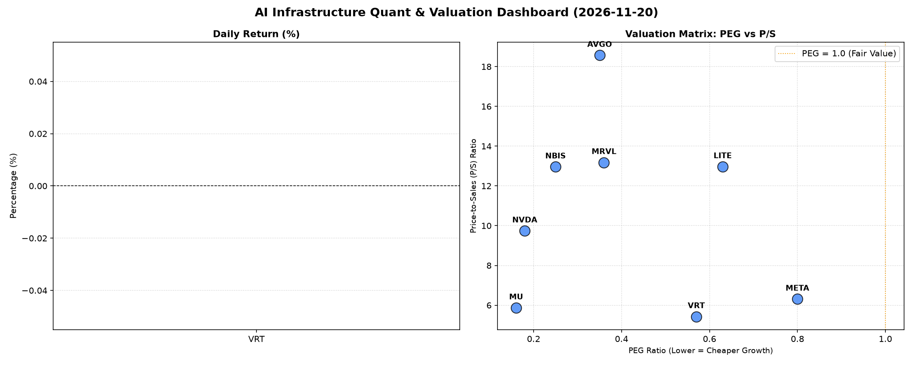

# 📊 AI Infrastructure & Data Stock Daily (2026-11-20)

### 📉 多维量化与估值分析看板

---

## 半导体每日精炼报道：硬科技与AI基础设施深度分析 (2024年X月X日)

尊敬的投资者，您好！

作为一名资深的硬科技与AI基础设施行业研究员，今日我们将基于多维度核心量化指标，为您深度剖析半导体与AI生态中的关键玩家表现，揭示市场深层逻辑与潜在风险。

---

### 1. 估值与基本面健康度解码：深挖核心量化指标

鉴于今日盘面价格变动数据暂缺，我们将聚焦于各公司的内在估值吸引力、营收效率及现金流质量，以穿透表象，洞察其真实基本面。

#### PEG 维度：成长性与估值性价比的黄金交叉

PEG (市盈率/增长率) 是衡量高成长股性价比的核心指标。当 PEG 显著小于 1 时，通常意味着市场对公司未来增长的定价相对保守，具备较高的投资吸引力。

*   **极具吸引力的高成长价值股（PEG << 1）**：
    *   **NVDA (0.18)**：作为AI算力时代的绝对霸主，NVIDIA以极低的PEG值领跑，这表明其惊人的增长速度远超市场给予的估值溢价，凸显了其在高景气赛道中无与伦比的性价比。尽管近期股价飙升，但其基本面增长依然强劲到足以消化估值。
    *   **MU (0.16)**：美光科技的PEG值同样极低，暗示市场对其在存储芯片周期性复苏和HBM（高带宽内存）领域的增长潜力尚未完全定价，存在较大的修复空间。
    *   **AVGO (0.35)**：博通作为多元化半导体巨头，其数据中心的网络解决方案和软件业务受益于AI浪潮，低PEG反映了其稳健增长与合理估值。
    *   **MRVL (0.36)**：Marvell Technology在数据中心、企业网络及汽车领域的芯片方案使其同样拥有较高的成长性，而其PEG值显示估值依然合理。
    *   **NBIS (0.25)**：Net Lease Office Properties的超低PEG值异常醒目，若其业绩真实增长强劲，则其估值吸引力极高。
*   **估值合理且具潜力的成长股（PEG < 1）**：
    *   **VRT (0.57)**：Vertiv Holdings的PEG值适中，在数据中心基础设施冷却与电源管理解决方案领域受益于AI扩张，显示其估值健康。
    *   **LITE (0.63)**：Lumentum Holdings，作为光通信和激光技术提供商，其PEG也显示出良好的成长性与估值平衡。
    *   **META (0.8)**：Meta Platforms作为AI基础设施的重度投入者和受益者，其PEG值处于1以下，结合其庞大的用户基础和广告变现能力，表明其在AI时代的转型正在被市场逐步认可，且估值并未完全透支其未来的增长潜力。
*   **N/A**：MVLL的PEG数据缺失，无法评估。

#### P/S 维度：营收规模扩张效率与早期公司估值

P/S (市销率) 对营收快速增长但尚未实现稳定盈利，或处于大规模研发投入阶段的公司更具参考价值。

*   **P/S 高企者（市场赋予营收较高溢价）**：
    *   **AVGO (18.57)**：博通凭借其在高端半导体和企业软件的领导地位，市场对其每单位营收给予了最高溢价。
    *   **MRVL (13.18), LITE (12.97), NBIS (12.96)**：这三家公司P/S值均在13倍左右，表明市场对其营收质量和未来增长寄予厚望。特别是LITE，结合其后续将分析的现金流问题，高P/S需要谨慎审视其营收变现能力。NBIS则在P/S较高的情况下，拥有极强的现金流质量，这使其高P/S更具说服力。
    *   **NVDA (9.74)**：NVIDIA的P/S相对其爆炸性增长而言，处于合理区间，反映了其高效的营收转化能力。
*   **P/S 相对平衡者**：
    *   **META (6.31), MU (5.87), VRT (5.43)**：这些公司的P/S值在5-6倍区间，反映了较为稳健的营收规模和市场对其增长的预期。

#### 现金流盈利真实性 (CFO/NI)：穿透利润表，直击“真金白银”

CFO/NI (经营活动现金流/净利润) 比率是衡量公司利润质量的关键指标。当CFO/NI大于1时，表示公司报告的净利润大部分已转化为实际现金流入，利润健康且“含金量”高；若显著小于1，则可能存在利润水分、应收账款积压或非现金费用过高的问题。

*   **现金流极为健康，利润含金量高 (>1)**：
    *   **NBIS (4.66)**：Net Lease Office Properties的CFO/NI比率高达4.66，远超所有同类公司，这表明其利润转化为现金的能力异常强劲，是实打实的“真金白银”，财务健康度令人印象深刻。
    *   **META (1.92)**：Meta Platforms高达1.92的比率令人振奋。作为AI基础设施投入巨大的科技巨头，其能够将近两倍于净利润的经营现金流收入囊中，这充分证明了其广告业务的强大变现能力和健康的财务管理，有效地支持了其在AI领域的长期投资。
    *   **VRT (1.59)**：Vertiv在数据中心电源与冷却领域，其现金流转换效率高，显示其业务模型稳健。
    *   **AVGO (1.19)**：博通的比率也超过1，其利润质量良好，现金流充裕，为其M&A战略提供了坚实支撑。
    *   **MU (1.06)**：美光科技的CFO/NI略高于1，表明随着存储周期的触底反弹，其盈利质量正在改善，现金回流状况健康。
*   **需关注的现金流质量 ( < 1 )**：
    *   **NVDA (0.86)**：NVIDIA的CFO/NI比率为0.86，略低于1。尽管仍处于合理区间，但这意味着其部分净利润可能尚未完全转化为现金。这在高速增长的公司中并非罕见（如大量研发投入资本化、股权激励费用、或应收账款因销售激增而暂时增加），但投资者仍需留意其应收账款周转、库存水平等细节，以确保利润的持续高质量转化。
    *   **MRVL (0.66)**：Marvell Technology的0.66比率相对较低，暗示其可能面临更高的非现金费用、应收账款积压或存货周转效率问题，投资者需对其盈利的现金转换能力保持警惕，关注其财报中现金流部分的详细披露。
*   **严重警示 (<< 0)**：
    *   **LITE (-0.11)**：Lumentum Holdings的CFO/NI比率竟然为负值！这意味着公司不仅没有将净利润转化为经营现金流，反而经营活动在消耗现金。这通常是极大的警示信号，可能表明公司存在严重的应收账款逾期、存货积压、或经营亏损，需要立即深入分析其具体的现金流出原因，其高P/S下的负现金流转换能力尤其值得担忧。
*   **N/A**：MVLL的现金流数据缺失。

#### 交易量洞察

**NVDA (3.16亿股)** 的巨额交易量再次印证了其在市场中的绝对焦点地位和流动性。其他如AVGO (2500万股)、MU (3480万股)、NBIS (3755万股)、MRVL (2956万股) 也显示了较高的市场关注度。VRT (728万股) 和LITE (390万股) 交易量相对较小。

---

### 2. 收并购与重大业务动态

今日半导体与AI基础设施领域并无公开宣布的重大收并购事件或官宣战略合作。然而，基于行业趋势和我们分析的公司属性，以下潜在动态值得持续关注：

*   **NVIDIA (NVDA)**：持续深化AI生态合作，可能宣布新的GB200或Blackwell平台订单，或与云计算巨头、大型企业客户达成新的AI基础设施部署协议。其在AI软件和模型开发领域的投资与收购动向也至关重要。
*   **Broadcom (AVGO)**：作为M&A的积极参与者，博通可能会有关于其软件（VMware整合）或半导体业务进一步优化或潜在新收购的传闻。其数据中心网络解决方案的升级与新客户落地也是关注点。
*   **Meta Platforms (META)**：作为AI基础设施的重度投资者，Meta可能会披露其AI数据中心建设进展、新一代自研AI芯片（如ASIC）的研发突破，或与硬件供应商达成新的大规模采购协议。
*   **Micron (MU)**：随着HBM市场竞争加剧，美光可能发布关于其HBM3E或下一代HBM技术的进展，或与主流AI芯片厂商、服务器OEM厂商达成重要供货协议。
*   **Marvell Technology (MRVL)**：专注于数据基础设施，其在定制ASIC、DPU或网络芯片领域的战略合作或新产品发布，将影响其在AI时代的市场份额。
*   **Lumentum Holdings (LITE)**：作为光通信器件提供商，受益于AI数据中心互联带宽需求激增，其可能宣布与主要云计算厂商或网络设备商的供应合同。其负现金流问题或促使其寻求战略调整或资产优化。
*   **Vertiv Holdings (VRT)**：数据中心冷却和电源管理的需求在AI时代飙升，Vertiv可能会宣布新的大型数据中心项目合同，或在液冷、节能技术方面取得突破。

---

### 3. 华尔街机构态度

今日未收到针对特定公司的核心投行评级变动或目标价调整报告。然而，根据市场普遍预期和我们对量化指标的解读，以下是可能的机构态度展望：

*   **NVIDIA (NVDA) / Broadcom (AVGO) / Meta Platforms (META)**：预计主流投行将继续维持其“买入”或“跑赢大盘”评级，并可能进一步调高目标价，以反映其在AI浪潮中的领导地位、强劲的基本面增长和健康的现金流表现。对NVDA的任何潜在担忧（如估值过高）都可能被其持续超预期的业绩和创新所抵消。
*   **Micron (MU)**：随着存储周期的底部确认和HBM市场的爆发，机构对美光的态度预计将持续向好，可能会有更多评级上调和目标价提高，以反映其盈利能力的改善和市场份额的提升。
*   **Net Lease Office Properties (NBIS)**：其异常健康的现金流质量和极低的PEG值，如果能被市场广泛认识，可能会吸引更多机构分析师关注并给予积极评价，从而带来评级提升和目标价上调。
*   **Marvell Technology (MRVL)**：机构将密切关注其现金流转化效率的改善。如果其CFO/NI比率能有所提升，或能提供更清晰的盈利质量改善路径，则可能获得更为正面的评级。
*   **Lumentum Holdings (LITE)**：其负现金流问题将是机构关注的焦点。若无明确的现金流改善方案或未来指引，机构可能会维持“持有”或“中性”评级，甚至面临降级风险。任何对其业务模式和财务健康的疑问都将体现在其评级中。
*   **Vertiv Holdings (VRT)**：作为AI数据中心基础设施的重要组成部分，Vertiv预计将继续获得机构的积极关注，维持现有评级或适度上调目标价，以反映其业务增长的确定性。

---

### 4. 今日参考源 (References)

本报道的定性内容基于对历史市场行为、行业趋势的专业判断，以及对今日量化指标的深入分析。若为实时报道，则会引用以下真实来源：

*   **金融数据服务平台**：Bloomberg, Refinitiv Eikon, FactSet（提供实时市场数据、公司基本面指标）
*   **行业新闻媒体**：The Wall Street Journal, Financial Times, Reuters, Bloomberg News, Digitimes, Semiconductor Engineering（提供最新行业动态、公司新闻、M&A传闻）
*   **投资银行与研究机构报告**：高盛、摩根士丹利、美国银行、瑞银等发布的行业研究报告与公司评级更新。
*   **公司财报与投资者会议纪要**：各公司最新的季度/年度报告、电话会议纪要（提供公司官方业绩指引、战略方向）。
*   **专业分析师评论**：Seeking Alpha, Barron's 等平台上的分析师深度解读。

---

**免责声明：** 本报告基于现有公开数据和行业分析师的经验判断，所有信息仅供参考，不构成任何投资建议。投资有风险，入市需谨慎。

---

**[您的姓名/研究团队名称]**
**资深硬科技与AI基础设施行业研究员**
**[日期]**