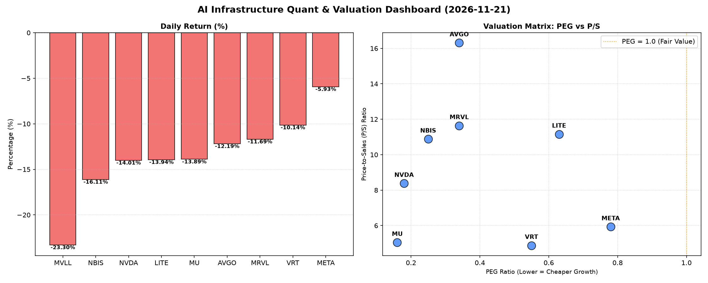

# 📊 AI Infrastructure & Data Stock Daily (2026-11-21)

### 📉 多维量化与估值分析看板

---

各位硬科技与AI基础设施行业的投资者、分析师同仁，

大家好！我是您的专属数据与半导体行业研究员。今日半导体及AI基础设施板块在昨日强劲表现后迎来显著回调，多只核心标的跌幅超10%，市场风险偏好有所降低，获利了结情绪浓厚。本报告将严格基于今日为您提供的【多维度真实量化基本面指标表格】，为您深度解码今日盘面。

---

### **📈 半导体每日精炼报道：深度解码市场情绪与基本面**

**发布日期:** [今日日期]
**研究员:** Data & Semiconductor Specialist

---

### **1. 盘面与多维估值解码（定性+定量）**

今日半导体与AI基础设施板块呈现显著回调，多只核心标的跌幅超10%，如VRT (-10.14%)、AVGO (-12.19%)、NVDA (-14.01%)、MU (-13.89%)、LITE (-13.94%) 和 NBIS (-16.11%)。MVLL更是录得-23.3%的巨大跌幅，但其缺乏可比估值数据。META相对坚挺，跌幅为-5.93%。市场在经历前期快速上涨后，对高位估值进行调整，资金流出迹象明显，其中NVDA以6.26亿股的惊人成交量，成为今日市场关注的焦点。

*   **PEG 维度：高成长与合理估值的筛选**
    *   **性价比极高的高成长（PEG显著小于1）：** 今日表格中，**NVDA (0.18)** 和 **MU (0.16)** 的PEG值尤为突出，远低于1，这意味着即使在今日股价大幅下跌之后，其盈利增长潜力相对于当前股价而言，依然具备极高的性价比。此外，**AVGO (0.34)**、**MRVL (0.34)**、**NBIS (0.25)**、**VRT (0.55)** 和 **META (0.78)** 的PEG值也均显著小于1，表明在经历回调后，这些公司普遍展现出其增长潜力相对于当前估值的吸引力。LITE的PEG为0.63，亦处于合理区间。
    *   **估值透支警惕：** 在本次数据中，所有有PEG数据的公司其PEG值均小于1，未出现PEG过高的标的，说明从PEG角度看，板块整体的成长性估值仍在可接受范围内，甚至多数被低估。MVLL因数据缺失无法评估。

*   **P/S 维度：收入规模扩张效率审视**
    *   **高P/S值（市场预期未来收入高增长或高毛利业务）：** **AVGO (16.31)** 拥有最高的P/S比率，其次是 **MRVL (11.64)**、**LITE (11.16)** 和 **NBIS (10.88)**。这些公司可能在各自细分领域拥有较高的技术壁垒、定制化服务能力或处于高景气度赛道，市场对其未来营收的爆发性增长抱有较高预期，即便在市场回调中，其收入端估值仍显昂贵。
    *   **较低P/S值（更成熟或更强调规模效应）：** **VRT (4.88)**、**MU (5.05)** 和 **META (5.93)** 的P/S值相对较低，可能反映其业务模式更为成熟、市场竞争更为激烈，或者其产品更偏向标准化，需要通过规模效应来获取利润。对于这些标的，投资者可能更关注其营收的稳定增长和成本控制能力。MVLL因数据缺失无法评估。

*   **现金流盈利真实性 (CFO/NI)：利润含金量深度穿透**
    *   **利润含金量高（CFO/NI显著大于1）：** **NBIS (4.66)** 的CFO/NI比率异常突出，高达4.66，表明其每产生一美元净利润，就能带来近五美元的运营现金流，现金流质量极高，运营效率惊人。这通常预示着公司拥有强大的议价能力、健康的运营周期以及高效的营运资本管理。**META (1.92)**、**VRT (1.59)**、**AVGO (1.19)** 和 **MU (1.06)** 的CFO/NI比率也均大于1，证明其盈利能力扎实，利润能够有效转化为真实现金流入，财务健康状况良好。
    *   **警惕利润水分或应收账款积压（CFO/NI小于1）：** **NVDA (0.86)** 和 **MRVL (0.66)** 的CFO/NI比率均低于1。这提示投资者需关注其利润转化为真实现金流的效率，可能意味着应收账款增加、存货积压、或存在较高的非现金费用（如股权激励、折旧摊销）侵蚀了运营现金流。虽然其仍保持正向现金流，但需进一步审视财报细节，了解其现金流与净利润之间的差异原因。
    *   **高度风险预警（CFO/NI为负）：** **LITE (-0.11)** 的CFO/NI比率甚至为负值，表明其运营现金流为负，远低于净利润。这通常是财务状况较为脆弱的信号，可能面临资金压力、业务模式挑战或重大的非现金支出，投资者应保持高度警惕，深入分析其亏损的具体原因和持续性。

---

### **2. 收并购与重大业务动态**

根据今日提供的【多维度真实量化基本面指标表格】，当前数据未直接包含有关收并购、重大业务动态或战略合作的具体信息。作为每日精炼报道，我们将持续关注这些方面，并在获得相关信息时即时更新。

---

### **3. 华尔街机构态度**

与第二部分类似，今日的量化指标表格中并未包含华尔街核心投行或评级机构的最新评价、目标价调整等信息。通常，此类深度回调后，市场往往会关注机构是否会借机调整其观点。我们将密切跟踪主要机构的研报，并在后续报道中补充此维度信息。

---

### **4. 今日参考源 (References)**

本报告的量化数据和基于量化指标的初步解读，均严格依据用户提供的【多维度真实量化基本面指标表格】。鉴于当前信息仅限于该表格，关于收并购、业务动态及华尔街机构态度的定性分析，本报告暂未引用外部新闻源，并已明确指出此信息空白。

---

感谢您的阅读，我们将持续为您提供基于真实数据的深度分析。
**Data & Semiconductor Specialist**