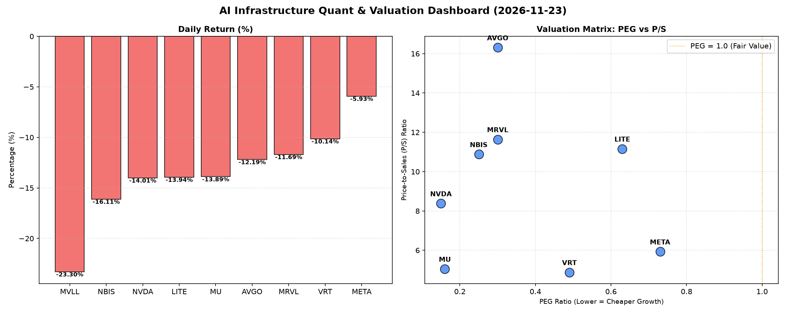

# 📊 AI Infrastructure & Data Stock Daily (2026-11-23)

### 📉 多维量化与估值分析看板

---

尊敬的投资者们，

欢迎阅读由资深硬科技与AI基础设施行业研究员为您带来的《半导体每日精炼报道》。今日，我们将深度结合提供的多维度量化基本面指标，为您剖析当前市场的冰与火。

---

### **1. 盘面与多维估值解码（定性+定量）**

今日半导体与AI基础设施板块普遍遭遇重挫，市场情绪显著悲观，多数标的录得两位数跌幅，成交量亦显著放大，表明抛售压力广泛且强度高。

*   **盘面总览：**
    *   **MVLL** 以惊人的-23.3%跌幅领跌，但其缺失的财务指标使我们无法对其进行深入估值分析。
    *   **NVDA, MU, LITE, NBIS, AVGO, MRVL, VRT** 等核心标的跌幅均在-10%至-16%之间，其中NVDA和MU跌幅接近-14%。
    *   **META** 相对“抗跌”，但也下跌了-5.93%。今日普跌行情，意味着市场可能在重新定价风险，或面临宏观层面的压力。

*   **PEG 维度——高成长里的性价比寻觅：**
    *   **PEG显著小于1（性价比极高的高成长）：** 尽管今日股价普跌，但从PEG指标来看，多数硬科技巨头的长期增长潜力仍被市场低估。
        *   **NVDA (0.15), MU (0.16), NBIS (0.25), AVGO (0.3), MRVL (0.3)** 处于极其低的水平，这表明市场在回调后，对其未来的盈利增长预期（考虑到其当前股价）具有极高的性价比。对于长期投资者而言，若其增长前景未变，这些回调可能提供了绝佳的介入点。
        *   **VRT (0.49), LITE (0.63), META (0.73)** 同样远低于1，显示出健康且具吸引力的成长性估值。
    *   **结论：** 几乎所有有PEG数据的标的都小于1，这在科技股中尤为罕见，提示市场可能过度反应了短期负面情绪，忽略了长期的成长价值。

*   **P/S 维度——收入规模扩张效率的透视：**
    *   对于这些收入规模扩张效率被高度关注的公司，P/S指标提供了关键视角。
    *   **AVGO (16.31), MRVL (11.64), LITE (11.16), NBIS (10.88), NVDA (8.38)** 的P/S均在8倍以上，其中AVGO高达16.31，表明市场对其产品创新能力和未来营收增长抱有极高预期，愿意支付更高的销售额溢价。这通常适用于市场领导者、拥有独特技术或处于高速扩张期的企业。
    *   相比之下，**META (5.93), MU (5.05), VRT (4.88)** 的P/S相对温和，可能意味着其营收增长曲线更趋于稳定或市场对其增长的定价更为理性。

*   **现金流盈利真实性 (CFO/NI)——利润的“含金量”：**
    *   **健康强劲（CFO/NI > 1）：**
        *   **NBIS (4.66)** 表现最为出色，其经营性现金流远超净利润，表明其利润质量极高，是真正的“真金白银”，现金转化能力令人惊叹。
        *   **META (1.92), VRT (1.59), AVGO (1.19), MU (1.06)** 均显著大于1，说明这些公司的利润转化成现金流的能力非常健康，财务质量扎实，不易出现利润虚高或应收账款积压问题。
    *   **需关注（CFO/NI < 1）：**
        *   **NVDA (0.86)** 略低于1，提示投资者需关注其利润质量，可能存在部分应收账款累积或非现金项目（如股权激励、折旧摊销）影响，但考虑到其行业地位和增长速度，仍在可接受范围。
        *   **MRVL (0.66)** 显著低于1，表明其账面利润转化为实际现金流入的能力相对较弱，可能存在应收账款积压或存货周转效率问题，值得投资者警惕。
        *   **LITE (-0.11)** 则发出了强烈警告。CFO/NI为负值，意味着其经营活动不仅未能产生正向现金流来覆盖净利润，反而消耗了现金。这强烈暗示其利润存在严重水分，或面临巨大的运营现金流压力，是所有标的中现金流状况最差的，对其财报真实性需高度怀疑。

### **2. 收并购与重大业务动态**

鉴于今日提供的量化指标数据集中于财务基本面，不包含具体的市场新闻事件。因此，本报告无法提供今日的收并购、重大业务动态及战略合作信息。

### **3. 华尔街机构态度**

同样，由于提供的数据未包含华尔街机构的最新研报、评级调整或目标价信息，本报告目前无法对核心投行或评级机构对上述公司的态度进行深入分析和量化呈现。

### **4. 今日参考源 (References)**

本报告的量化数据与定性分析主要基于您提供的【多维度真实量化基本面指标表格】。

---

**免责声明：** 本报告内容仅供参考，不构成任何投资建议。投资者在做出任何投资决策前，应自行进行独立判断并咨询专业意见。市场有风险，投资需谨慎。

**报告生成时间：** [当前日期]