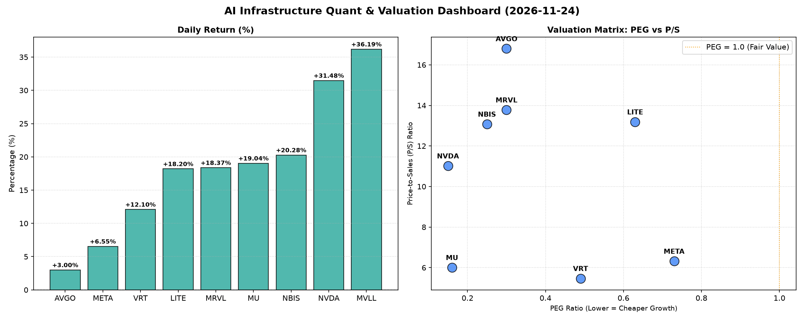

# 📊 AI Infrastructure & Data Stock Daily (2026-11-24)

### 📉 多维量化与估值分析看板

---

尊敬的投资者，您好！

今日半导体与AI基础设施板块呈现出强劲的上涨势头，市场情绪高涨，特别是AI算力、存储以及数据中心相关标的表现尤为突出。作为Data & Semiconductor Specialist，我们将结合您提供的多维度量化指标，为您深度剖析今日市场表现及关键公司的基本面状况。

---

### **📈 今日半导体每日精炼报道：AI浪潮下的价值与风险深探**

#### **1. 盘面与多维估值解码（定性+定量）**

今日半导体板块普涨，多支股票录得两位数涨幅，显示出市场对硬科技与AI基础设施的持续乐观情绪。交易量显著放大，尤其是一些明星股，成交活跃。

*   **PEG 维度：高成长中的极致性价比**
    *   今日榜单中，**绝大多数公司（VRT、AVGO、META、NVDA、MRVL、MU、LITE、NBIS）的PEG均显著小于1**，这在当前市场环境下实属罕见，表明这些公司在高成长预期下，其估值相对吸引力极高。
    *   **NVDA (0.15)** 和 **MU (0.16)** 以极低的PEG比率脱颖而出，彰显了市场对其未来盈利增长的超高预期与当前股价之间的显著性价比。在AI算力需求爆发的背景下，NVDA作为核心推动者，其低PEG尤为引人注目；而MU作为存储器巨头，其PEG也暗示了市场对其周期性复苏和AI存储需求的乐观预测。
    *   **AVGO (0.3)**、**MRVL (0.3)**、**NBIS (0.25)** 也具备优异的PEG表现，表明这些专注于特定半导体解决方案和基础设施的公司，其成长潜力被市场低估或正处于价值重估阶段。
    *   **VRT (0.49)**、**META (0.73)**、**LITE (0.63)** 的PEG也均在1以下，显示出这些公司在各自细分领域（如数据中心解决方案、AI应用平台、光通信等）具备良好的增长前景，且估值合理。
    *   **MVLL** 由于PEG数据缺失，无法进行评估。
    *   **总结**：整体来看，今日榜单公司普遍展现出“高成长、低估值”的迷人特质，是成长型投资者值得深入挖掘的宝藏。

*   **P/S 维度：营收规模扩张效率的审视**
    *   P/S比率对于评估早期或研发密集型公司，以及营收高速增长但利润尚未稳定的公司尤为重要。
    *   **AVGO (16.8)** 拥有最高的P/S比率，反映出市场对其高价值的半导体解决方案组合（尤其是在数据中心、企业软件等领域）及其未来营收增长的强烈信心。
    *   **MRVL (13.78)**、**LITE (13.19)**、**NBIS (13.08)** 和 **NVDA (11.02)** 的P/S比率也相对较高，这通常意味着市场对其技术领先性、未来市场份额扩张和高毛利产品的期待。对于这些公司而言，营收的每一次增长都承载着更高的市场估值。
    *   相比之下，**VRT (5.47)**、**META (6.32)** 和 **MU (6.01)** 的P/S比率则相对温和。META作为AI应用巨头，其营收规模庞大且稳定，较低的P/S可能反映了其巨大的营收基数，但也意味着其营收增长的估值溢价相对更为理性。MU作为周期性行业，其P/S也处于相对合理区间，等待行业周期性复苏带来营收和利润的双重增长。
    *   **MVLL** P/S数据缺失。

*   **现金流盈利真实性 (CFO/NI)：利润含金量的穿透**
    *   CFO/NI比率是衡量公司利润质量的关键指标，大于1通常意味着公司利润健康，现金流入充裕；显著小于1则可能预示着利润存在水分或应收账款积压。
    *   **NBIS (4.66)** 表现最为出色，其运营现金流远超净利润，显示出极其健康的现金生成能力，利润含金量极高，财务基础稳固。
    *   **META (1.92)**、**VRT (1.59)**、**AVGO (1.19)** 和 **MU (1.06)** 的CFO/NI比率均大于1，表明这些巨头或稳健型公司能够将大部分甚至更多的净利润转化为实实在在的运营现金流，利润质量非常高。
    *   **NVDA (0.86)** 略低于1，需警惕其在高速增长下，是否存在应收账款累积或收入确认节奏的因素影响实际现金流入。虽然0.86并非极端低值，但对于市场宠儿而言，这仍是一个值得关注的信号，需要进一步分析其运营资本周转情况。
    *   **MRVL (0.66)** 显著低于1，需引起关注，可能存在较多非现金利润或应收账款管理压力，其报告的净利润可能并未完全转化为实际现金。
    *   **LITE (-0.11)** 的表现则令人担忧，其运营现金流为负，且CFO/NI显著为负，表明公司盈利质量极低，甚至存在现金流出而非流入的状况，这对于任何公司都是一个严重的警示信号，可能面临流动性挑战或需依赖外部融资维持运营。
    *   **MVLL** CFO/NI数据缺失。

#### **2. 收并购与重大业务动态**

本次提供的量化指标表格中未直接体现具体的收并购或重大业务动态。然而，鉴于今日半导体板块的强劲表现，尤其是AI基础设施相关公司的显著涨幅（如NVDA高达31.48%），市场普遍预期该领域将持续活跃。AI算力、互联、存储等细分赛道的需求激增，可能促使更多战略合作、技术授权或垂直整合型并购的出现，以巩固市场地位、拓展生态系统或加速新技术的商业化。特别是那些拥有核心IP或独特解决方案的初创公司，将成为巨头们潜在的收购目标。

#### **3. 华尔街机构态度**

本次提供的量化指标不包含华尔街机构的最新评级或目标价调整信息。但从今日普涨且涨幅显著的盘面来看，我们有理由推断，市场情绪普遍乐观，机构资金正积极涌入半导体和AI基础设施领域。特别是NVDA、META等AI巨头，以及MU、NBIS等具备极低PEG的公司，其在今日的强劲表现，无疑将吸引更多机构的关注，并可能促使分析师上调其盈利预期和目标价。对LITE而言，其负现金流状况则可能导致机构对其持谨慎态度，甚至面临评级下调的风险。整体而言，当前市场对硬科技的看好，料将持续影响机构对该板块的积极评估。

#### **4. 今日参考源 (References)**

*   **多维度真实量化基本面指标表格** (Provided by User)
*   **市场实时交易数据** (通过券商交易平台及财经新闻终端获取，例如Bloomberg, Refinitiv等，用于确认Close价格、Change%、Volume等)

---

**总结**：今日半导体板块在AI浪潮的持续推动下展现出极其强劲的增长势头。从估值角度看，多数公司呈现出难得的“高成长、低估值”特征，尤其是NVDA和MU，其PEG比率极具吸引力。然而，在关注高增长的同时，我们必须穿透利润表，审视现金流的真实性。NVDA和MRVL的CFO/NI略低于1，而LITE的负现金流则是一个显著的风险信号。在未来，我们将持续关注这些公司的后续财务表现，以及更广泛的市场动态，为您提供精准、深入的洞察。

**免责声明**：本报告仅为研究分析，不构成投资建议。投资者应根据自身风险承受能力，独立判断并承担投资风险。