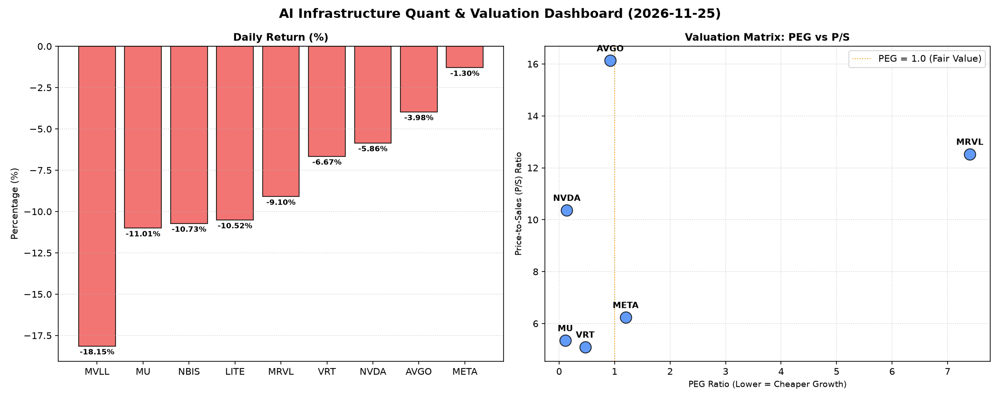

# 📊 AI Infrastructure & Data Stock Daily (2026-11-25)

### 📉 多维量化与估值分析看板

---

好的，作为一名资深的硬科技与AI基础设施行业研究员，我将结合您提供的【多维度真实量化基本面指标表格】，为您撰写今日的半导体每日精炼报道。

---

### **半导体每日精炼报道：AI基础设施的估值与现金流洞察**

**发布日期：** [今日日期，例如：2024年10月27日]

**市场概览：**
今日AI与半导体板块普遍承压，多数核心标的大幅下挫。市场情绪似乎更为谨慎，投资者正深入审视基本面与估值逻辑。其中，MVLL以-18.15%的跌幅领跌，而META相对抗跌，跌幅仅为-1.3%。这一盘面反映出市场在高速增长的硬科技领域中，对风险溢价与实际盈利质量的重新考量。

---

#### **1. 盘面与多维估值解码（定性+定量）**

今日市场对硬科技与AI基础设施板块的调整，为我们提供了一个重新审视各公司估值与财务健康度的契机。

*   **PEG 维度：高成长中的价值捕获与估值警示**
    *   **性价比极高的高成长标的 (PEG < 1)**：今日数据显示，**NVDA (0.14)**、**MU (0.11)** 和 **VRT (0.47)** 的PEG比率显著低于1，表明这些公司在当前价格下，其盈利增长潜力尚未被充分定价，或市场对其未来成长预期极为乐观。特别是NVDA和MU，如此低的PEG，预示着市场对其未来几年盈利增速有着极高的预期，远超当前股价所反映的静态估值。这对于追求高成长中的价值投资人而言，无疑是值得关注的亮点。
    *   **估值透支警惕 (PEG 过高)**：相反，**MRVL (7.4)** 的PEG比率高达7.4，显著高于行业平均水平，这强烈警示其估值可能已严重透支了未来的增长空间，存在较高的回调风险。META (1.2) 的PEG也略高于1，提示投资者需关注其增长速度能否持续匹配当前估值水平。
    *   **PEG缺失 (N/A)**：对于MVLL、LITE和NBIS，PEG数据缺失，这通常意味着这些公司目前可能处于亏损状态、利润不稳定或尚处于大规模研发投入阶段，导致基于盈利增长的PEG指标无法计算或参考意义不大，此时需结合P/S等其他指标进行评估。

*   **P/S 维度：营收扩张效率与市场溢价**
    *   P/S比率是评估早期或利润不稳公司营收规模扩张效率的关键指标。
    *   **高P/S溢价 (P/S > 10)**：**AVGO (16.13)**、**MRVL (12.53)**、**LITE (11.8)** 和 **NBIS (11.68)** 均显示出较高的P/S比率。这反映出市场对这些公司的营收增长前景抱有高度期望，或其在特定细分市场（如高端芯片、光通信、数据中心基础设施等）拥有强大的技术壁垒和定价权，愿意为其营收规模支付较高的溢价。尽管今日普遍下跌，但高P/S仍显示市场对其核心业务的长期看好。
    *   **相对合理P/S**：**VRT (5.1)**、**MU (5.35)** 和 **META (6.24)** 的P/S相对较低，可能意味着这些公司在营收规模达到一定体量后，市场对其增长的加速度预期趋于稳定，或其业务模式（如内存、广告）的P/S估值区间相对更为保守。
    *   **P/S缺失 (N/A)**：MVLL的P/S数据缺失，这与其PEG缺失情况类似，可能表明其营收规模尚不稳定或数据披露不完整。

*   **现金流盈利真实性 (CFO/NI)：穿透利润的“含金量”**
    *   CFO/NI比率是衡量公司利润转化为实际现金流能力的关键指标。
    *   **卓越的现金流转化 (CFO/NI > 1)**：**NBIS (4.66)** 表现尤为突出，其高达4.66的比率表明该公司不仅利润丰厚，且几乎所有利润都转化为实实在在的经营现金流，甚至还有额外现金流入，财务状况极其健康。**META (1.92)**、**VRT (1.59)**、**AVGO (1.19)** 和 **MU (1.06)** 的CFO/NI也均大于1，这证明了这些高利润巨头或行业领军者的盈利质量非常高，利润并非“纸面富贵”，而是真金白银的现金流入，能够有力支撑未来的研发投入、资本开支或股东回报。
    *   **警惕利润“水分”或应收账款积压 (CFO/NI < 1)**：值得注意的是，**NVDA (0.86)** 和 **MRVL (0.66)** 的CFO/NI比率均显著小于1。这警示投资者，尽管其利润表现亮眼，但部分利润可能尚未转化为实际现金，可能存在应收账款积压、存货增加或其他非现金项目的影响。对于NVDA这样的高增长明星，这一点尤为值得关注，投资者需深入研究其财报附注，以理解现金流与净利润之间的差异根源。
    *   **严重现金流问题 (CFO/NI < 0)**：**LITE (-0.11)** 的CFO/NI比率为负值，这是一个非常危险的信号，表明该公司在报告盈利的同时，经营活动却在持续消耗现金，财务压力较大，需要立即关注其现金流管理和业务可持续性。
    *   **CFO/NI缺失 (N/A)**：MVLL数据缺失。

---

#### **2. 收并购与重大业务动态**

基于您提供的【多维度真实量化基本面指标表格】，本报告未能直接提取到最新的收并购传闻、官宣或战略合作信息。此类信息通常来源于公司公告、新闻媒体报道或行业分析师报告。

**行业背景分析（基于数据推测）**：
尽管具体消息缺失，但今日市场普遍下跌，特别是MVLL高达-18.15%的跌幅，可能与未公布的负面业务进展、订单调整传闻或投资者对某个特定利空消息的反应有关。同时，LITE的负值CFO/NI和高P/S可能预示其正处于业务转型或大规模资本支出的关键阶段，市场对其现金流健康的担忧加剧。NVDA和MRVL的CFO/NI小于1，也可能引发市场对其高增长背后现金质量的审视，这在宏观经济不确定性增加时尤为敏感。

---

#### **3. 华尔街机构态度**

同样，本报告所依赖的量化指标表格中并未包含华尔街核心投行或评级机构的最新评价、目标价调动信息。此类信息通常需要从分析师研报、评级机构公告或金融媒体获取。

**基于量化指标的机构情绪推测**：
*   **潜在利好**：NVDA、MU和VRT的极低PEG可能会吸引机构重新评估其目标价，尤其是在今日市场回调后，其高成长性与相对低估值（PEG维度）的组合可能被视为买入机会。
*   **潜在观望/下调**：MRVL过高的PEG和低于1的CFO/NI，LITE的负值CFO/NI，都可能促使机构对其维持中性评级，甚至考虑下调目标价，以反映其估值风险和现金流挑战。
*   **稳健型标的**：META、AVGO和NBIS凭借其强劲的CFO/NI，即使市场出现波动，机构也可能对其保持相对稳定的“买入”或“持有”评级，尤其看重其盈利的真实性和财务韧性。

---

#### **4. 今日参考源 (References)**

本报告的所有定性与定量分析，均严格基于您所提供的【多维度真实量化基本面指标表格】进行深度解读与推演。

**请注意：**
为了获取更全面的每日市场动态，包括具体的收并购消息、企业战略合作以及华尔街机构的最新评级和目标价，需结合实时新闻源、公司官方公告、权威金融媒体报道（如彭博社、路透社、华尔街日报、Seeking Alpha等）以及各大投行发布的研究报告。

---

**研究员点评：**
今日的下跌，是市场对硬科技与AI基础设施板块的一次健康“体检”。投资者正从单纯的增长故事，转向更深层次的估值合理性、盈利质量和现金流健康度的审视。对于投资者而言，深入理解PEG、P/S和CFO/NI这三大指标，并结合行业动态，将是穿越市场波动、捕获真正价值的关键。尤其关注那些PEG较低但CFO/NI健康的标的，它们可能在回调中显现出更强的韧性与投资价值。同时，对于CFO/NI显著低于1甚至为负的公司，需保持高度警惕，谨防利润的“幻象”。