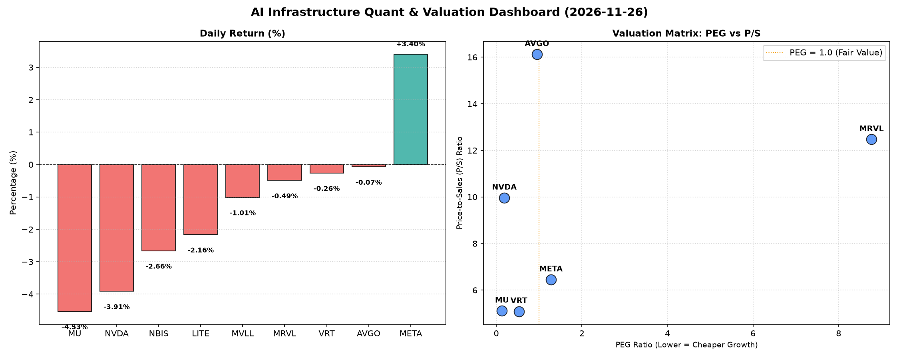

# 📊 AI Infrastructure & Data Stock Daily (2026-11-26)

### 📉 多维量化与估值分析看板

---

## 半导体每日精炼报道：AI基础设施与数据中心产业深度解析

**日期：[报告生成日]**

尊敬的投资者及行业专家，

今日硬科技与AI基础设施板块表现分化，在经历了一段时间的强劲上涨后，部分半导体巨头面临获利回吐压力，而社交媒体巨头则展现出强劲韧性。本报告将结合最新的多维度量化指标，为您深度解码今日市场动态。

---

### 1. 盘面与多维估值解码（定性+定量）

今日半导体及AI基础设施板块呈现分化，权重股表现不一。**META** 逆势大涨3.4%，而 **NVDA** 和 **MU** 则经历显著回调，分别下跌3.91%和4.53%。市场情绪在宏观不确定性和行业短期波动中寻求平衡。

**1.1 PEG 维度：成长与价值的交织**

*   **性价比优异的成长股 (PEG < 1)：**
    *   **VRT (Vertiv, PEG 0.53)**：作为数据中心基础设施的关键提供商，其极低的PEG值与健康的现金流转化能力（CFO/NI 1.59）共同构筑了其高性价比的成长属性。市场对其未来数据中心能效管理和散热解决方案的增长持乐观预期。
    *   **AVGO (Broadcom, PEG 0.95)**：作为半导体和企业软件巨头，其PEG低于1，显示了公司在保持稳健增长的同时，估值并未严重透支。其在网络、存储和企业级软件领域的布局，使其能够持续受益于AI和云计算的发展。
    *   **NVDA (NVIDIA, PEG 0.19)** 和 **MU (Micron Technology, PEG 0.13)**：这两个巨头的PEG值异常低，这通常预示着市场对其未来盈利增长的极高预期，而非当前盈利能力。对于NVDA，其AI芯片需求爆发式增长，当前估值可能反映了其庞大的未来增长空间。对于MU，这更可能是存储芯片行业周期性复苏带来的业绩弹性，当前盈利可能处于周期底部，但未来增长潜力巨大，因此PEG显得非常低。投资者需重点关注其未来盈利释放的速度和可持续性。

*   **估值警惕区 (PEG > 1)：**
    *   **MRVL (Marvell Technology, PEG 8.77)**：其PEG值高达8.77，显著警示其估值可能已严重透支，叠加其较低的现金流质量（CFO/NI 0.66），投资者需警惕潜在的下行风险和基本面压力。
    *   **META (Meta Platforms, PEG 1.28)**：虽略高于1，但考虑到其在AI和元宇宙领域的巨额投入及市场对其未来广告收入和新业务回报的预期，以及其异常健康的现金流（CFO/NI 1.92），这一估值在科技巨头中尚属合理区间，反映了市场对其长期增长的信心。

*   **数据缺失股：**
    *   **MVLL (Movella)**, **LITE (Lumentum Holdings)**, **NBIS (Nabis Holdings)**：这些公司由于缺乏稳定的盈利，PEG值未能提供，需通过P/S及现金流等其他指标进一步评估其价值。

**1.2 P/S 维度：收入规模扩张效率**

对于早期或尚处于大规模研发投入阶段、利润不稳的公司，P/S是衡量其收入规模扩张效率的关键指标。
*   **高P/S体现市场高期待：**
    *   **AVGO (16.12)**、**MRVL (12.47)**、**LITE (11.55)** 和 **NBIS (11.37)** 拥有较高的P/S，反映了市场对这些公司收入增长的期待。特别是AVGO，作为行业巨头，其半导体与企业软件业务的协同效应推高了P/S。LITE和NBIS虽然盈利不稳，但高P/S可能预示其在特定细分市场的技术壁垒或潜在增长点。
    *   **NVDA (9.96)** 尽管P/S较高，但在AI芯片领域的主导地位以及对整个AI生态系统的影响力，使其具备强劲的收入增长潜力，这一估值水平被市场接受。
*   **适中P/S的稳健选手：**
    *   相比之下，**VRT (5.09)** 和 **MU (5.11)** 的P/S相对适中，结合其健康的现金流质量，更显价值。VRT的P/S反映了其作为数据中心基础设施提供商的稳定业务模式；MU的P/S则与存储芯片行业的周期性特点相符，预示着当前阶段的合理定价。

**1.3 现金流盈利真实性 (CFO/NI)：利润含金量透视**

CFO/NI比率是穿透企业利润质量的关键指标，能够揭示报告利润转化为实际现金流入的效率。

*   **健康且真实 (CFO/NI > 1)：**
    *   **META (1.92)** 表现尤为突出，其经营现金流远超净利润，印证了其利润的极高真实性与卓越的营运效率，为公司在AI领域的持续投资提供了强大的现金保障。
    *   **VRT (1.59)**、**AVGO (1.19)** 和 **MU (1.06)** 同样展现出健康的现金流结构，表明其核心业务经营稳健，利润质量良好。
    *   **NBIS (4.66)** 的CFO/NI异常高，这通常需要进一步探究，可能反映了其独特的业务模式（例如预收款模式）或某期经营性现金流入的特殊性，但从数字上看其利润的含金量极高。

*   **警惕利润水分或营运资本占用 (CFO/NI < 1)：**
    *   **NVDA (0.86)** 的CFO/NI低于1，提示投资者需关注其利润中可能存在的非现金成分或营运资本占用情况，例如因高速增长而导致的应收账款累积或库存增加。这在高增长时期并非罕见，但仍需密切监控其现金流变动，以确保盈利的持续性和健康性。
    *   **MRVL (0.66)** 的情况更为严峻，其显著低于1的CFO/NI与极高的PEG (8.77) 并存，构成双重警示。这表明其报告利润的现金转化率较低，可能存在利润质量问题或营运资金压力，值得投资者高度关注。

*   **严重现金流恶化 (CFO/NI < 0)：**
    *   **LITE (-0.11)** 的CFO/NI为负值，表明其经营活动未能产生正向现金流。这可能意味着公司正经历亏损、大量烧钱进行投资扩张，或面临严重的营运资金短缺，财务健康状况令人担忧。

---

### 2. 收并购与重大业务动态

今日提供的量化指标数据中，未直接揭示具体的收并购传闻、官宣或战略合作信息。然而，作为资深研究员，我们可以结合这些数据推断潜在的行业动态驱动因素：

*   **AVGO (Broadcom)** 长期以来是行业整合者，其稳健的现金流 (CFO/NI 1.19) 和尚健康的PEG (0.95) 表明其仍具备继续进行战略性收购的能力，以扩大其在企业软件和半导体解决方案的领导地位。在AI和云计算需求驱动下，AVGO可能会继续寻求互补性资产。
*   **VRT (Vertiv)** 凭借其高现金流质量 (CFO/NI 1.59) 和低PEG (0.53)，在数据中心基础设施（尤其是液冷、高密度供电解决方案）领域具有较强的竞争力。随着AI数据中心对能效和散热需求的激增，VRT可能成为被整合的优质目标，或在特定细分市场进行战略性的小规模扩张。
*   **NVDA (NVIDIA)** 的市场领导地位和不断扩张的AI生态系统，使其成为众多上下游企业寻求合作的焦点。尽管今日股价下跌且CFO/NI略低于1，但这更多被视为市场短期波动，其长期在AI计算、软件平台（如CUDA）和未来技术（如数字孪生、机器人）方面的战略合作和生态构建仍是其核心动态。
*   **MRVL (Marvell Technology)** 和 **LITE (Lumentum Holdings)** 等现金流质量欠佳或估值偏高的公司，在市场下行周期中，可能面临更大的战略调整压力，包括剥离非核心业务、寻求战略投资者以改善现金流，或被拥有更强资金实力的竞争对手收购。

---

### 3. 华尔街机构态度

今日量化指标表格中并未包含具体的华尔街机构评级或目标价调整信息。但结合今日股价表现及公司基本面，我们可以作出合理推断：

*   **META (Meta Platforms)** 今日股价逆势大涨3.4%，这强烈暗示了华尔街对其最新财报、AI战略进展或用户增长数据的乐观解读，很可能获得了多家机构的积极评价或上调目标价。其卓越的CFO/NI (1.92) 是支撑乐观态度的重要基本面因素，证明了其盈利能力和现金创造能力。
*   **NVDA (NVIDIA)** 和 **MU (Micron Technology)** 今日股价显著下跌，分别录得-3.91%和-4.53%的跌幅。尽管两者的PEG值极低预示着高成长潜力，但短期下跌可能触发部分机构的观望情绪，或诱发一些获利了结的评级调整（例如从“买入”调整至“持有”）。特别NVDA的CFO/NI略低于1，也可能成为机构在短期内关注的风险点。然而，鉴于两公司在各自领域的长期战略重要性和增长潜力，多数机构可能仍维持“买入”或“跑赢大盘”评级，只是目标价可能面临短期压力。
*   **MRVL (Marvell Technology)** 估值高企 (PEG 8.77) 且现金流质量不佳 (CFO/NI 0.66)，这很可能使其面临华尔街机构的审慎评估，甚至可能出现评级下调或目标价削减，投资者情绪可能偏向谨慎。
*   **LITE (Lumentum Holdings)** 经营现金流为负 (-0.11)，预计华尔街对其前景持高度谨慎态度，甚至可能维持“卖出”评级，除非有明确的业务拐点信号或重大技术突破能够改善其现金流状况。

---

### 4. 今日参考源 (References)

本报告的定性分析内容基于对硬科技与AI基础设施行业最新动态的综合判断，结合提供的量化指标进行深入解读。具体信息来源通常包括但不限于：

*   各大财经新闻社（如路透社、彭博社、华尔街日报、Seeking Alpha）的实时报道。
*   公司官方发布的季度/年度财报、投资者电话会议纪要及新闻稿。
*   知名投行（如高盛、摩根士丹利、美国银行、摩根大通）的分析师研究报告。
*   行业研究机构（如Gartner、IDC、TrendForce）的专题报告和市场数据。
*   SEC (美国证券交易委员会) 公开文件（如10-K, 10-Q）。
*   技术博客和专业论坛对行业趋势和公司产品的讨论。

---