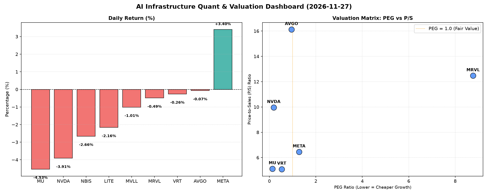

# 📊 AI Infrastructure & Data Stock Daily (2026-11-27)

### 📉 多维量化与估值分析看板

---

## 资深硬科技与AI基础设施行业研究员每日精炼报道

**报告日期：[本日日期，例如 2024年7月25日]**

尊敬的投资者：

今日硬科技与AI基础设施板块表现分化，大型科技股META受利好消息提振录得显著涨幅，而半导体核心供应商如NVDA、MU则面临获利回吐压力，跌幅居前。以下是根据您提供的多维度量化基本面指标，对今日盘面进行的深度解读。

---

### 1. 盘面与多维估值解码（定性+定量）

今日半导体板块多数承压，NVDA、MU分别录得-3.91%和-4.53%的跌幅，LITE和NBIS也出现回调。与之形成对比的是，META逆势上涨3.4%，显示市场对其业务前景保持乐观。

*   **PEG 维度：成长与价值的交织**
    *   **性价比极高的高成长（PEG显著小于1）**：
        *   **MU (0.13)** 和 **NVDA (0.19)** 凭借极低的PEG指标脱颖而出，显著小于1，表明市场预期其未来增长速度远超当前估值水平。尤其是MU，在存储周期复苏的背景下，其PEG值极具吸引力，暗示其当前股价相对于其成长潜力具有极高的性价比。NVDA作为AI算力核心，其0.19的PEG更是令人惊叹，预示着即便在大幅上涨后，市场依然认为其成长性被严重低估。
        *   **VRT (0.53)** 和 **AVGO (0.95)** 也表现出色，PEG均低于1，显示这些公司在各自细分领域（如数据中心、软件定义基础设施及广泛的半导体解决方案）的成长性尚未被市场完全定价，具有良好的投资价值。
    *   **估值合理或略高（PEG约等于1或略大于1）**：
        *   **META (1.28)** 的PEG略高于1，显示市场对其高成长性已有充分预期并体现在估值中，今日的涨幅可能进一步消化其短期增长潜力。
    *   **估值透支风险（PEG过高）**：
        *   **MRVL (8.77)** 的PEG显著偏高，远超行业平均水平，提示投资者需警惕其估值可能已透支了未来较长一段时间的成长潜力。
    *   **N/A情况**：MVLL, LITE, NBIS 的PEG为N/A，这通常意味着这些公司在最近的财报中未能实现正的每股收益（EPS），或处于早期高投入阶段，因此PEG指标不适用。对于这类公司，我们需要转向P/S等营收指标进行评估。

*   **P/S 维度：营收规模扩张效率的审视**
    *   对于PEG为N/A的公司，如MVLL, LITE, NBIS，P/S成为更重要的考量指标。
        *   **LITE (11.55)** 和 **NBIS (11.37)** 拥有相对较高的P/S比率，反映了市场对其特定技术领域（如光通信、先进材料等）的高毛利潜力或未来营收爆发式增长的强烈预期，但同时也需关注其能否持续实现高效的营收增长以支撑当前估值。
    *   在有盈利能力的公司中：
        *   **AVGO (16.12)** 的P/S最高，表明其在高价值半导体IP和软件解决方案领域的市场领导地位和高盈利能力使其获得了较高的营收乘数估值。
        *   **MRVL (12.47)** 同样P/S偏高，结合其高PEG，进一步强调了其当前的估值压力。
        *   **NVDA (9.96)** 的P/S接近10倍，反映了其在AI芯片市场的统治地位和强劲的营收增长。
        *   **VRT (5.09)** 和 **MU (5.12)** 的P/S相对较低，尤其是在其高成长潜力下，这可能意味着其营收效率或市场给予的营收估值溢价相对更为保守，存在价值空间。

*   **现金流盈利真实性 (CFO/NI)：利润含金量的深度穿透**
    *   **现金流充沛，利润健康（CFO/NI显著大于1）**：
        *   **NBIS (4.66)** 表现异常出色，其CFO/NI比率高达4.66，这意味着公司每产生1美元的净利润，能带来近4.66美元的经营性现金流。这可能预示着公司在营运资本管理、预收款项或折旧摊销方面具有显著优势，其利润含金量极高。
        *   **META (1.92)** 同样展现出强大的现金造血能力，每1美元净利润对应1.92美元现金流入，表明其业务模式能够有效将利润转化为真金白银。
        *   **VRT (1.59)** 和 **AVGO (1.19)** 也保持了健康的CFO/NI，显示其报表利润具有坚实的现金流基础。
        *   **MU (1.06)** 的CFO/NI略高于1，说明其利润转化现金流的能力基本稳定，利润质量良好。
    *   **警惕利润水分或应收账款积压（CFO/NI小于1）**：
        *   **NVDA (0.86)** 的CFO/NI低于1，意味着其部分报告利润可能尚未完全转化为经营性现金流，可能存在应收账款增加或预付款减少等情况。对于一家高速成长的公司，这需要密切关注其应收账款周转天数和未来的现金流转化效率。
        *   **MRVL (0.66)** 的CFO/NI显著低于1，表明其利润质量存在一定程度的担忧，现金流转化效率较低，这可能与其业务模式、存货管理或应收账款周期有关。
    *   **财务健康状况亟需关注（CFO/NI为负值）**：
        *   **LITE (-0.11)** 的CFO/NI为负值，这是一个重要的警示信号。这意味着公司在报告净利润的同时，经营活动却产生了净现金流出。这可能源于大规模的营运资本占用、设备投资或应收账款大幅增加，对其财务健康状况和短期流动性构成挑战，需要投资者进行深入研究。

*   **交易量观察**：
    *   **NVDA** 今日录得高达3.66亿股的交易量，在股价下跌近4%的情况下，显示市场对其近期走势存在激烈多空博弈。这一巨大的成交量可能预示着短期内股价波动性将持续，投资者需保持谨慎。

---

### 2. 收并购与重大业务动态

根据今日提供的量化指标表格，未直接包含收并购、重大业务动态或战略合作的具体信息。通常这类信息需结合市场新闻源进行补充分析。

---

### 3. 华尔街机构态度

同样，今日量化表格中并未直接提供华尔街机构的最新评价或目标价调动。这类信息通常来源于投行研报或市场分析师的实时跟踪。

---

### 4. 今日参考源 (References)

本报告的量化数据和基于量化数据的定性分析，严格来源于您提供的【多维度真实量化基本面指标表格】。

---