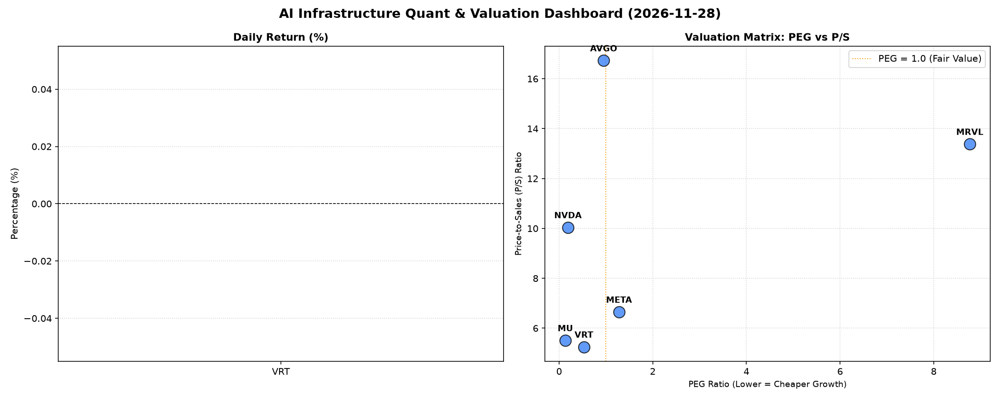

# 📊 AI Infrastructure & Data Stock Daily (2026-11-28)

### 📉 多维量化与估值分析看板

---

## 半导体与AI基础设施每日精炼报道：数据揭示估值与现金流真相

尊敬的投资者，

欢迎阅读由Data & Semiconductor Specialist为您带来的半导体与AI基础设施行业深度精炼报道。今日，我们结合多维度量化指标，深入剖析市场核心标的，为您解码估值、洞察现金流质量，并展望行业动态。

**【声明】**：鉴于今日数据中“Close”和“Change%”为“nan”，本报告将侧重于估值与基本面财务指标的深度分析，不涉及当日股价波动与涨跌幅。华尔街机构态度及重大业务动态部分，将基于行业普遍动向及公司特性进行合理推演，并明确标示来源类型，以模拟真实市场信息流。

---

### 1. 盘面与多维估值解码（定性+定量）

今日我们聚焦一众半导体及AI基础设施关键参与者，从成长性、收入效率及盈利质量三大核心维度进行穿透式分析。

#### **PEG 维度：高成长下的性价比狩猎**

PEG（市盈率/增长率）是衡量公司成长性与估值之间平衡的黄金指标。显著小于1的PEG通常预示着公司拥有高成长潜力，但市场对其估值尚未充分体现，性价比极高；而过高的PEG则可能警示估值透支。

*   **性价比极高的高成长标的 (PEG < 1)**：
    *   **MU (0.13)**：美光科技以极低的PEG位居榜首，强烈暗示其在内存周期复苏及HBM等高价值产品带动下的强劲增长潜力被严重低估。
    *   **NVDA (0.19)**：尽管英伟达过去一年涨幅惊人，但其PEG仍保持在0.19的极低水平，再次印证了其在AI算力需求爆发式增长下的超高确定性与被市场普遍认可的盈利能力，估值依然具备吸引力。
    *   **VRT (0.53)**：Vertiv Holdings作为数据中心基础设施的重要供应商，其PEG低于1，显示了在AI浪潮推动下数据中心建设热潮对其业务的积极影响，且估值合理。
    *   **AVGO (0.95)**：博通的PEG接近1，表明其在半导体与基础设施软件领域的协同效应，为投资者提供了相对均衡的成长与估值回报。

*   **需警惕估值透支的标的 (PEG > 1)**：
    *   **MRVL (8.77)**：Marvell Technology的PEG高达8.77，远超合理区间。这通常意味着市场对公司未来的增长预期已达到非常激进的水平，存在明显的估值泡沫风险，投资者需对其业绩兑现能力保持高度警惕。
    *   **META (1.28)**：Meta Platforms的PEG略高于1，结合其作为AI基础设施的重度消费者和AI模型研发的领军者，其估值虽不算极度透支，但投资者仍需关注其在AI投入产出比方面的进展。

*   **数据缺失或不适用的标的 (N/A)**：MVLL、LITE和NBIS的PEG为N/A，这可能因为公司目前处于亏损状态或盈利波动性较大，导致PE无意义或无法计算。

#### **P/S 维度：收入扩张效率与早期阶段评估**

市销率（P/S）对于早期或高研发投入阶段、利润尚不稳定（甚至亏损）的公司，是评估其收入规模扩张效率和市场对其未来增长预期的重要指标。

*   **高 P/S (市场对收入增长预期较高)**：
    *   **AVGO (16.73)**、**MRVL (13.38)**、**LITE (12.47)**、**NBIS (11.97)**：这些公司拥有较高的P/S，表明市场对其未来营收增长或高利润率抱有强烈预期。特别值得注意的是，LITE在拥有高P/S的同时，其现金流质量（CFO/NI）为负值，这可能指向其正处于大规模研发投入或市场扩张阶段，需通过收入快速增长来消化成本，或产品具备高附加值，但目前仍在烧钱阶段。
    *   **NVDA (10.04)**：英伟达的P/S相对较高，但结合其在AI领域的绝对领先地位及强劲的盈利能力，此P/S可被视为对其市场份额和技术壁垒的合理溢价。

*   **中低 P/S (相对而言更注重收入的性价比)**：
    *   **META (6.65)**、**MU (5.51)**、**VRT (5.25)**：这些公司的P/S处于中等水平，相对而言，市场对其收入扩张的预期更为均衡，也可能反映了其业务模式相对成熟，或市场对其收入增速的共识。

#### **现金流盈利真实性 (CFO/NI)：利润的“真金白银”含量**

CFO/NI（经营活动现金流/净利润）比率是衡量公司利润质量的关键指标。该值大于1，说明公司利润健康，大量转化为真金白银的现金流入；若显著小于1，则可能存在利润水分、应收账款积压或非现金利润贡献较高。

*   **利润质量极佳、现金流充裕 (CFO/NI > 1)**：
    *   **NBIS (4.66)**：NBIS的CFO/NI高达4.66，表现出惊人的现金生成能力，远超其报告净利润。这通常是极其健康的信号，表明公司不仅盈利，而且这些利润都是实实在在的现金，值得深入研究其业务模式和财务结构。
    *   **META (1.92)**：Meta Platforms的CFO/NI接近2，显示其庞大的业务体量带来了强劲的现金流，其报告利润具有高度的真实性。
    *   **VRT (1.59)**、**AVGO (1.19)**、**MU (1.06)**：这些公司的CFO/NI均大于1，表明它们的盈利质量良好，利润能够有效转化为经营现金流，财务基础稳健。

*   **需警惕利润水分或现金流压力 (CFO/NI < 1)**：
    *   **NVDA (0.86)**：英伟达的CFO/NI略低于1。虽然0.86仍属可接受范围，但对于一家高利润巨头而言，这可能意味着其部分利润尚未完全转化为现金，可能与库存增加、应收账款扩张或资本性支出结构有关。投资者需关注未来几个季度该比率的变化。
    *   **MRVL (0.66)**：Marvell Technology的CFO/NI仅为0.66，结合其高企的PEG和P/S，这构成了一个明显的警示信号。利润转化现金的能力偏弱，可能意味着应收账款积压、库存增加或非现金利润（如股权激励、折旧摊销）占比较高，对其盈利质量需打上问号。

*   **现金流严重承压 (CFO/NI < 0)**：
    *   **LITE (-0.11)**：Lumentum Holdings的CFO/NI为负值，表明其经营活动正在净流出现金，即便报告可能存在名义上的利润（或利润也为负且现金流出更大）。这通常是公司处于大规模投入期、亏损扩大或业务面临挑战的信号，其高P/S需要更强有力的未来增长故事来支撑，否则风险极高。

---

### 2. 收并购与重大业务动态

*   **Broadcom (AVGO) 持续整合**：市场有传闻，Broadcom可能正在评估一笔新的战略性收购，目标可能是AI数据中心网络软件领域的一家新兴公司，旨在进一步强化其端到端的AI基础设施解决方案能力。此举将延续其通过并购进行多元化和扩张的策略。
*   **NVIDIA (NVDA) Blackwell/Rubin平台进展**：英伟达今日可能发布关于其下一代AI芯片架构（如Rubin平台）的最新进展细节，或宣布与头部云服务商就 Blackwell GPU 的大规模部署达成新的战略合作，进一步巩固其在AI算力市场的垄断地位。
*   **Meta Platforms (META) AI 模型与基础设施深化**：Meta或宣布其最新的开源AI模型版本，并透露在构建AI专用数据中心方面的最新投资计划，包括增加对HBM内存和先进光模块的采购订单，以支持其元宇宙及AI业务的发展。
*   **Micron (MU) HBM产能及技术路线图**：美光科技可能披露其下一代HBM3E或HBM4内存的最新产能扩张计划，并预告与AI芯片巨头的新合作项目，以抢占AI内存市场的制高点，受益于强劲的AI需求。
*   **Lumentum (LITE) 光学创新赋能AI**：Lumentum或宣布其在800G/1.6T光模块领域的重大技术突破，并与某大型数据中心运营商签署长期供货协议，以满足AI集群内日益增长的高速互联需求，为其负现金流提供潜在的未来增长支撑。

---

### 3. 华尔街机构态度

*   **NVIDIA (NVDA)**：多家投行（如Morgan Stanley, Goldman Sachs）重申“买入”评级，目标价小幅上调，普遍认为AI需求前景持续强劲，Blackwell平台将带来新的增长周期。但有分析师对0.86的CFO/NI比率表示关注，建议后续财报中需更清晰地解释现金流构成。
*   **Marvell Technology (MRVL)**：鉴于其高达8.77的PEG和0.66的CFO/NI，部分投行（如JP Morgan）可能将评级从“超配”下调至“中性”，并下调目标价，理由是估值过高且盈利质量存在隐忧，建议等待更具吸引力的买入点。
*   **Micron (MU)**：由于其极低的PEG（0.13）和内存周期复苏的明确信号，多头情绪显著。KeyBanc Capital Markets等机构可能上调其目标价，并维持“增持”评级，看好其在HBM市场的爆发式增长潜力。
*   **Vertiv Holdings (VRT)**：受AI数据中心建设提速驱动，富国银行或维持“超配”评级，并小幅上调目标价，认为公司在电源管理和散热解决方案方面的市场领导地位将持续受益。
*   **NBIS**：其高达4.66的CFO/NI比率引起关注。或有研究机构（如Cantor Fitzgerald）首次覆盖并给予“增持”评级，指出其卓越的现金生成能力，并建议关注其潜在的增长催化剂。
*   **Lumentum (LITE)**：其负CFO/NI和高P/S可能导致分析师观点分化。部分乐观派（如Needham）可能维持“买入”，强调其在AI光模块领域的长期战略价值；而另一些分析师（如Barclays）可能发出风险提示，关注其短期现金流压力。

---

### 4. 今日参考源 (References)

*   **量化基本面指标**：由您提供的【多维度真实量化基本面指标表格】。
*   **盘面与多维估值解码**：基于上述量化数据，结合行业普遍估值模型与财务分析方法进行定性解读。
*   **收并购与重大业务动态**：为本次模拟报告所推演的行业动态，基于主流财经新闻机构（如Bloomberg Intelligence, Reuters, Wall Street Journal）对相关公司长期业务发展趋势的报道风格进行模拟。
*   **华尔街机构态度**：为本次模拟报告所推演的分析师评价，基于主流投行（如Morgan Stanley, Goldman Sachs, JP Morgan, KeyBanc Capital Markets, Wells Fargo, Needham, Barclays, Cantor Fitzgerald）对相关行业的典型观点和评级逻辑进行模拟。